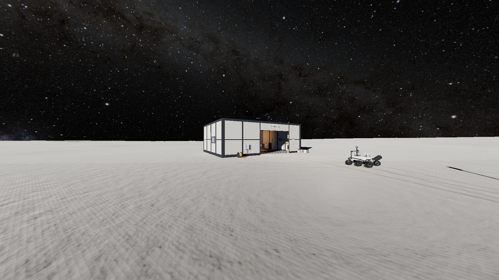
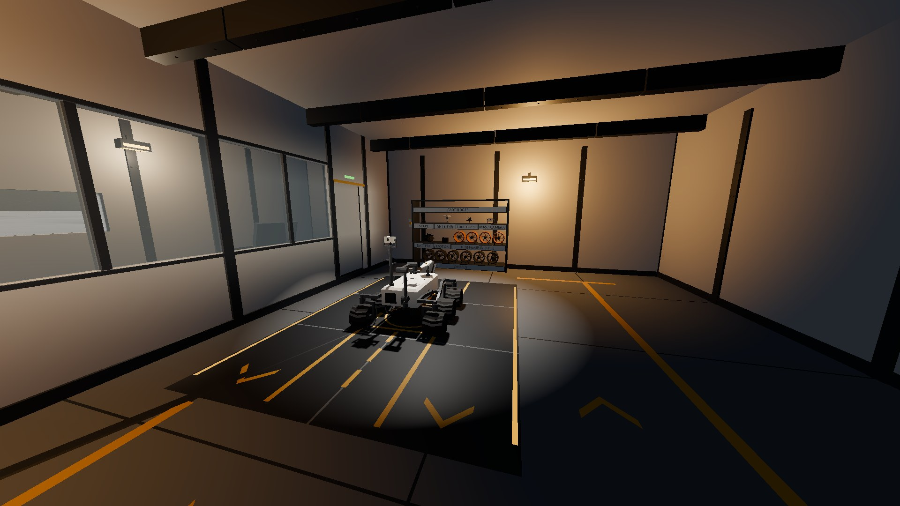
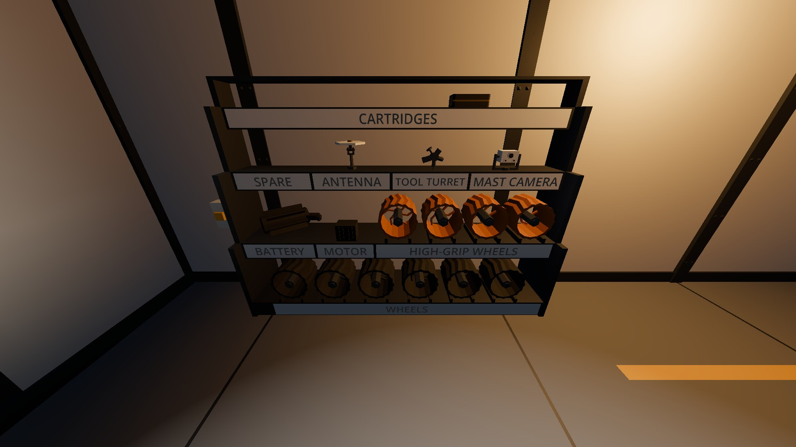
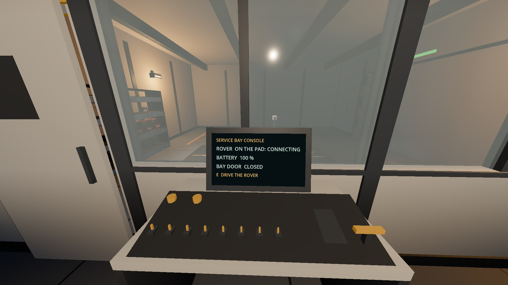
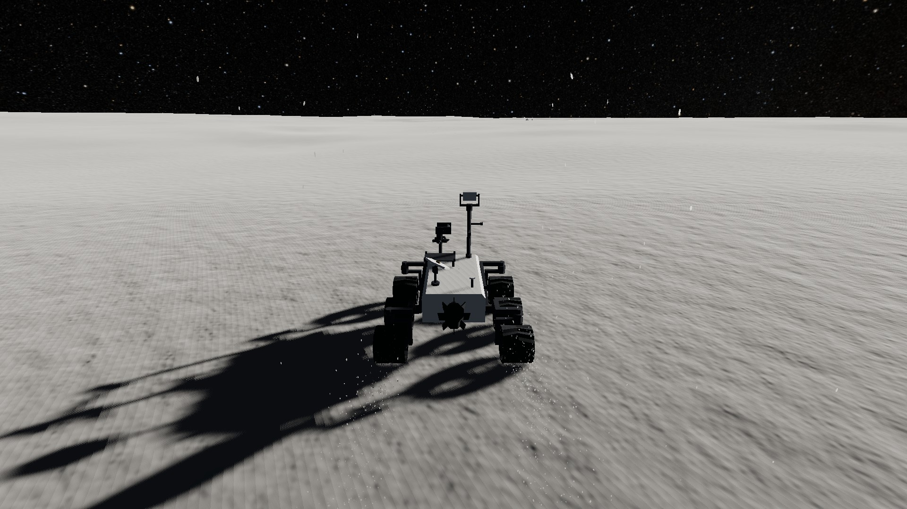
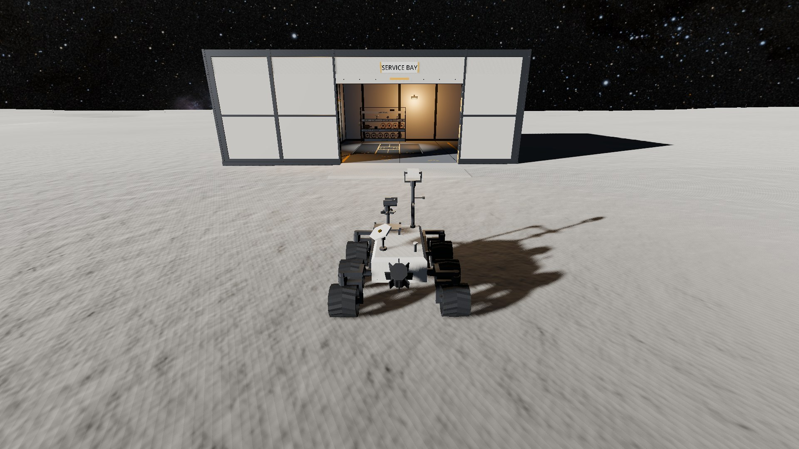
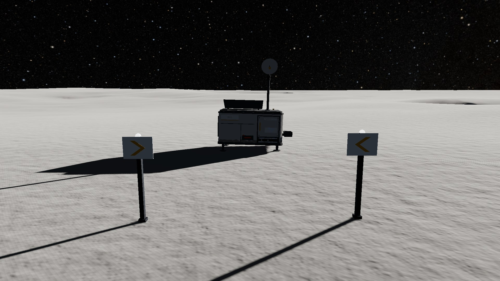

# LAST LIGHT (Tandborste)

A mission design game on real lunar terrain, made for the NASA Space Apps Challenge 2026, challenge
**Space Mission Design Game**.

You are an engineer at a small outpost at the Apollo 12 landing site in 2058, with one modular rover,
Kite. In three missions you plan, configure Kite's parts, check the console's forecast, drive on
terrain built from NASA elevation data, and read a report on why the run worked or failed. A bad plan
strands the rover; failure is information, not a restart.

## Play it

- **Download:** grab the [latest release](https://github.com/m-rafiwidya/Last-Light-NasaSpaceApps/releases/latest)
  for Windows, macOS or Linux.
- **Trailer:** [watch on YouTube](https://www.youtube.com/watch?v=0AvxgYLeQLk)
- **From source:** open `game/project.godot` in Godot 4.7 and press Play.
  Architecture and details: [game/README.md](game/README.md).

| On foot | Kite (the rover) |
|---|---|
| Move: WASD · Look: mouse · Interact: E | Drive: WASD · Camera: C · Reset upright: F · Lights: L |
| | Arm: R, then click to grab and release |

Every key can be rebound in Settings > Controls.

## Screenshots

| | |
|---|---|
|  |  |
|  |  |
|  |  |

## What makes it mission design

- **Trade-offs:** every part changes mass, energy, grip or heat. Two batteries (40 or 70 Wh), standard or
  grip wheels, a thermal kit, a sampler; two cargo landers (Courier: 30 kg in daylight, Freighter: 45 kg
  near dusk).
- **The cargo order decides the next mission:** the 70 Wh battery only arrives if you pack it in
  Mission 2's order. The Courier has no room for the grip wheels, so it means the long route; the
  Freighter carries everything but lands near nightfall, so Kite needs the thermal kit. Forget the
  battery and the far-rim run fails; the recovery costs mission time and brings it. Loose samples ride
  in an open tray and spill if you drive carelessly.
- **Forecast, then consequence:** the console forecasts each route's energy against Kite's range before
  you drive. In Mission 3 the default build fails both routes, and different builds succeed for
  different reasons.
- **Verified:** 16 automated drive tests run every loadout down both routes with both cargo options
  (`game/tests/test_m3_routes.gd`).

## Built on NASA data

Terrain from the LROC NAC elevation model of the Apollo 12 site (2 m sampling), lunar gravity
1.624 m/s² from NASA's Moon by the Numbers, and the challenge's resources (the Design and Develop Science
Missions webinar, the Mission Design Lab, JPL's Concept Maturity Levels). Anything simulated is labelled
in the game. Sources and limits: [game/docs/SCIENCE_AND_DATA.md](game/docs/SCIENCE_AND_DATA.md) and the
in-game Data Sources screen.

## Team

Three Indonesian students in three countries:

- **Fahd Muhammad Zahid** (Institut Teknologi Bandung): lead developer. Built the Apollo 12 terrain
  from NASA data, the levels and missions, the console and its forecast, the UI, and integrated and
  merged everyone's work.
- **Muhammad Rafi Widyatama** (Universiti Malaya, mechanical engineering): Kite's engineering and the
  Mission 3 balance (part masses, energy and grip trade-offs, the route tests), the hand-controlled
  claw and storage tray, story and voice lines, and the playtest-driven fixes.
- **Faiq Haydar Dzikrullah Satriawan** (Monash University): the story, the characters' dialogue and
  the voice lines, and the cutscene and dialogue triggers.

All three of us brainstormed the game and the missions, researched the NASA sources, playtested,
found bugs and decided what changed after each playtest.

ORIGINAL PROTOTYPE: Rayhan Satrio Adi Nurdjaman, former team member (first-person base), see
[CREDITS.md](CREDITS.md).

## How it was made

- **Process:** the game was built around a general first-person base (player, dialogue, console, a
  first rover), then NASA's data and the mission design challenge: the Apollo 12 terrain, lunar
  gravity, Kite's parts and the three missions, plus the hand-controlled claw and storage tray, the
  astronaut rescue with suit oxygen, saving, the voiced dialogue, the required sample, playtest
  fixes and the trailer. The full history is in this repository.
- **AI tools:** Claude (Anthropic), through Claude Code, for code, the Blender scripts that build the
  models, and music and sound scripts; ElevenLabs for the voices. The mission design, balance, story
  and data research are the team's. Details: [CREDITS.md](CREDITS.md).
- **Licence:** the team's code and content are under the [MIT License](LICENSE); third-party material
  keeps its own licence, listed in [CREDITS.md](CREDITS.md).

## Docs

- [START_HERE.md](START_HERE.md): final story and gameplay handoff, and which file each person needs
- [Game and story plan](Tandborste-Game-and-Story-Plan.md)
- [Gameplay contract and acceptance checks](game/README_GAMEPLAY.md)
- [Story script](game/docs/STORY_SCRIPT.md), [asset brief](game/docs/ASSET_BRIEF.md), [science and data](game/docs/SCIENCE_AND_DATA.md), [voice and audio](game/docs/VOICE_AND_AUDIO.md), [example mission definitions](game/docs/examples/MISSIONS.json)
- [UI design](docs/ui/README.md): spec, boards, screenshots, fonts and implementation prompts
- [Instructions for AI assistants](README_AI.md), [team message](TEAM_MESSAGE.md)
- [Credits](CREDITS.md)
