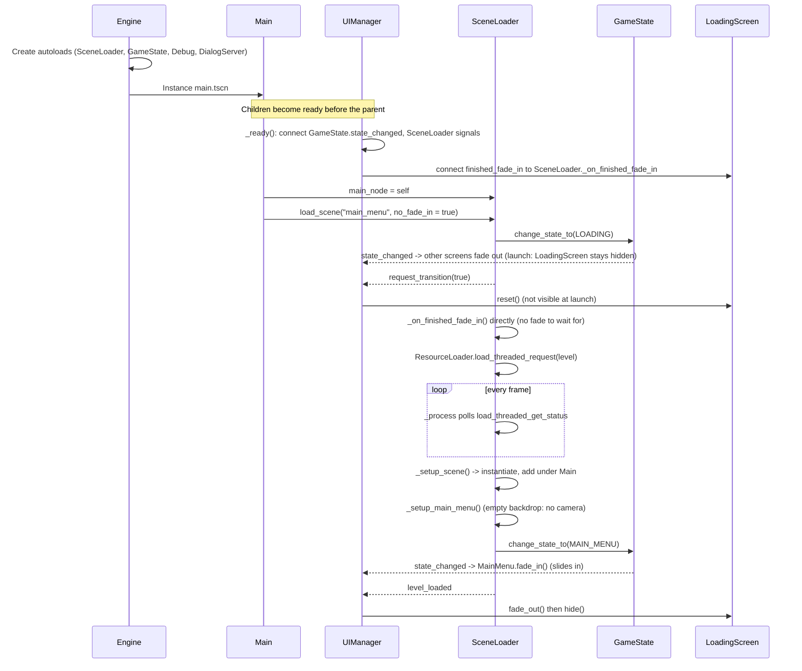
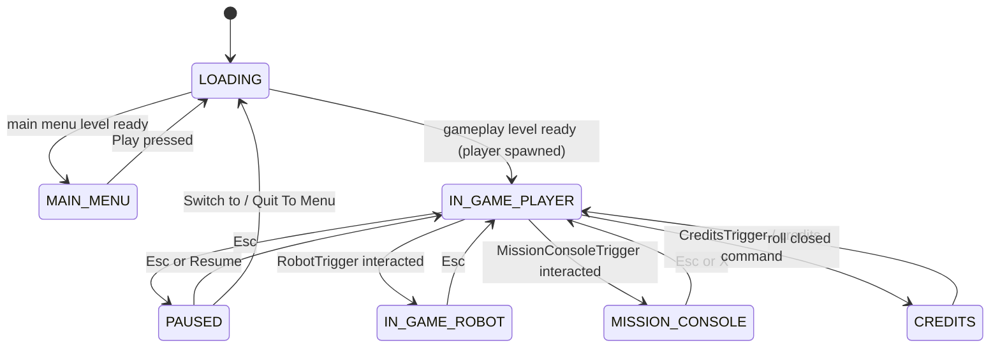
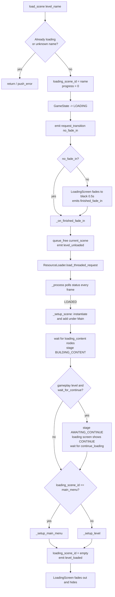

# Game (Godot 4) - Architecture & Context Guide

This document explains how the current game works: boot sequence, global state, UI, level loading, the player, and the small dialog/interaction systems. It is written for both humans and AI agents. Everything here was verified against the code in `src/` (see [Known issues](#13-known-issues--gotchas--todos) for places where code and intent disagree).

**Planning and design docs** (the target, not a description of the current code): [START_HERE](../START_HERE.md) (final story handoff, 11 October 2026), [game and story plan](../Tandborste-Game-and-Story-Plan.md), [gameplay contract and acceptance checks](README_GAMEPLAY.md), [story script](docs/STORY_SCRIPT.md), [asset brief](docs/ASSET_BRIEF.md), [science and data](docs/SCIENCE_AND_DATA.md), [voice and audio](docs/VOICE_AND_AUDIO.md), [example mission definitions](docs/examples/MISSIONS.json), [instructions for AI assistants](../README_AI.md), [team message](../TEAM_MESSAGE.md), [UI design](../docs/ui/README.md).

## 0. Reading order (start here)

Follow the code in this order and the whole game will make sense:

1. `src/main.tscn` and `src/main.gd` - the entry point. They instantiate `UIManager`.
2. `src/ui/ui_manager/` - owns every UI screen and reacts to game-state changes.
3. `src/ui/main_menu/` - the first screen the player sees.
4. `src/autoloads/scene_loader.gd` - loads levels, spawns the player.
5. `src/player/` - the physics-based first-person player.
6. `src/robot/` - the drivable robot (currently what `SceneLoader` spawns instead of the player, see [section 15](#15-robot)).

Then the supporting pieces: `game_state.gd`, `dialog_server.gd`, `debug.gd`, HUD, pause menu, console.

---

## Table of contents

1. [Quick facts](#1-quick-facts)
2. [Directory map](#2-directory-map)
3. [Autoloads (global singletons)](#3-autoloads-global-singletons)
4. [Boot sequence](#4-boot-sequence)
5. [Game state machine](#5-game-state-machine)
6. [UI layer](#6-ui-layer)
7. [Scene loading](#7-scene-loading)
8. [Player](#8-player)
9. [Interaction & object pickup](#9-interaction--object-pickup)
10. [Dialog system](#10-dialog-system)
11. [Debug console](#11-debug-console)
12. [Input map & physics layers](#12-input-map--physics-layers)
13. [Known issues / gotchas / TODOs](#13-known-issues--gotchas--todos)
14. [Recipes: how to extend the game](#14-recipes-how-to-extend-the-game)
15. [Robot](#15-robot)
16. [Audio](#16-audio)
17. [Save slot metadata](#17-save-slot-metadata)

---

## 1. Quick facts

| Item | Value |
|---|---|
| Engine | Godot 4.7 (`config/features`), Forward Plus renderer |
| Physics | Jolt Physics (`3d/physics_engine`) |
| Main scene | `res://src/main.tscn` |
| Viewport | 1920x1080 base, stretch mode `canvas_items`, aspect `expand`, HiDPI allowed: the UI is laid out on the base and drawn at the window's real resolution (see "Resolution and rendering quality" in section 6) |
| Language | GDScript |
| Game type | First-person 3D, rigidbody character, physics prop pickup, subtitle/dialog system, drivable robot (placed in the level, entered via an interact trigger) |
| Content | Two levels: `src/levels/test_level.tscn` and `src/levels/moon_level.tscn` (Moon: the real Apollo 12 landing site from an LROC NAC DTM with its sky and light at the EVA 2 moment); the Moon is started from the main menu (PLAY > START NEW CAMPAIGN), either is switched to from the pause menu, and the console's `testlevel` loads the test level |
| Theme | `res/theme.tres` (shared by all UI) |

The repository has three top-level folders (`backend/`, `database/`, `game/`). This document only covers `game/`.

---

## 2. Directory map

```
game/
├── project.godot            # autoloads, input map, display, physics engine
├── res/                     # raw assets
│   ├── theme.tres           # global UI theme
│   ├── textures/{dev,ui,sky}/ # dev grid textures, crosshair.svg, interaction.svg; the Moon's star map and Earth (credits: ../CREDITS.md)
│   ├── models/astronaut_kit/ # the astronaut (tools/blender/ASTRONAUT_KIT.md): rigged T-pose, seated and on-stand statics
│   ├── models/decor_kit/    # the workshop's set dressing (tools/blender/DECOR_KIT.md); its photos and tread texture in textures/decor/
│   ├── decor/decor_texts.json # every word on the decor (service notes, signs, labels, history cards): edit freely
│   └── terrain/moon_apollo12/ # the Moon's terrain: the DTM's 2 m posts (float32), 16-bit ring tiers, horizon maps, rocks, site brightness, terrain.json (made by ../tools/terrain/)
└── src/
    ├── main.tscn / main.gd           # entry point (root "Main" node)
    ├── autoloads/
    │   ├── scene_loader.gd           # level loading + player spawning
    │   ├── game_state.gd             # state machine, pause, mouse mode
    │   ├── debug.gd                  # console log + command parser
    │   └── dialog_server.gd          # subtitle timing + signals
    ├── audio/                        # gameplay sound observers Sfx attaches: player_sounds.gd, rover_sounds.gd, workshop_sounds.gd
    ├── object_holder/
    │   └── object_holder.gd                  # shared pick up / hold / throw logic for the player and the robot (class ObjectHolder)
    ├── robot/
    │   ├── robot.tscn / robot.gd                 # RigidBody3D vehicle sim (class Robot)
    │   ├── robot_controller.gd                 # keyboard + mouse input -> desired_speed/steer/look vars + interact/primary signals (class RobotController)
    │   ├── components/                       # engine.gd/.tscn (RobotEngine), running_gear.gd/.tscn (RunningGear), engine_sound.gd (motor whir)
    │   ├── kit/                              # RoverVisuals, RoverCamera, CargoDelivery (the arm's automatic delivery), RoverScanner (mast camera scans)
    │   └── socket/                           # HotswapSocket, HotswapPart + WheelPart / MotorPart / BatteryPart, cartridge_part.tscn
    ├── dialog/
    │   ├── dialog.gd                 # Resource: one subtitle line (+ future audio)
    │   └── dialog_sequence.gd        # Resource: ordered array of Dialog
    ├── workshop/                     # the lunar workshop: workshop.tscn/.gd (Workshop), charging_pad.gd (ChargingPad), workshop_decor.gd (WorkshopDecor), workshop_kit_import.gd
    ├── iris/                         # IRIS, the research station: iris.tscn/.gd (Iris), cargo_port.gd (CargoPort)
    ├── interact_trigger/
    │   └── interact_trigger.gd       # Area3D the player can "use" with E
    ├── levels/
    │   ├── rover_level.gd            # base for levels with rovers + a parts pile (class RoverLevel)
    │   ├── test_level.tscn / .gd     # the test sandbox (extends RoverLevel)
    │   ├── moon_level.tscn           # Moon level (script: rover_level.gd)
    │   ├── terrain/                  # MoonTerrain (moon_terrain.gd), RockField (rock_field.gd), regolith.gdshader
    │   └── lunar_sky.gd / .gdshader  # the Moon's sky, sun and Earth (class LunarSky, on its WorldEnvironment)
    ├── save/                         # SaveIndex (save slot list for the PLAY popup) and SaveSlotInfo: metadata only, see section 17
    ├── settings/                     # every setting, one class per area, all in user://settings.cfg (section 6.5):
    │   ├── settings_section.gd       #   SettingsSection: a saved section (typed, clamped values, `changed`)
    │   ├── general_settings.gd       #   subtitles, subtitle size, tooltips, FPS counter
    │   ├── audio_settings.gd         #   bus volumes, mute when unfocused
    │   ├── display_settings.gd       #   window mode (windowed / fullscreen / borderless)
    │   ├── video_settings.gd         #   resolution, vsync, frame cap, field of view, brightness, quality preset
    │   ├── graphics_settings.gd      #   terrain detail, dust and tracks (next level load)
    │   ├── control_settings.gd       #   mouse sensitivity, invert Y, toggle crouch
    │   └── input_bindings.gd         #   rebindable keys (InputMap), conflicts, reset
    ├── effects/wheel_dust/           # WheelDust: the wheels' lunar dust (one GPUParticles3D per wheel), its particle and grain shaders
    ├── effects/tyre_tracks/          # TyreTracks: tyre tracks that last the session (TrackLog, TrackMap, TrackRaster, the shader include, TrackFloor)
    ├── player/
    │   ├── player.tscn / player.gd           # RigidBody3D character (class Player)
    │   └── player_controller.gd              # input -> intent (class PlayerController)
    └── ui/
        ├── ui_screen.gd              # base class (CanvasLayer) with fade_in/fade_out
        ├── ui_manager/               # orchestrates all screens
        ├── main_menu/                # MainMenu, MenuMoon, OpeningSequence, PlayPopup + SaveCard (the PLAY popup)
        ├── pause_menu/               # PauseMenu (blurred game, centred items, hosts the settings)
        ├── level_choice/             # one menu button per playable level (pause menu)
        ├── hud/                      # player HUD (crosshair, subtitles)
        ├── robot_hud/                # robot HUD (speed, battery, friction circles, camera-feed overlay)
        ├── boundary_hint/            # "Survey area boundary in 12 m" on both HUDs (BoundaryHint)
        ├── dock_hint/                # "Charging pad: 0.8 m ahead" on the robot HUD (DockHint)
        ├── rover_hints/              # CargoHint ("IRIS's port: 0.08 m closer") and ScanHint ("SCANNING  IRIS  35%") on the robot HUD
        ├── mission_console/          # computer-theme mission list (dummy content)
        ├── loading_screen/
        ├── console/
        ├── dialog_box/               # one subtitle line widget
        ├── sub_screens/settings_sub_menu.tscn/.gd   # SettingsSubMenu: shared by main + pause menu (tabbed, some widgets still dummies)
        └── button_style_components/  # ButtonResizeComponent, ButtonSoundComponent
tests/                                # headless test scripts (see each file's header)
tools/                                # windowed helper scripts: render_sky_previews.gd, render_terrain_previews.gd, render_workshop_previews.gd, render_decor_previews.gd, render_iris_previews.gd, render_dust_previews.gd, render_tracks_previews.gd, measure_moon_fps.gd
```

---

## 3. Autoloads (global singletons)

Registered in `project.godot` in this order. All of them are globally reachable by name.

| Autoload | File | Responsibility |
|---|---|---|
| `SceneLoader` | `autoloads/scene_loader.gd` | Loads levels on a thread, instantiates them under `Main`, spawns the player / menu camera. Emits `request_transition`, `level_loaded`, `level_unloaded`; reports its `stage` and `overall_progress()` and holds gameplay levels for CONTINUE (see Loading stages and CONTINUE). |
| `GameState` | `autoloads/game_state.gd` | Holds the current `State`, emits `state_changed`, controls pause + mouse mode. Holds the reference to the current `player`. |
| `Debug` | `autoloads/debug.gd` | Stores console log lines and parses console commands. |
| `DialogServer` | `autoloads/dialog_server.gd` | Times and broadcasts subtitles (`dialog_played`, `dialog_ended`). |
| `AudioManager` | `autoloads/audio_manager.gd` | Background music and UI sounds by name (`play_ui`), audio volumes; runs while paused. See [section 16](#16-audio). |
| `Sfx` | `autoloads/sfx.gd` | Gameplay sounds: one-shots (`play`), loops with a limit and ducking, ambience beds; attaches the sound observers in `src/audio/`. Pauses with the game. See [section 16](#16-audio). |
| `CampaignState` | `autoloads/campaign_state.gd` | The campaign in memory: current mission, completed objectives, flags and items. Loads `res/story/missions.json` (missions `m1` to `m3` and their objectives, IDs lowercase with dots). Signals `mission_started`, `mission_completed`, `objective_completed`, `flag_changed`; API in `workflow_1.md`. Unknown IDs only warn. `debug_dump()` feeds the `campaign` console command. |

`SceneLoader`, `GameState` are set to `PROCESS_MODE_ALWAYS` so they keep running while the tree is paused. `UIManager` is also `process_mode = 3` (ALWAYS) in its scene.

### Communication style

The architecture is **signal driven and one-directional**:

```
SceneLoader --(calls)--> GameState.change_state_to()
GameState   --(signal state_changed)--> UIManager --(calls)--> each UI screen
SceneLoader --(signals request_transition / level_loaded)--> UIManager --> LoadingScreen
LoadingScreen --(signal finished_fade_in)--> SceneLoader   (wired by UIManager)
DialogServer --(signals)--> HUD --> DialogBox
```

UI screens never decide game state themselves, except by calling `GameState.change_state_to(...)` (pause menu Resume) or `SceneLoader.load_scene(...)` (menu buttons).

---

## 4. Boot sequence

What happens from launching the game to seeing the main menu.



Key points:

- `main.tscn` is just `Main (Node)` + an instance of `UIManager`. `main.gd` gives `SceneLoader` a reference to itself (`main_node`) so loaded levels get added as children of `Main`, then requests the `"main_menu"` level.
- Launch goes black -> opening sequence with no loading screen: Godot's boot splash is plain `#050507` without an image (`application/boot_splash/*`), the main menu covers the screen with its sequence's black overlay from its `_ready()` (`OpeningSequence.cover()`), and `UIManager` keeps the `LoadingScreen` hidden for the launch's main-menu load (`_launching`, cleared when `MAIN_MENU` is first reached). Every later load (levels, Quit To Menu) shows the loading screen as before.
- `main.gd` applies the saved window mode (`DisplaySettings.apply_saved()`) before the first load, except under tests (a script runs the `SceneTree`), which keep the window the command line asks for. It also puts the saved key bindings in the InputMap (`InputBindings.load_saved()`), applies the video settings (`VideoSettings.apply_saved()`) and keeps Brightness on every `WorldEnvironment` (`VideoSettings.track_environments`). Under tests the settings classes built on `SettingsSection` (and the bindings) start from their defaults, not the player's file (`SettingsSection.read_saved`), so a frame cap or a rebound key can't change a test.
- The main menu's "level" is **`menu_backdrop.tscn`, an empty `Node3D`** (see `LEVEL_PATHS`): the menu draws its own starfield and its 3D Moon (in its own `SubViewport`), so no camera is made and the main viewport renders no 3D while the menu is up. No player is spawned for it. (A backdrop level with a `CameraMarker` would still be viewed through a camera there.)

---

## 5. Game state machine

Defined in `GameState` (`enum State {MAIN_MENU, LOADING, IN_GAME_PLAYER, IN_GAME_ROBOT, PAUSED, IN_GAME_MENU, MISSION_CONSOLE, CREDITS}`). Initial value: `LOADING`. `IN_GAME_MENU` is declared but not used anywhere yet.

- `IN_GAME_PLAYER` is the default in-game state (first-person player active). A gameplay level always loads into it.
- `IN_GAME_ROBOT` means the robot is being driven. It is entered from `IN_GAME_PLAYER` by the `RobotTrigger` in the test level and left with Esc (`ui_cancel`), which goes back to `IN_GAME_PLAYER` (not to pause).
- `GameState.last_in_game_state` remembers which of the two was active. `PAUSED`, `MISSION_CONSOLE` and `CREDITS` leave through `GameState.return_to_game()` (Esc, Resume, the console's X button), which returns to it. `GameState.is_in_game()` is true for both.
- `MISSION_CONSOLE` is entered from `IN_GAME_PLAYER` by the `MissionConsoleTrigger` in the test level.
- `CREDITS` plays the credits over the game (`GameState.open_credits()`, in-game only): from the test level's CREDITS TEST box (`CreditsTrigger`, Interact) or the `credits` console command. The game is paused behind it like `PAUSED`; closing the roll (SKIP then MAIN MENU, Esc, or MAIN MENU) returns to `last_in_game_state`, i.e. the level and the spot the player was in. (On the main menu the credits open without a state: `Credits.open()`.)



### Side effects per state

`change_state_to(new)` runs `_on_state_exit(old)`, sets state, runs `_on_state_enter(new)`, then emits `state_changed(old, new)`.

| State | On enter | On exit | UI shown (via `UIManager`) |
|---|---|---|---|
| `MAIN_MENU` | Mouse mode `VISIBLE` | - | `MainMenu` |
| `LOADING` | - | - | `LoadingScreen` visible |
| `IN_GAME_PLAYER` | Mouse `CAPTURED`; remembered as `last_in_game_state` | - | `HUD` |
| `IN_GAME_ROBOT` | Mouse `CAPTURED`; remembered as `last_in_game_state`; robot camera becomes current | - | `RobotHUD` |
| `PAUSED` | Mouse `VISIBLE`, `pause_game()` | `unpause_game()` | `PauseMenu` |
| `CREDITS` | Mouse `VISIBLE`, `pause_game()` | `unpause_game()` | `Credits` (the HUD fades out) |
| `MISSION_CONSOLE` | Mouse `VISIBLE` | - | `MissionConsole` (computer-theme window with hardcoded dummy mission list, X button closes, opacity fade) |

### Input lock

`PlayerController` only accepts input while `GameState.state == IN_GAME_PLAYER` (`is_input_enabled()`); `RobotController` only while `IN_GAME_ROBOT`. Both are also locked while the debug console is open. Only one of them is ever active, so the player stands still while the robot is driven and vice versa. The description below is for `PlayerController`; `RobotController` works the same way.

`PlayerController` In any other state it zeroes `move_direction`, `is_sprinting` and `request_jump`, ignores mouse look and all presses, but still forwards key/button **releases** so crouch/interact/primary/secondary can't get stuck. The first physics tick after re-entering `IN_GAME_PLAYER` is also treated as locked, so a click used to close a UI screen isn't read as a throw. New states automatically lock both; to allow input in a new state, change `is_input_enabled()`.

### Pausing

Pausing is a smooth slow-down, not an instant freeze:

- `pause_game()`: tween `Engine.time_scale` to `0.0` over 0.5s (tween ignores time scale and runs while paused), then `get_tree().set_pause(true)`.
- `unpause_game()`: sets `get_tree().paused = false` immediately and tweens `time_scale` back to `GameState.normal_time_scale` (1.0 unless the `timescale` console command changed it) over 0.5s.
- Any node that must animate/process while paused needs `process_mode = ALWAYS` (UI tweens use `TWEEN_PAUSE_PROCESS` + `set_ignore_time_scale(true)`).

---

## 6. UI layer

### 6.1 UIManager (`src/ui/ui_manager/`)

A `Node` (process mode ALWAYS) whose children are all UI screens:

```
UIManager
├── HUD            (CanvasLayer, player HUD)
├── RobotHUD       (CanvasLayer, robot HUD)
├── MainMenu       (CanvasLayer)
├── PauseMenu      (CanvasLayer)
├── MissionConsole (CanvasLayer, computer-theme window, hardcoded dummy items)
├── LoadingScreen  (CanvasLayer, layer = 256, always on top)
└── Console        (PopupPanel, hidden)
```

`ui_manager.gd` does three things:

1. **Reacts to `GameState.state_changed`** - the single place that maps state -> visible screens:
   - `new == MAIN_MENU` -> `MainMenu.fade_in()` else `fade_out()`
   - `new == PAUSED` -> `PauseMenu.fade_in()` else `fade_out()`
   - `new == IN_GAME_PLAYER` -> `HUD.fade_in()` else `fade_out()`
   - `new == IN_GAME_ROBOT` -> `RobotHUD.fade_in()` else `fade_out()`
   - `new == MISSION_CONSOLE` -> `MissionConsole.fade_in()` else `fade_out()`
   - `LoadingScreen.visible = (new == LOADING or old == LOADING)` (so it stays visible through the `LOADING -> X` transition until `level_loaded` fades it out), except during the launch's main-menu load.
2. **Relays SceneLoader signals to the LoadingScreen**: `request_transition(no_fade_in)` -> `reset()` (instant black) or `fade_in()`; `level_loaded` -> `fade_out()`.
3. **Handles global keys** in `_process`: `console` (backtick) and `ui_cancel` (Esc); and in `_input` (before the GUI, so Alt+Enter doesn't also press the focused button): `toggle_fullscreen` (F11, Alt+Enter) -> `DisplaySettings.toggle_fullscreen()`, windowed <-> the last fullscreen kind, saved.
   - Backtick: shows/hides the `Console` popup. It does **not** change game state (the game keeps running while it is open). See [section 11](#11-debug-console).
   - Esc is ignored while the main menu's PLAY popup is (or was, at the end of the last frame) open: the popup closes itself on Esc in `_input`, and that Esc does nothing else.
   - Esc: `IN_GAME_PLAYER -> PAUSED`, `IN_GAME_ROBOT -> IN_GAME_PLAYER`, `PAUSED`/`MISSION_CONSOLE -> last in-game state`.

### 6.2 UIScreen base class (`ui/ui_screen.gd`)

`class_name UIScreen extends CanvasLayer` with empty `fade_in()` / `fade_out()`. `MainMenu`, `PauseMenu`, `HUD`, `RobotHUD`, `MissionConsole` and `LoadingScreen` all extend it so `UIManager` can treat them uniformly. **New full-screen UI should extend `UIScreen`.**

It also provides the shared animation helpers: `create_ui_tween()` (ease in/out cubic, ignores time scale, runs while paused), `slide_to(node, x)` (slides a menu sub-screen) and the constants `FADE_DURATION` (0.5 s) and `SLIDE_DISTANCE` (1920 px).

### 6.3 Main menu (`ui/main_menu/`)

Built on the new UI theme (`res/ui_theme_v2.tres`, components in `ui/components/`; design in `docs/ui/UI_SPEC.md`, all design sizes x 1.2).

- `Background`: the static starfield (`components/starfield.gd`). It does not slide; it fades out and hides when the menu leaves.
- `MainMenuSubScreen`: the Moon (`menu_moon.tscn`, below) and the left column at x 180: the astronaut logo (`res/ui/astronaut_logo.svg`, 7 s float loop), LAST LIGHT, then **PLAY / SETTINGS / QUIT GAME** (`UnderlineButton`s; hovering an item focuses it, so mouse and keyboard/gamepad share one highlight; up/down move between them).
  - **PLAY** opens the `PlayPopup` (`play_popup.tscn/.gd`, board `.ll-save`/`.ll-btn`/`.ll-tag`, design x 1.2). It sits above the menu in the same `CanvasLayer`; its full-screen `Blur` (`components/backdrop_blur.gdshader`: a 16-tap mip blur of the screen, 12 px, mixed to 45 % towards `bg`, tweened in 0.5 s) blurs and dims the starfield, the Moon and the column, and takes the mouse. While it is open the menu's `MainMenuSubScreen` has `mouse_behavior_recursive` and `focus_behavior_recursive` disabled, so neither the buttons nor the Moon take input. Back button top-left (`BackButton`), footer `KeyChip`s.
    - It reads `SaveIndex.list_saves()` (section 17) every time it opens. **No saves:** a `FramedPanel` with "There's no save file." (Exo 2) and START NEW CAMPAIGN (`SolidButton`); footer Esc Cancel. **Saves:** "Select save data to load.", one `SaveCard` per save, newest first, START NEW CAMPAIGN under the list; footer Enter Load, Esc Cancel. More than five cards scroll (`ScrollContainer`, `follow_focus` keeps the selected card in view, no visible scroll bar).
    - `SaveCard` (`save_card.gd`, extends `FramedPanel`): the mission image (`res/ui/missions/<mission_id>.png`, 16:9; placeholders from `tools/ui/make_mission_placeholders.py`, replace them with real images of the same names), DD/MM/YYYY HH:MM in local time, the mission title (from `docs/examples/MISSIONS.json`), a 16-segment story progress bar with %, "X min played" / "1 h 12 min played" top-right and the slanted Autosave tag. Hovering focuses a card and focus selects it (frame, glow, corner brackets), so mouse and keyboard share one highlight; up/down move between the cards and START (focus never leaves the popup), Enter or click loads.
    - Focus goes to the newest card (or START when there are none) on open and back to PLAY on close. Esc (handled in the popup's `_input`) or the back button closes it.
    - START NEW CAMPAIGN -> `SaveIndex.start_new_campaign()` (`SceneLoader.load_scene("moon_level")`, the normal loading path); a card -> `SaveIndex.load_slot(slot_id)`, a stub that prints a TODO and loads the Moon level until the campaign state exists.
    - The test level is not on the main menu: use the pause menu's "Switch to Test level" or the console's `testlevel`.
  - **SETTINGS** opens `SettingsSubMenu` (section 6.5) over the blurred menu the same way (the Moon keeps turning behind the blur; the menu takes no mouse or focus meanwhile); BACK or Esc closes it and puts the focus back on SETTINGS. **QUIT GAME** -> `get_tree().quit()`.
- `MenuMoon` (`menu_moon.gd`): a sphere with the LROC colour map (`res/textures/moon/lroc_color_4k.jpg`) in a `SubViewport` with its own world and a transparent background, orthographic camera, unshaded shader with a fixed view-space light from the upper left and a softened terminator (`menu_moon.gdshader`; texture coordinates come from the object-space direction, so the near side faces +Z). It turns slowly by itself, can be dragged (inertia; spin resumes 1.2 s later), brightens and grows 2 % on hover, and emits `moon_clicked` on a click without drag (it opens the planet explorer). Only the disc takes the mouse (`_has_point`). `set_active(false)` stops the `SubViewport` rendering (`UPDATE_DISABLED`) and its `_process`: the menu does this whenever it is hidden or the settings cover it.
- `PlanetExplorer` (`src/ui/planet_explorer/`): opened by clicking the Moon; the menu's items and Moon fade out (the Moon stops rendering) and the explorer is drawn on the menu's starfield. `PlanetGlobe` is the same sphere idea for any planet (`menu_moon.gdshader`, 768 px, drag to turn, idle spin, `turn_to()` for a selected site, `project()` for the markers: the surface point through the real `Camera3D` (`unproject_position`) and the container's transform; the sphere mesh is radius 1 with a 2-unit orthographic camera, so the disc fills the control — Godot's default `SphereMesh` is radius 0.5, so set it explicitly; a locked globe is dark, doesn't turn, and a horizontal swipe changes planet). `PlanetData` holds the board's `planets()` (sites, rows, notes, badges, views) and `is_unlocked()`, the one place to read campaign progress (TODO: Mars after the Moon chapter, Earth after the game; until then Moon only, or all with `unlockall`). `SiteMarker` buttons follow the globe each frame (hidden on the far side, fading towards the limb). The stage scales with the screen's height (no wider than the screen) and open the tooltip card; `PlanetTab` draws the planet-coloured underline and lock. Colour maps: `res/textures/planets/` (see CREDITS.md). Back button / Esc return to the menu.
- `Intro` (`opening_sequence.gd`): at launch it is shown as a black cover (`cover()`) while the menu loads; then the opening sequence, played the first time the menu opens per launch (`SceneLoader.is_first_main_menu_load`): black, TANDBORSTE PRESENTS, the Moon rises in, the astronaut drifts in, LAST LIGHT resolves from blur (a `CanvasGroup` with a mip-blur shader, `title_blur.gdshader`, switched off with its mipmaps once the title is sharp), the items slide in; about 10 s, timings from the board's `.ll-intro` CSS. Every element is a function of the sequence time, so SKIP / any key / click / gamepad button just applies the end state. Its clock is real time advanced at most 1/20 s per frame, so a first-frame hitch doesn't swallow the start, and for its first 0.5 s (under the opaque overlay) the Moon and the blurred title are drawn as if visible, so their first-use cost is paid while the screen is black. TANDBORSTE PRESENTS and LAST LIGHT are `SpacedLabel`s (`components/spaced_label.gd`): text shaped once and each letter drawn at a float offset, so their animated letter-spacing is smooth (a `FontVariation`'s `spacing_glyph` is whole pixels: every step moved the last letter by as many pixels as there are letters). F11 / Alt+Enter don't skip it. The debug console's `intro` command plays it again.
- `fade_in()` slides the sub-screen in (or starts the opening sequence), shows the background and starts the Moon; `fade_out()` slides both sub-screens out, fades the background and stops the Moon.
- Tests: `tests/test_main_menu.gd` (headless; windowed with `-- --shot=<dir>` it saves screenshots of the sequence, the menu and both fullscreen kinds; with `-- --measure` it prints frame times through the sequence). Measured on the M4, 1920 x 1080 window: mean 6.1 ms, p95 about 8 ms in every phase; the only frames over 20 ms (27-54 ms) are the first one or two, under the black overlay.

### 6.4 Pause menu (`ui/pause_menu/`)

Restyled to `docs/ui/UI_SPEC.md` "Pause" (board `Pause.dc.html`, design x 1.2, `res/ui_theme_v2.tres`). `PauseMenu` (`pause_menu.tscn/.gd`, extends `UIScreen`) is a hidden `Root` control holding a full-screen `Blur` (`components/backdrop_blur.gdshader`, 6 px, game view darkened to 50 %), the `Content` (centred **PAUSED** in `LabelScreenTitle`, a 48 px rule, then the items as centre-grow `UnderlineButton`s of the `UnderlineButtonPause` variation) and the `SettingsSubMenu` instance. Items: **RESUME** (`GameState.return_to_game()`), **SWITCH TO <level>** (a `LevelChoice` of `level_button_pause.tscn`, `uppercase`, `hide_current_level`: one button per playable level except the loaded one, refreshed in `fade_in()`; `SceneLoader.load_scene(level_id)`), **SETTINGS**, **QUIT TO MENU** (`SceneLoader.load_scene("main_menu")`), **QUIT TO DESKTOP**.

- `fade_in()` shows `Root`, blurs the game (0.45 s), focuses RESUME and fades the title, rule and items in one after another (.05 s, .1 s, then .14 s + .04 s each; 12 px rise). The rise needs the items' laid-out positions, so it starts one frame after the menu is shown, with the items invisible until then. `fade_out()` unblurs and hides `Root` after 0.3 s. Hovering an item focuses it (one highlight for mouse and keyboard / gamepad).
- **SETTINGS** opens the shared screen: the pause blur and the items fade out while the settings' own blur (10 px, 30 %) fades in, so the two never stack. BACK or Esc in the settings returns to the pause menu (`_on_settings_back`, SETTINGS focused). `is_settings_open()` tells `UIManager` not to treat that Esc as Resume: `UIManager` remembers whether it was open at the end of the previous frame, because the settings close themselves on Esc before `UIManager._process` runs.

### Resolution and rendering quality

The project's stretch mode is `canvas_items` on the 1920 x 1080 base (aspect `expand`, `display/window/dpi/allow_hidpi` on): every screen is laid out in base units as before, but drawn at the window's real pixels (a 3187 x 1793 Retina window draws the UI 1.66x, not a 1920 x 1080 picture scaled up), and the 3D view renders at the window's size times the 3D render scale (Settings > Video > Quality Preset: Ultra native, High native up to 1440 px of height (FSR 1 at the matching scale above it, recomputed when the window resizes), Medium FSR 1 at 0.75, Low FSR 1 at 0.5; `VideoSettings`). What depends on it:

- **Text:** dynamic fonts are rasterised per size and oversampled to the screen (`gui/fonts/dynamic_fonts/use_oversampling`, Godot's default), so text is drawn at its real pixel size; the font imports (`res/fonts/*.import`) use light hinting, subpixel positioning (auto) and mipmaps (for titles that scale in tweens); no MSDF (softer than this at the small IBM Plex Mono sizes).
- **Textures:** the default canvas filter is Linear Mipmap (`rendering/textures/canvas_textures/default_texture_filter` = 2; careful: in that setting 3 is *Nearest* Mipmap); textures without mipmaps draw linear. The SVGs are imported larger than drawn, with mipmaps: the crosshairs at 4x (their `TextureRect`s keep 8 / 16 px with `expand_mode` 1), the astronaut logo at 1.3 (its rects set its size).
- **Screen-reading shaders** work in base pixels: `backdrop_blur.gdshader` (`radius_px`), `title_blur.gdshader` (`blur_lod`) and `camera_feed.gdshader` (edge blur, grain) take the stretch scale from `CANVAS_MATRIX` (`ui_scale`), so blurs keep their width on screen at any window size.
- **The menu Moon** (`MenuMoon._fit_viewport`): its `SubViewport` renders at the Moon's on-screen pixel size, the container made that big and scaled back down. The control is anchored to the bottom-right corner and sized from the screen's height (`BASE_SIZE` x `height_unit()`; no absolute position is kept, `_apply_layout` runs on every window resize), so on any aspect ratio (ultrawide, 16:10, tall) the Moon reaches the right edge and keeps its place relative to that corner; `tests/test_main_menu.gd` resizes the window to 1920x1080, 1920x1200, 2560x1080 and 1080x1920 to check it. The workshop console's `SubViewport` is a texture in the 3D world and keeps its size.
- **Wheel dust** sizes its grains from the 3D picture's real height (`VideoSettings.render_height_3d`).
- `tests/test_native_resolution.gd` (headless, and windowed at a large size) checks the settings, the fonts, the Moon's viewport size and the crosshairs. Screenshots of every screen at a window size: the UI tests with `-- --shot=<dir>`, `tools/ui_screenshots.gd` (HUDs, consoles) and the gallery's `-- --shot=<file>`.

**Frame time** (`tools/measure_moon_fps.gd -- unthrottled`, Moon level, MacBook Pro M4, 3187 x 1793 window, vsync off, every phase focused; mean ms):

| | chase camera | mast camera | on foot |
|---|---|---|---|
| before (stretch `viewport`: 3D at 1920 x 1080, upscaled) | 8.4 | 6.2 | 6.8 |
| High / Ultra, native (3D 3188 x 1794) | 18.0 | 11.9 | 13.6 |
| Medium, FSR 1 at 0.75 (2391 x 1346) | 14.3 | 11.3 | 11.5 |
| Low, FSR 1 at 0.5 (1594 x 897) | 8.9 | 8.6 | 7.8 |

At native size the 3D view draws 2.75x the pixels it did before: about twice the frame time on a large Retina window. `scale_3d=<x>` on the tool measures any scale.

### 6.5 Settings screen (`ui/sub_screens/settings_sub_menu.tscn`)

`class_name SettingsSubMenu`, shared by the main and pause menus (docs/ui/UI_SPEC.md "Settings", board `Settings.dc.html`, design x 1.2). A full-screen control like the PLAY popup: a `Blur` (`backdrop_blur.gdshader`, 10 px, 30 %, tweened by `open()` / `close()`) over whatever is drawn before it, and a `FramedPanel` (unselected card style) holding **SETTINGS**, the `SlantedTab` row (GENERAL / AUDIO / VIDEO / CONTROLS), a `Pages` container (one `ScrollContainer` per tab, each holding a `Rows` VBox) and **BACK** (compact `SolidButton`). The owner (main menu / pause menu) turns its own input off while it is open, calls `open()` / `close()` and closes it on the `back_requested` signal, which BACK and Esc both emit (Esc is taken in `_input` when `is_open`, unless a key slab is listening or a select list is open; either of those takes the Esc first).

- Rows are built in code: `PanelContainer` (`SettingsRow`, the 1 px divider) > `HBoxContainer` [`LabelMono` label 264 px, the control, then a slider's value or a note such as "(next level load)"]. Controls are the components in `ui/components/`: `SlantedSelect` (an `OptionButton`: light slab with a chevron, long labels trimmed), `SlantedToggle` (62 x 26 slanted switch), `SettingsSlider` (thin track, round knob, ring on focus) with its value label, and `KeyBindSlab` (shows the key; a click shows PRESS A KEY and the next key press is sent with `key_bound`, Esc or losing focus cancels). Each row reads its setting through a Callable and writes it through another; `open()` and every change re-read all rows (`_refresh`), so the main and pause menus' copies, the quality preset and swapped keys always show the real values. Reset buttons: RESET TO DEFAULTS (General) resets the General settings, RESET BINDINGS (Controls) the key bindings to `project.godot`'s.
- Exactly one tab is shown (General by default); pressing the active tab does nothing. Keyboard / gamepad: focus starts on the active tab, up / down walk the page's controls from the tab to BACK (`_wire_focus`, `_wire_tab_links`), left / right change a slider.
- **Every row is real** (applied at once unless the row says "next level load", saved in `user://settings.cfg`, restored at launch):
  - General (`GeneralSettings`, section `general`): **Subtitles** shows / hides the HUD's `DialogServer` lines (also the scan reports and refused-mount messages, which are subtitles too); **Subtitle Size** 50-200 % of the 24 px text (`DialogBox`); **Show Tooltips** the part tooltip (`PartTooltip`, player and robot HUD); **Show FPS Counter** `FpsCounter` (`ui/fps_counter/`, top right, IBM Plex Mono, 4 updates a second, above every screen, added by `UIManager`).
  - Audio (`AudioSettings`, section `audio`): Master / Music / Effects / **Voice** / Interface Volume (buses `Master`, `Music`, `SFX`, `Voice`, `UI`; `DialogServer` plays voice lines on `Voice`); **Mute When Unfocused** (`AudioSettings.options`): `AudioManager` mutes Master while the window has no focus (not when embedded in the editor, where it never has it).
  - Video: **Display Mode** (`DisplaySettings`: Windowed, Fullscreen = exclusive, Borderless = borderless fullscreen window; section `display`; follows F11 / Alt+Enter; only the window mode changes, the 1920 x 1080 base and stretch settings stay). `VideoSettings` (section `video`): **Resolution** the windowed size (centred, no bigger than the screen; fullscreen ignores it and going back to windowed applies it; until one is picked the window stays as the project opens it); **VSync**; **Frame Rate Limit** `Engine.max_fps` (30 / 60 / 120 / 144 / Unlimited, default Unlimited); **Field Of View** 60-120, the player's camera and the rover's mast camera unzoomed (its zoom scales along), the chase view scaled from its 70 at 90; the hazard and tool cameras are fixed lenses; **Brightness** the 3D exposure (`CameraAttributes.exposure_multiplier` on every `WorldEnvironment` and the rover's tool camera; 50 as designed, 0 half, 100 twice; the UI is drawn after the 3D picture and never changes); **Quality Preset** Low / Medium / High / Ultra: the 3D render scale (Low FSR 1 at 0.5, Medium FSR 1 at 0.75, High native with the 3D height capped at 1440 px via FSR 1, Ultra native; the UI is always full resolution), MSAA, soft shadow filter and directional shadow atlas at once (`VideoSettings.QUALITY_PRESETS`; High is the game as built, Ultra adds 4x MSAA, soft-high shadows and an 8192 atlas) and sets Terrain Detail and Dust and Tracks; it shows Custom when those two were changed after it. **Terrain Detail** and **Dust and Tracks** (`GraphicsSettings`, next level load; Dust and Tracks shows the board's High / Low / Off).
  - Controls: `ControlSettings` (section `controls`): **Mouse Sensitivity** 1-100 (40 is the speed the look was tuned at, `PlayerController.px_to_rad`), **Invert Y Axis**, both for the player's and the rover's look; **Toggle Crouch** (a press of the crouch key crouches, the next stands up). Then a key slab per `InputBindings.ACTIONS` entry (movement, sprint, jump, crouch, interact, lights, rover camera, zoom, arm, reset upright, fullscreen) and the fixed rows `InputBindings.LOCKED` (Throw = LMB, Pause / Back = Esc). Rebinding replaces the action's first key in the InputMap (its mouse wheel / Alt+Enter stay); keys that differ from `project.godot` are saved (section `bindings`, physical keycodes). A key another listed action has is **swapped** (that action gets the old key; the note under the slabs says so); Esc and the debug console's backtick are refused (the note says why); the menus' `ui_*` actions don't count. `KeyChip`, the player and robot HUD hints and the part tooltip's / cargo hint's "E" follow the new keys (`InputBindings.events.changed`). `UIManager` ignores the console key in the frame a slab took it (`KeyBindSlab.took_key_this_frame`), since Input polling still sees a handled key.
- **Hidden rows** (`HIDDEN_ROWS`, kept as hidden label-only rows with the reason as meta): Language (no translations), Camera Shake (the game has none), Speaker Setup (Godot mixes to the device's own layout), Motion Blur (Godot 4 has none).
- `tests/test_pause_settings.gd` checks the rows of every tab against the board, the key slab, the resets, focus, Esc / BACK from the main menu and from pause (windowed with `-- --shot=<dir>` it saves screenshots). `tests/test_settings.gd` checks what every setting does: applied, saved, restored after a simulated launch, rebinding with swaps / refusals / reset, key chips, hidden rows, and field of view, brightness, look and crouch in the test level and on the rover.
- GDScript gotcha met here: a static function must not be called `reload()`: `ClassName.reload()` calls `Script.reload()` instead, which recompiles the script and resets its static variables (and their signal connections).

### 6.6 HUD (`ui/hud/`) and Robot HUD (`ui/robot_hud/`)

The `HUD` below is the **player** HUD, shown only in `IN_GAME_PLAYER`, with its own controls hint bottom-right (move, sprint, jump, crouch, look, E, throw, L: helmet light, Esc). `RobotHUD` (`robot_hud.tscn/.gd`, extends `UIScreen`) is shown only in `IN_GAME_ROBOT`: a speed readout (`Debug.current_robot.linear_velocity`) bottom-left and a controls hint bottom-right, faded with a `CanvasModulate` like the player HUD. A debug **friction circle** panel (`friction_circles.gd`, top-right) reads `Debug.current_robot` directly and draws one circle per wheel (six, in a front / middle / rear grid): the circle is the grip limit (`mu * load`), the dot is the ground force in the wheel's own (steered) frame (up = drive, down = brake, sideways = cornering), with a fading trail, a grip-used arc/percentage, a load bar and the chassis-frame velocity in the middle.

- `CanvasModulate` is tweened to fade the whole HUD (alpha 0/1). Both HUDs start hidden, `show()` on `fade_in()` and `hide()` once `fade_out()` finishes; the running fade tween is killed first, so a quick out -> in can't leave the HUD hidden.
- **Crosshair swap** (every frame): shows `crosshair.svg` normally, `interaction.svg` when `GameState.player.looking_at_object` is an `InteractTrigger` or a `RigidBody3D` (something you can use/pick up). Both hidden while `player.hide_crosshair` is true.
- **Subtitles**: listens to `DialogServer.dialog_played/ended`, instantiates a `DialogBox` into `DialogBoxContainer/Boxes` (bottom-centre) and fades it out on end. `DialogBoxContainer` is a single themed `PanelContainer` that draws one background behind the whole stack; `Boxes` is a `VBoxContainer` inside it. It is anchored to a zero-height line near the bottom, so it grows upward as boxes are added and collapses to nothing when empty.
- **Part tooltip:** `PartTooltip` (`ui/part_tooltip/`, a small panel next to the crosshair, also in `RobotHUD`) describes what the crosshair is on: a part, loose or mounted (name, what it does, where it mounts, stats, and the E prompt), an empty socket ("Empty: Mast camera goes here") or any other `InteractTrigger` (just its `tooltip`, the E prompt). On foot it reads `Player.looking_at_object`, in the rover's mast view `Robot.looking_at_object`. Names, descriptions and mount hints come from `PartCatalog` (`robot/socket/part_catalog.gd`): to add a part, add an entry there and set the part scene's `catalog_id` (empty = the default for its part type; e.g. the high-grip wheels use `wheel_high_grip`). Stats come from `HotswapPart.get_stat_lines()` (wheel grip and radius, battery charge, motor values).
- **Cargo and scanning** (IRIS_KIT.md): a `CARGO` line under `BATTERY` names what the cargo mount holds ("CARGO  Diagnostic cartridge", "empty"); the `ARM` line says "delivering cargo" or "cargo loaded: automatic only" (manual arm control is locked while cargo is loaded). `CargoHint` (`ui/rover_hints/`, under the dock hint, same notification sound) is `CargoDelivery.get_hint()` near a port; `ScanHint` (under the crosshair) is `RoverScanner.get_hint()`. Where the level turns the mast pickup off (the Moon), the controls hint reads "E: deliver cargo" instead of "E: pick up / drop   LMB: throw", and the crosshair doesn't light up over loose things.
- The old `Tooltip` label and a static `DialogBox` node still exist in `hud.tscn` but are hidden and unused.

### 6.7 Loading screen (`ui/loading_screen/`)

Restyled to `docs/ui/UI_SPEC.md` "Loading" (design x 1.2, `res/ui_theme_v2.tres`, `ui/components/`): `Starfield` background; "Did you know?" (Exo 2), one fact (Michroma, `LabelLoadingFact`) with its source caption and 8 dots; the floating astronaut on the right; at the bottom the stage text (IBM Plex Mono, pulsing), the percentage and the 2 px bar. Stage and percentage labels have theme variations `LabelLoadingStage` / `LabelLoadingPercent`.

- **Facts**: `FACTS` (the board's `facts()`), the first one random on every load (`_begin_load`, run by `reset()` / `fade_in()`), then the next every `FACT_PERIOD` (7 s) with a 0.8 s fade and 9.6 px rise. `fact_index` is the one showing.
- **Astronaut**: `res/ui/astronaut_logo.svg`, the main menu's float loop (`MainMenu.FLOAT_KEYS` / `FLOAT_PERIOD`, read from its script, not copied). The float and the stage pulse run only while the screen is visible.
- **Bar and stage text** follow `SceneLoader` (`stage`, `overall_progress()`, `progress[0]`), polled every frame; the bar moves toward the target at most 1.5 /s so a jump is a quick fill. Stage text: `LOADING_ASSETS` (threaded load of the scene) is PREPARING THE WORKSHOP below 50 % of `progress[0]`, WAKING UP KITE above it; `BUILDING_CONTENT` (MoonTerrain building its meshes after the scene loaded) is LOADING TERRAIN; `STARTING` / `AWAITING_CONTINUE` is ALMOST THERE. At `IDLE` (the fade-out) it keeps what it shows.
- **CONTINUE** (`UnderlineButtonPrimary`, underline at 25 %, grows on hover): once `SceneLoader.stage == AWAITING_CONTINUE` and the bar is full, the stage text gives way to it, it takes focus, and Enter / Space (`ui_accept`) or a click calls `SceneLoader.continue_loading()`. A captured mouse is freed meanwhile.
- `AnimationPlayer` with `RESET` (alpha 1, i.e. opaque), `fade_in` (0 -> 1 in 0.5s), `fade_out` (1 -> 0 in 0.5s).
  Note the naming: "fade_in" means *the black screen fades in* (hiding the game).
- Emits `finished_fade_in` (wired to `SceneLoader._on_finished_fade_in` by `UIManager`) and `finished_fade_out` (then hides itself).

### 6.7a Credits screen (`ui/credits/`)

`docs/ui/UI_SPEC.md` "Credits" (design x 1.2, `res/ui_theme_v2.tres`, `Starfield`, `UnderlineButton`, the theme's `SkipButton`). `CreditsScreen` (`UIScreen`, canvas layer 100, instanced under `UIManager`, hidden) rolls for `ROLL_TIME` (48 s, linear): the logo and "LAST LIGHT", then the sections, while the astronaut drifts across (from -312,144 / -20 deg to 192,-96 / 12 deg) and floats with the main menu's `FLOAT_KEYS`. It ends on THANK YOU FOR PLAYING, the Earth line and WATCH AGAIN / MAIN MENU (text 1.6 s, buttons 1.2 s after 1.4 s). SKIP (bottom-right) or Esc jumps to the ending; Esc there, or MAIN MENU, closes it (`closed` signal). While it is open SKIP holds the keyboard focus, so Enter can't press a button of the screen underneath; the focus goes back on close.

- **Text**: `CreditsData` reads `res://res/credits.md` (the root `CREDITS.md` points to it; an exported build needs `*.md` in the export preset's resource filters, there is no preset yet). Each `###` heading is a section; blank-line separated blocks are entries; a block of `NAME | small line` lines becomes name rows (team, studio), any other block is centred text with its line breaks; `CLOSING NOTE` has no title. `[YOUR SPECIAL THANKS]` is the placeholder to replace before release.
- **Opening**: the `credits` console command (main menu: `open()`; in a level: `GameState.open_credits()`, state `CREDITS`) and the test level's CREDITS TEST box. `UIManager` shows it on `CREDITS` and, when it is `closed` in that state, calls `return_to_game()`; `UIManager._process` counts it as an open popup so the Esc that closes it doesn't also pause. `play()` restarts the roll, `skip()` ends it.
- `tests/test_credits.gd`, `tests/test_credits_in_game.gd`.

### 6.8 Button components (`ui/button_style_components/`)

Drop-in child `Node`s that style their parent `Button`:

- `ButtonResizeComponent`: scales up on hover (elastic tween), back on exit. Sets the button and itself to process while paused.
- `ButtonSoundComponent`: hover and press sounds through `AudioManager` (see [section 16](#16-audio)). `press_sound` picks the press sound (`click` by default, e.g. `back` or `menu_open`, empty for none); hover is skipped for disabled buttons and when a menu slides in under a still cursor.

All buttons in the menus use `focus_mode = 0` (no keyboard focus).

---

## 7. Scene loading

`SceneLoader` is the only thing that creates or destroys levels. Levels are registered in a dictionary:

```gdscript
const LEVEL_PATHS: Dictionary = {
    "test_level": "res://src/levels/test_level.tscn",
    "moon_level": "res://src/levels/moon_level.tscn",
    MAIN_MENU_ID: "res://src/levels/menu_backdrop.tscn",   # "main_menu" (empty)
}
## The levels the pause menu offers ("Switch to ..."), in menu order: id -> display name
const PLAYABLE_LEVELS: Dictionary = {"test_level": "Test level", "moon_level": "Moon"}
```

`current_level_id` is the id of the loaded level ("" while none is). `ui/level_choice/` builds the pause menu's level buttons from `PLAYABLE_LEVELS` (`LevelChoice`, a `VBoxContainer` of `level_button.tscn`s, emits `level_chosen(level_id)`), so a new playable level only needs an entry there.

### Flow of `load_scene(level_name, no_fade_in = false)`



### `_setup_level()` (gameplay level)

Expects a node named **`SpawnPoint`** (`Marker3D`) in the level (if it is missing, an error is logged and the player spawns at the level origin). It spawns the player and then calls `GameState.change_state_to(IN_GAME_PLAYER)` -> HUD appears, mouse captured. The robot is **not** spawned by code any more; levels that want one place it manually (see the test level).

**`_setup_player(spawn_point)`**
1. Creates a `PlayerController` (plain `Node`) and adds it to the level.
2. Instantiates `player.tscn`, sets `GameState.player`, copies the spawn point's `transform`, assigns `player.controller`, adds it to the level.

The controller must be assigned **before** `add_child(player)` because `Player._ready()` connects to its signals. `_setup_player` also makes the player's camera current, since the robot's camera lives in the level too.

### `_setup_main_menu()`

If the backdrop level has a **`CameraMarker`** (`Marker3D`), creates a `Camera3D` (FOV 90) at that marker's transform and makes it current. The default backdrop (`menu_backdrop.tscn`) is empty and has none, so no camera is made. Then sets state to `MAIN_MENU`. No player is spawned.

### Level requirements checklist

| Node name | Type | Needed for |
|---|---|---|
| `SpawnPoint` | `Marker3D` | any gameplay level |
| `CameraMarker` | `Marker3D` | optional, a level used as a 3D main-menu backdrop |

Content that is still being built when the level enters the tree (MoonTerrain's meshes) joins the group `loading_content` with `is_ready_to_play()`, a `content_ready` signal and, optionally, `content_progress()` (0 to 1): `SceneLoader._setup_scene` waits for it (the loading screen stays up; at most `CONTENT_TIMEOUT`, 120 s, then it logs an error and starts anyway) before the player spawns.

**Loading stages and CONTINUE.** `SceneLoader.stage` (`Stage`: `IDLE`, `LOADING_ASSETS`, `BUILDING_CONTENT`, `STARTING`, `AWAITING_CONTINUE`) and `overall_progress()` (0 to 1: the threaded load is the first `ASSET_SHARE`, 35 %, the content built after it the rest; levels without such content jump to the end) are what the loading screen shows. Once a *gameplay* level is in the tree and its content is ready, the loader stays in `AWAITING_CONTINUE` (`GameState` still `LOADING`, the player not spawned, the loading screen still up, `loading_scene_id` still set so no other load can start) until `continue_loading()` emits `continue_requested`; then it spawns the player, enters `IN_GAME_PLAYER` and emits `level_loaded` as before, which fades the screen out. The main menu (Quit To Menu, the launch, the fallback after a failed load) never waits. `SceneLoader.wait_for_continue` switches the wait; it defaults to off when Godot runs a script (`-s`, which is how every test and tool in `tests/` and `tools/` runs, so none of them needs to press CONTINUE) and on otherwise. `tests/test_loading_screen.gd` sets it to check the flow.

Every path in `LEVEL_PATHS` is checked with `ResourceLoader.exists` in `SceneLoader._ready()`, so a typo is reported at startup. If a threaded load fails, `SceneLoader` clears its loading state and falls back to the main menu (unless the main menu itself failed). On unload it also clears `GameState.player`, `GameState.robot` and `Debug.current_robot` (the robot HUD's rover), so nothing points into the old level; its player, rovers, cameras and held props are freed with it, `DialogServer` stops any dialog (`level_unloaded`), leaving `PAUSED` unpauses the tree, and the new level's player camera is made current. `tests/test_level_switch.gd` checks all of this switching Test level -> Moon -> Test level -> main menu through the real menus (with a prop held on foot and by the driven rover).

### Rover levels (`levels/rover_level.gd`)

`RoverLevel` is the shared level script for rovers and the parts pile, found by name: every `Robot` child `<Rover>` with an `InteractTrigger` named `<Rover>Trigger` gets "E drives this rover"; `PartsPile` is recorded as the level starts (`PartsStock`) and `RespawnPartsTrigger` clears its loose parts and lays it out again. A rover served by a `Workshop` is driven from the workshop's console instead. `test_level.gd` extends it (adding the dialog and mission console triggers); the Moon level uses it as is. Two sandbox switches (both default true, the Moon sets both false; IRIS_KIT.md 10): `rover_pickup`, the rover's mast camera picks up, holds and throws (each `Robot` reads it as `pickup_enabled`), and `player_lifts_rovers`, the player on foot can pick up a rover (`Player.player_lifts_rovers`, set through `SceneLoader`'s `PLAYER_LEVEL_SETTINGS`).

### The Moon level (`levels/moon_level.tscn`)

The Apollo 12 landing site in Oceanus Procellarum (`Terrain`, see Moon terrain below), with the sky and light of the moment Conrad and Bean walked to Surveyor 3 (Moon sky and lighting below). The 1 km play area holds the LM, the ALSEP, Surveyor 3 and the whole EVA 2 route (Head, Bench and Sharp craters, Halo, Surveyor crater, Block); the historic hardware isn't modelled (`terrain.json` `artifacts` has its positions, from LROC). The base is a graded 46 x 32 m patch (0.46 degree plane, 0.22 m largest change) around (-300, 252), over 225 m from the hardware and 120 m from the EVA 2 stations, with the `Workshop` on it (below: door facing azimuth 30, floor at y -5.37) and a `BaseSign` post at the end of its apron. The player spawns inside the workshop (`SpawnPoint`, facing the console) and stays inside; the ready rover (`ReadyRover`, `start_assembled`, with its `ReadyRoverController`) starts docked on the charging pad and is driven from the console; the rover parts sit on the rack. There is no outdoor drive trigger or parts pile. `Iris` (below), the research station IRIS, stands 151 m from the workshop at bearing 40 degrees ((-204, -3.256, 136), turned 140.4 degrees), its port facing the way a rover arrives; `IrisGate`, two marker posts with arrow signs, marks the approach lane about 6 m before it. The Moon turns both sandbox switches off (`rover_pickup`, `player_lifts_rovers`). Lunar gravity: `gravity = 1.62` on the root (see Level gravity below); `camera_far = 50000` (50 km: the ring reaches 33 km, and the mare's horizon is 2.6 km away).

### The workshop (`src/workshop/`, `Workshop`)

The lunar workshop of the asset brief (A01-A04, A07; spec, measurements and layout in `tools/blender/WORKSHOP_KIT.md`, models in `res/models/workshop_kit/` from `tools/blender/scripts/workshop/`): a 10 x 8 m building with a rover service bay (charging pad, parts rack) and an operator area (mission console) behind a glazed partition with a sliding personnel door. One scene, `workshop.tscn`, used by the Moon level and the test level; the level places it and the rover it serves (`rover` export). `Workshop._ready` builds it from the kit: `ws_layout.glb` holds one `place_<part>_NN` empty per part GLB (102 instances) and the empties for lights, triggers, spawn and anchors; the parts' own empties (dock point, rack slots and labels, console anchors) are collected into `anchors` (positions in the workshop's frame). Axes: the bay door faces the workshop's -Z, floor top at y 0.

- **Console** (`ConsoleTrigger`, E): stands the player at the console (`anchor_operator`, facing the screen) and opens the mission console (`MISSION_CONSOLE`); its CONTROL KITE button (`drive_from_console`) drives `rover`, so Esc brings the view back to the console. `_on_console_interacted` still drives directly (tests use it). The screen (`console_screen`, one 16:9 quad) shows a `SubViewport` status page (rover, battery, dock and door state); the mission UI belongs to the UI work.
- **Charging pad** (`charging_pad.gd`, `ChargingPad`, group `charging_pad`): a rover whose origin is within 0.4 m of the dock point (kit x -0.5, so even at the zone's east edge the rover drives straight out of the bay door with 0.47 m to the jamb), at any heading, slower than 0.05 m/s, with a battery, docks: the charge probe slides under the contact plate to below the rover's origin (always inside the belly's clear zone), rises to 20 mm under the belly, and the battery charges at `charge_power` (2000 W: a flat 100 Wh battery in 3 minutes) through `BatteryPart.add_charge`. The probe has no collision and never touches the rover's physics; the vehicle controller is unchanged. The pad's edge strips and the charger's beacon show the state (idle dim white, on the pad amber 1 Hz blink, charging green pulse, full green, fault red 4 Hz blink); the charger's tooltip and the console say it in words. `DockHint` (`ui/dock_hint/`, on the robot HUD under the boundary hint, with the same notification sound) tells the driver "Charging pad: 0.8 m ahead, 0.3 m to the right", "Stop here to charge", "Charging 63%" or "No battery to charge" within 3 m of a pad.
- **Bay door** (fold-down ramp, `bay_door`): opens while a rover is being driven inside the building or near the door (`DoorArea`), closes 3 s after the doorway is clear (never onto a rover); the panel beside it (`BayDoorTrigger`, E) opens and closes it by hand. In the test level the player on foot near the door opens it too.
- **Pressure curtain** (`airlock_barrier`, on in the Moon level, off in the test level): an invisible wall across the bay door on collision layer 8, which only the player's mask includes, so the player stays inside while rovers and parts pass. The personnel door is locked (red light) while the bay door is open and the curtain is on.
- **Doors' colliders:** `AnimatableBody3D`s (the import script `workshop_kit_import.gd` turns the doors' `-convcolonly` bodies into them). An `AnimatableBody3D` only follows its own transform, not its parent's, so `Workshop` makes them top-level and places them on their leaves every physics frame.
- **Rack**: the 15 rover parts (six wheels, four high-grip wheels, motor, battery, mast camera, tool turret, antenna) on numbered slots, wheels standing in cradles; `Label3D`s on the label rails (65 mm capitals, shrunk to fit their plate but never under 50 mm); `RestockTrigger` ("Restock rack") lays them out again (`PartsStock`, `levels/parts_stock.gd`, shared with `RoverLevel`'s parts pile). The rack is stepped (0.48 m deep at the floor to 0.18 m at the top), so every part stands in front of the shelf above it and is in view and in reach from the walkway at any distance.
- **Lights**: one shadowed spot over the pad, three amber / warm lamps without shadows, an exterior flood over the apron, and an interior `ReflectionProbe` (ambient colour, updated once) for fill, since the Moon's sky fill is tuned for open ground.
- **Lost and found:** `MoonTerrain`'s `LostZone` returns the player to the level's `SpawnPoint` and a workshop's rover to its dock.
- **Astronaut** (`tools/blender/ASTRONAUT_KIT.md`, models in `res/models/astronaut_kit/` from `tools/blender/scripts/astronaut/make_astronaut.py`): static meshes, no animation.
  - `SuitOnStand` (`astronaut_rack.glb`): an empty suit on its stand (`ws_suit_stand`, with collision) in the operator area's south-east corner, its helmet on the stand's shelf.
  - `Operator` (`astronaut_seated.glb` and `ws_stool`, at `anchor_seat`, no collision or shadows): the seated operator. It shows only while the console drives the rover (and through a pause), so the rover's camera sees someone at the console through the partition window; leaving the rover hides it again.
  - `astronaut.glb` is the same suit rigged (45 bones, Godot humanoid names, T-pose) and isn't used yet. It is there for Mixamo animations later, with `tools/blender/parts/astronaut/astronaut_mixamo.fbx`. `astronaut_fp.glb` (the same rig, the helmet split off, hand-keyed clips) is the player's own body (8.8).
- **Decor** (`tools/blender/DECOR_KIT.md`, models in `res/models/decor_kit/` from `tools/blender/scripts/decor/`; `decor_enabled`, on in both levels): `WorkshopDecor` (`workshop_decor.gd`), the child `Decor`, built from `dc_layout.glb`.
  - Inside: one merged mesh (`dc_interior.glb`, 2,669 triangles, 10 surfaces plus the two photo quads): a tool chest, labelled crates, a cable reel, spare panels, an old spare wheel ("NOT FOR FITTING"), a ladder, an oxygen rack, two fire extinguishers, hazard stripes inside the bay door, hazard signs, a mug and a tablet on the console desk, a plant-growth lab under the east window, five service notes by the equipment they describe (A12) and two history cards with NASA photos (AS12-49-7278, AS12-48-7136; credits on the cards and in `CREDITS.md`).
  - Outside: two crates, a cable reel, a power outlet and its cable, a ramp sign; the floor pieces and the cable are rested on whatever ground is under them as the level starts (the Moon's apron isn't flat). Tyre tracks on the apron are `Decal`s that only paint the Moon terrain's render layer (none in the test level, never on a rover); the rovers' own tracks are TyreTracks (below).
  - Words: Godot draws every word (`Label3D`s, fitted to their paper or plate; the notes wrap) from `res/decor/decor_texts.json`, so they can be rewritten without touching a model. Nothing is baked into a texture.
  - Scenery only: static meshes and 12 `StaticBody3D` boxes (layer 1, mask 0) on the floor pieces; no `RigidBody3D`, trigger or part, so the crosshair stays plain and the part tooltip hidden. The desk items sit inside the console's trigger, so looking at them shows the console's prompt. No new lights.
  - `set_decor_visible()` hides it (its colliders stay) for frame-rate comparisons: `tools/measure_moon_fps.gd -- unthrottled decor_ab` (off / on pairs in the bay and from the rover on the apron). Measured: the render's CPU time +0.05 ms in the bay, +0.08 ms on the apron; about +180 / +250 draw calls over all passes; frame time within this machine's noise (DECOR_KIT.md, as built). Previews: `tools/render_decor_previews.gd` (window) into `tools/previews/decor/`.
- **Frame rate** (`tools/measure_moon_fps.gd`, last phase; MacBook Pro M4, 1920x1080, vsync off): standing in the bay facing the docked rover 148.6 fps (6.73 ms), 0.65 ms more than facing the rover outside in the same run. The bay light's shadow left the ground out of its casters for this: the rock field is one multimesh across the play area, and drew 1.6 M triangles into it (the terrain's chunks and rocks are on render layer 10, `MoonTerrain.RENDER_LAYER`). Lighting previews: `tools/render_workshop_previews.gd` (window) into `tools/previews/workshop/`.

`tests/test_workshop.gd` (Moon level, then test level): the layout, the rover starting docked, the rack parts on their slots and the labels fitting; reach from where the player stands (console, rack, charger, the rover's battery socket); the seated operator only while the console drives (also through a pause), the empty suit on its stand, which the player walks past but not through; charging at the dock point and at the zone's edge at an odd heading, not 0.6 m off (and the hint), the no-battery fault; console drive and return; the decor (every text from the texts file drawn and fitting, the cards' photos and credits, static bodies on layer 1 only, the crosshair and tooltip ignoring it with the player really looking at seven pieces, the tool chest stopping the player, the exterior rested on the ground, the tracks on the terrain's layer only, the budget); a scripted drive out through the door (which closes behind it), back in along the entry lane, round the U-turn and onto the pad, never touching the workshop; the personnel door, its lock, and the curtain (holding on the Moon, open in the test level).

### IRIS and the cargo delivery (`src/iris/`, `robot/kit/cargo_delivery.gd`, `robot/kit/rover_scanner.gd`)

The Moon's task (A07, A06; spec, measurements and checks in `tools/blender/IRIS_KIT.md`, models from `tools/blender/scripts/iris/`): take the diagnostic cartridge from the rack, drive Kite to IRIS, scan it, park in front of its service port and press E; the arm puts the cartridge in.

- **IRIS** (`iris.tscn/.gd`, `Iris`, groups `iris` and `scan_target`): the research station, a static scene, never a `Robot` (`res/models/iris_kit/iris.glb` from `make_iris.py`: a 2 x 1.5 x 1.3 m body on footpads, the service panel with labelled connectors, the diagnostic port where the delivery was tuned, the module socket on its left side, a 3 m mast with the indicator and a pan/tilt antenna; tools/blender/IRIS_KIT.md 6). Offline (indicator dark, antenna parked) until `set_online(true)`: lit, the antenna turns to track in 3 s. Its colliders (body, port and module-socket boxes) are on layer 2 with mask 0, which rovers collide with, but the wheels' ground check (layers 1, 3) and the arm's (layer 1) ignore. Signals `scanned(rover)`, once, and `cartridge_inserted(cartridge, rover)`, after the port's status light has read the cartridge for 3 s (red blink until then, amber while reading, then green). It replaces the disabled-rover prop that was called Kite; Kite is now the player's rover.
- **Cartridge and cargo mount:** `cartridge_part.tscn` (`PartType.CARGO`, catalog `cartridge`, "Diagnostic cartridge", rack slot 17, 2 kg). The rover's `CargoSocket` (anchor `socket_cargo_item` on `cargo_mount.glb`, which `RoverVisuals` puts on the deck's `socket_cargo`) takes it like any socket: drop or throw it into the capture box, E on it to take it out.
- **Port** (`cargo_port.gd`, `CargoPort`, group `cargo_port`, on IRIS's `socket_cartridge`): `fits(part)` (the part type), `needs_scan()` (its `scan_gate` not scanned yet), and `accept(part)`, which puts the part on the seat, frozen, layers 0, and emits `cargo_inserted(part, rover)`. The opening is 0.28 x 0.17 m, loading from the top.
- **Delivery** (`CargoDelivery`, a node on the rover): `Robot._on_controller_interact` gives E to `CargoDelivery.handle_interact()` first; it starts a delivery when the rover holds cargo, is stopped in a port's window (from the arm's yaw axis to the port's top centre 0.45-0.57 m, -18 to +13 degrees off ahead), the port is scanned and in reach. The arm (`RoverVisuals.arm_scripted`) goes latch (0, 90, 90, 90, 0), lift (0, 90, 70, 110, 0), transit to the approach pose 0.10 m over the port (an analytic IK with the latch pointing straight down), turns J5 to square the cartridge, strokes down at 0.07 m/s, releases 6 mm over the seat, and stows. The rover moving (0.03 m or 2 degrees), driving input or the arm within 20 mm of the terrain aborts before the release: the arm lifts, carries the cartridge back onto the mount and stows. `get_hint()` guides the parking ("IRIS's port: turn 5 degrees left", "0.08 m closer", "In position: press E to insert the cartridge"). Everything here is visual: the arm has no collision and the cartridge rides it frozen.
- **Scanning** (`RoverScanner`, a node on the rover): while driving in the mast view, a ray from the camera's centre (30 m, layers 1 and 2) held on a `scan_target` for 1.5 s (0.3 s grace off it) calls its `mark_scanned(rover)` and plays its `scan_report` as a "Kite" subtitle.
- **Stowed pose:** with the cargo mount, the arm's stowed pose is (0, 90, 80, 100, 0) (the turret 57 mm higher, clear of a loaded cartridge); the old stowed pose is the latch pose.

`tests/test_iris.gd` (Moon, then test level): load the cartridge from the rack onto the docked rover; the pickup rules on the Moon; drive out of the bay to IRIS; scan it; park by the hint; an insert interrupted with throttle (the cartridge back on the mount); the insert (seated, signals once, green light, arm stowed, the arm 20 mm or more above the terrain and never inside IRIS, the rover never touching IRIS); then the test level's sandbox rules. In-game previews: `tools/render_iris_previews.gd` (window) into `tools/previews/iris/`.

### The M1 loop (`levels/mission_director.gd`, `ui/mission_console/`, `ui/mission_hint/`)

`SaveIndex.start_new_campaign` starts `m1` when no mission is active. `MissionDirector` (Moon level, group `mission_director`) completes objectives in mission order only (`try_complete`): on `m1` it takes Kite's battery out until `m1.kite_prepared` (a `BatteryPart` mounted in `battery_socket`); a `scan_target` emitting `scanned` with `target_id` `iris_panel` completes `m1.iris_scanned`; `ChargingPad.docked` completes the mission's `*.kite_docked`, but not after an emergency recovery until Kite has left the pad. A flat battery off the pad while a mission is active: `alert`, 3 s, Kite back on the dock, recharged, objectives kept. The return estimate is distance to the pad x Wh/m measured this session (0.05 until 20 m driven) x 1.3; `return_warning()` within 10% of it. `MissionHint` (robot HUD, top left) shows the objective, the estimate and the alert. The mission console has Mission / Kite / Downlink sections, CONTROL KITE, and the Downlink action (2.5 s, then the mission's `report` from `missions.json`) and "Start next mission". `ScanTarget` (`levels/scan_target.gd`) is the scan contract; `Iris/ServicePanel` (`IrisServicePanel`, a 0.70 x 0.87 x 0.02 m box on IRIS's `scan_point`, layer 2, in front of IRIS's body collider; `target_id` `iris_panel`) is the M1 scan target; Guidance glows its `highlight_node` (the model's `iris_service_panel`) and only falls back to a GuidanceBox when a target has none. `tests/test_m1_loop.gd` runs the whole loop.

### Guidance (`levels/guidance.gd`, `ui/guidance/`)

`Guidance` (Moon level, group `guidance`) reads each objective's `guidance` steps from `missions.json` (format in its `_readme`). The current step is the one after the last step whose `done_when` holds, so a later step being met counts the earlier ones as met (Control Kite leaves the console state; driving back leaves IRIS), while undoing the last one steps back (dropping the battery). It only reads state and never completes objectives; it is frozen outside `IN_GAME_PLAYER`, `IN_GAME_ROBOT` and `MISSION_CONSOLE`. The step's target gets a pulsing glow and outline (`material_overlay`, `guidance_glow` + `guidance_outline` shaders), or a glowing box on its collision box when it has no visible mesh, and a fixed-size `Label3D` with its name drawn over everything; both go when the step changes. After 45 s on a step its `stuck` hint shows. `GuidanceOverlay` (a CanvasLayer under it) is the on-foot tracker (top left: objective, step with its key, stuck hint) and, while driving to a `waypoint` step, an on-screen marker with the distance, clamped to the screen edge (arrow) when off screen or behind. `MissionHint` shows the step and stuck hint while driving. Settings > General > Show Guidance (`GeneralSettings.guidance()`) or the `guidance on|off` console command turns it off (the objective line stays). `tests/test_guidance.gd`.

### Moon terrain (`levels/terrain/`, `MoonTerrain`)

Built by `tools/terrain/build_moon_terrain.py` (`tools/terrain/moon_apollo12.json`) from the LROC NAC DTM of the Apollo 12 site, `NAC_DTM_APOLLO12_E030S3365` (2 m posts, float32 heights; sources, method and decisions in `tools/terrain/MOON_TERRAIN.md`; credits in `../CREDITS.md`). The data (`res/terrain/moon_apollo12/`, `terrain.json` describes every file): **play** the DTM's 2 m posts verbatim, 513 x 513 to +-512 m, float32 (`play.f32`), heights minus one constant (the centre post's, -1422.590 m), no curvature, as the brief asks; the only change is the graded base, and `play_measured.f32` keeps the untouched posts (`terrain.json` `provenance` and `authored_changes` say exactly what was taken and what was changed); **near** 8 m to +-4 km (the DTM blended into SLDEM2015 where the DTM ends), **mid** 64 m to +-33 km (SLDEM2015), both 16-bit on the tangent plane with the Moon's curvature; horizon maps per tier (16 azimuths, the first the sun's); rocks; a site brightness map from the orthophoto. Axes: X east, -Z north, Y up. (The south pole site's data, `moon_site01`, is gone from the game; its settings still build it.)

- **Collision:** the play tier as one `HeightMapShape3D` (`Terrain/Ground`, layer 1) of the measured 2 m posts, built in `_ready` so nothing falls through; rocks of 0.2 m and up as convex shapes (`Terrain/Rocks/RockCollision`, 1709 of 9619), so the wheels climb them. The rocks are authored (procedural, seeded), listed in `authored_changes`. Nothing outside the play tier collides; the boundary keeps everything in (below).
- **Meshes:** 64 x 64-cell chunks per tier (568) with automatic LODs; each outer tier leaves out exactly the cells under the inner one and hangs skirts (2 / 40 / 400 m; the play tier's also hides the curvature it leaves out: the ring is 7.5 cm lower at the middle of the play tier's edge, 15 cm at its corners) from its edge. Triangles split like Jolt's heightfield, from (1,0) to (0,1) (the other diagonal is up to 2.5 cm off, enough to fail the wheel checks). Only the play and near tiers cast shadows. Built by low-priority worker tasks that only compute arrays and LODs (cached in `user://terrain_cache/`, written to a temporary file and renamed); the main thread turns 48 a frame into meshes. **Workers must not touch the RenderingServer or take every thread:** Jolt runs its physics jobs on the same pool, and the first version (high-priority tasks calling `ImporterMesh.get_mesh()` and `ResourceSaver.save`) deadlocked: the main thread waited in the physics step for Jolt's jobs, the workers waited for the main thread, and the loading screen stayed up for good. First load 2.7 s from the menu (data and collision 83 ms, meshes 2.0 s), later 0.8 s (0.5 s of it the loading screen's fade). Not built headless (`build_meshes_headless` for tests).
- **Detail setting:** `GraphicsSettings.terrain_detail` (Settings > Video > Terrain Detail, saved in `user://settings.cfg`, used at the next level load; `-- terrain_detail=low` / `=high` on the command line): Low turns off the detail relief's own shadows (`regolith.gdshader` `detail_shadows`; its normals stay), which cost 0.5-1.2 ms a frame on the M4. The measured 2 m posts are never thinned: the wheels stand on them at either setting (Low used to halve the south pole's 0.5 m tier). The menu's labels (`GraphicsSettings.TERRAIN_DETAIL_NAMES`): High (fine ground shadows), Low (no fine ground shadows, weaker computers).
- **Material** (`regolith.gdshader`, procedural): grey albedo mottled at 120 / 15 / 2 m, brighter on steep slopes, times the site's brightness pattern (`site_brightness_play.png`, +-30%): the LROC orthophoto divided by the DTM's own Lommel-Seeliger shading under the image's sun (37.9 degrees up in the west), normalised and blurred to 8 m. It brings in the real site's look (Surveyor crater's bright halo, the LM's blast zone, fresh craters' haloes); it is approximate, not albedo (relief smaller than the DTM keeps its shading in it), and shading only. Lommel-Seeliger light with a mild opposition surge instead of Lambert, no specular; the sun (the directional light) is dimmed per vertex where the horizon map says distant terrain hides it, beyond the shadow cascades' 500 m. `LunarSky.sun_changed` keeps the shader's sun direction current.
- **Detail relief** (below the mesh; shading only, never collision): the pipeline's roughness spectrum (Hurst 0.9, 3 degrees RMS slope from 10 m to 1 m) carried on down to 3 cm, as four value-noise octaves (periods 0.3 / 0.15 / 0.075 / 0.0375 m, amplitudes 11 / 5.8 / 3.0 / 1.9 mm) each fitted to the RMS height and slope of one octave band of it: 5.5 mm RMS height, 5.3 degrees RMS slope in all. It is drawn through its normals (an analytic gradient) and its own shadows: a 10-step march of the height field towards the sun (6 mm to 0.7 m, stopped once the sun is fully hidden, skipped where the horizon map already hides it or the sun is above any slope the relief has) finds where a rise hides the sun, soft over the sun's 0.53 degrees; against an exact trace it shades 47% of the ground with the sun 2.1 degrees up (exact: 51%; they agree on 96%), 13.6% at 5 (15%), 1% at 9 (1%). It costs 0.5-1.2 ms a frame (below); 16 steps with finite-difference normals cost 3-4. Each octave fades out where it is finer than the pixel (the square root of the pixel's footprint area: its long side, along the line of sight at grazing angles, dropped the relief 15 m away), all of it by 60 m. On average the lit slopes make up for the shadows (rough ground catches as much sunlight as the flat ground under it: 0.99-1.02 of flat at every sun height), so nothing replaces the relief where it fades. Under the south pole's 2.1 degree sun about half the ground near you was in these small shadows; under Apollo 12's 16.7 degrees almost none is (above the relief's steepest slopes). The relief used to be drawn through its normals alone, 2 cm bumps every 0.4 m (2.4 times the spectrum's height at that size, all the slope in one octave): under a sun lower than its slopes, every slope facing away went black in blobs on the noise grid while the ground behind it stayed lit.
- **Boundary:** walls on collision layer 7 (Boundary) at +-500 m, 4 km tall; survey stakes every 25 m; `distance_to_boundary()` drives the HUDs' "Survey area boundary in N m" (`BoundaryHint`, within 20 m). The wheels' ground check doesn't include layer 7, so a wall is never ground. A `LostZone` 3 km down brings back anything lost (parts to the pile, rovers and the player to their spots).
- **Cameras:** the level's `camera_far` reaches past the ring; `RoverLevel.near_for_far` raises near planes to far / 10^7 (5 mm here), since Godot's light culler fails every frame at 200 km / 1 mm.
- **Light:** the sun is where JPL Horizons puts it from the site at the EVA 2 midpoint, 1969-11-20 05:49 UTC: 16.72 degrees up at azimuth 90.62 (shadows 3.3 times as long as their object, pointing west); 99.7% of the play area is in sunlight, the shadows are inside craters (the largest, 1200 m2, on Head crater's floor under its east rim). Earth is 61.3 degrees up at azimuth 90.2, 1.92 degrees across, 14% lit, 45 degrees from the sun, with longitude 225 E (the Pacific) facing the site. Both come from the pipeline's `ephemeris` setting (`tools/terrain/moon_apollo12.json`); Horizons' replies are cached in `tools/terrain/raw/`. For other moments of the stay: landing 5.1 degrees, EVA 1 7.5-9.5, liftoff 21.1, always due east (`tools/terrain/MOON_TERRAIN.md`). **After rebuilding the terrain, reimport** (`Godot --headless --path game --import`, or open the editor): running the game doesn't reimport the changed horizon PNGs, and the old maps with the new `terrain.json` shade the wrong terrain.

Previews: `tools/previews/terrain/` (`low_*` at Low), from `tools/render_terrain_previews.gd` (needs a window; not re-rendered for the Apollo 12 site yet). Frame rate and memory (`tools/measure_moon_fps.gd`, MacBook Pro M4, 1920x1080, vsync off, lights on; only phases with the window focused throughout): chase camera 141-144 fps (7.0 ms, p99 12-14 ms, worst 16-19 ms), on foot 120-136 fps, facing the rover with both lights 120-137 fps, about 5.3 M triangles a frame with the shadow passes (the mast phase lost the window's focus in every run); the level takes 25 MB of static and 137 MB of video memory over the main menu.

**Tests:** `tests/test_terrain.gd` (append `-- terrain_detail=low` or `=high`; it follows the saved setting otherwise): the collision is the measured 2 m posts at either setting and the DTM is untouched outside the graded base, the layout on flat ground, mesh triangles = collision to 1 mm, the base lit and the sunlit share the pipeline's, the boundary stopping the player and the rover (with the HUD warning), and a drive from the base along the EVA 2 route in reverse, down into Head crater and out, never within 75 m of the LM, the ALSEP or Surveyor 3 (about 2.4 m/s, about 340 s; `-- drive_speed=5` for 5 m/s) with the wheel checks of `test_wheel_contact.gd` every tick and frame. `tests/test_rover_landing.gd`: landings off a crater rim at 4-6 m/s with the Moon suspension (Level gravity).

### Level gravity

Each level has its own gravity: `RoverLevel.gravity` (m/s^2, default 9.8, the project's `physics/3d/default_gravity`; the Moon sets 1.62). `SceneLoader._apply_level_gravity` sets it on the world's physics space as every level loads (a level without a `gravity` property, e.g. the menu backdrop's, gets the project default), so no level inherits the previous one's. Every rigid body falls with it; scripts read it back instead of the project setting: `Player` (`gravity` from `state.total_gravity` each physics step, for its ground friction and slope compensation) and `FrictionCircles` (`robot.get_gravity()` for the static wheel load). Levels also set player values: `SceneLoader.PLAYER_LEVEL_SETTINGS` lists the `Player` properties a level root may define (`RoverLevel.jump_height`, default `Player.JUMP_HEIGHT`, and `ground_friction`, default `Player.FRICTION`; the Moon caps the jump at 1.2 m and sets friction 1.6), copied onto the player when it spawns.

What lunar gravity does (`tests/test_level_gravity.gd`, the same runs on a flat floor the test builds over the Moon level, under 9.8 with the rover scene's suspension and 1.62 with the Moon's; numbers from the current tuning):

| | Earth 9.8 | Moon 1.62 |
|---|---|---|
| Player jump height / time in the air | 0.82 m / 0.8 s | 1.16 m / 2.3 s (`jump_height` 1.2; with Earth's take-off speed it would be 4.2 m / 4.5 s) |
| Player walking speed | 2.0 m/s | 2.0 m/s |
| Player stop after letting go (from walking) | 0.4 m | 0.74 m (`ground_friction` 1.6; at Earth's 0.5 it would be 2.1 m) |
| Rover ride height (body origin) | 10.0 cm | 10.2 cm (the level's suspension; Earth's springs: 14.2 cm) |
| Rover full throttle: top speed / heading drift, no steering | 9.7 m/s / 0.00 deg in 12 s | 9.5 m/s / 0.01 deg (without traction control: 2.0 m/s, then spins round) |
| Rover 30% throttle: top speed / drift | 2.5 m/s / 0.0 deg | 2.5 m/s / 0.0 deg (0.4-1.4 with Earth's springs) |
| From 30%: full-reverse stop distance / deceleration | 1.6 m / 2.4 m/s^2 | 2.5 m / 1.35 m/s^2 |
| From 30%: coasting distance | 5.7 m | 5.7 m (6.4 / 6.0 m before the automatic brake took the last 0.3 m/s) |
| 30% full-lock turn: speed / radius / lateral accel per g | 0.72 m/s / 1.15 m / 0.05 | 0.81 m/s / 1.07 m / 0.38 |
| 26.6 degree ramp, 3 m run-up, full throttle | reaches the top | reaches the top (without traction control: spins out, 0.7 m) |
| Same ramp from a standstill 1 m up | can't start: with the static rolling resistance it needs 375 N, the motors give 357 N at stall (it stalled at 2.6 m when it could first roll back for a run-up) | reaches the top |
| Parked on that ramp, no throttle, 1 s | rolls back 0.20 m while the last run's throttle fades out, then the brake holds (0.9 m before the brake) | 0.03 m (0.24 m before) |

Tyre forces scale with the wheel load, so everything grip-limited drops to about a sixth: at full throttle the motors (357 N at stall) far exceed what the tyres carry (about 130 N). Without traction control the wheels spin, a spinning tyre loses its sideways grip, and the rover yaws round; the rover's traction control (15.3) keeps the slip near the tyre's peak instead. Speed and anything motor-limited stay the same (top speed at part throttle, coasting: `rolling_resistance_force` is a fixed 12 N, not load-scaled).

**Rover suspension:** `RoverLevel.rover_suspension` (a Dictionary of `RunningGear.SUSPENSION_PROPERTIES`: springs, dampers, ride heights, bump stop) replaces the rover scene's values for every rover in the level, applied by `Robot._ready` (`Robot.apply_suspension`; properties left out keep the scene's values, so the test level, which sets none, is unchanged). The Moon's:
- **Springs a sixth as stiff** (440.8 N/m per wheel, 2666.7 x 1.62 / 9.8): the same 49 mm sag and 10.1 cm ride height as on Earth, so the same droop travel over dips (Earth's springs sagged 8 mm on the Moon and rode 4 cm high).
- **Earth's dampers** (266.7 N s/m): about 2.5 times critical-ratio-matched (108), on purpose: that is what absorbs a landing and keeps the rebound to 0.2 m/s. With dampers scaled to the springs (and no bump stop) the rover bottomed out at every speed; with stronger bump than rebound damping it pogoed off crests and rolled once at 5 m/s on the real terrain.
- **A progressive bump stop** over the last 15 cm of travel (`bump_stop_length` 0.15, `bump_stop_stiffness` 3000: 450 N per wheel at the top; `bump_stop_damping` 2000 N s/m at the top, on compression only). The scene's default has none.

Landing off a crater rim (`tests/test_rover_landing.gd`: a 12 degree rise to a 0.85 m crest, ground 1.0 m below the approach beyond it; the rover lands 1.9 m lower):

| Off the rim at | Landing speed | Deepest compression (travel 300 mm) | Rebound | Back in the air |
|---|---|---|---|---|
| 4 m/s | 2.43 m/s | 253 mm (Earth suspension: 183) | 0.16 m/s (0.59) | 0 s (0.52 s) |
| 5 m/s | 2.55 m/s | 244 mm (179) | 0.18 m/s (0.61) | 0 s (0.51 s) |
| 6 m/s | 2.67 m/s | 261 mm (297, bottoms out) | 0.20 m/s (0.88) | 0 s (0.93 s) |

Not retuned yet:
- **Rolling resistance** is a fixed 12 N; making it proportional to the wheel load would let the Moon rover coast further (minor).

### Moon sky and lighting (`levels/lunar_sky.gd`, `LunarSky`)

The Moon's `WorldEnvironment` carries `LunarSky` (a `@tool` script, so the editor shows it too). It places the `Sun` light and feeds `lunar_sky.gdshader`, a sky shader that draws, in one pass:
- **Stars:** NASA's Deep Star Maps 2020 (`res/textures/sky/starmap_2020_4k.exr`, 4096x2048, imported BC6H: 8 MB of video memory), an equatorial plate carree panorama (RA 0h in the middle, RA growing to the left; checked against Canopus, Avior and Polaris in the map). `LunarSky.world_to_equatorial()` turns it as seen from the Apollo 12 site at the EVA 2 midpoint (`use_fixed_orientation`, `fixed_world_to_equatorial`: the pipeline's `sky.world_to_equatorial`, the rotation that maps the sun's and Earth's ICRF directions from Horizons onto their azimuth / elevation there; it puts Jupiter, not used in the fit, within 0.6 arcsec, Mars 12). So the sky is date- and site-aligned for that moment only: straight up is RA 164.8, Dec +3.1 (between Leo and Crater), the north celestial pole is 3.1 degrees up at azimuth 338.9, Sirius 24 degrees up in the south-west, Spica 51 degrees up beside Earth. Without the fixed orientation the script still does the south pole's (the south ecliptic pole overhead, `forward_ecliptic_longitude`). `star_brightness` is how bright the stars look whatever the exposure.
- **The sun's disc** (0.53 degrees: the shader's `sun_min_angular_diameter`, or the light's `light_angular_distance` if larger).
- **Earth:** a sphere `earth_angular_diameter` across (the Moon: Horizons' 1.92 degrees) along the level's `earth_direction`, textured with NASA's Blue Marble (`res/textures/sky/earth_blue_marble_1024.jpg`), `earth_facing_longitude` in the middle (the Moon: Horizons' 225 E), north pole where the celestial north pole is and lit by the `Sun` light, so its phase is right. The Moon puts it where it was from the site (Moon terrain above): azimuth 90.2, 61.3 degrees up, 45 degrees from the sun, 14% lit. Terrain always hides it (it is part of the sky).

Lighting: no atmosphere, fog or glow; one `Sun` (energy 2, shadows) and a faint blue-grey fill (ambient colour), so shadows are nearly black. With `auto_fill` (default on) the fill follows the sun's height (`LunarSky.fill_for_elevation`: 0.04 at 9 degrees, 0.074 at the Moon's 16.7, 0.0094 at the pole's 2.1), in proportion to the sunlight on flat ground: it stands for light scattered off sunlit ground, so shadows stay an eighth as bright as flat sunlit ground at any sun height (a fixed 0.04 under the 2.1 degree sun's higher exposure made them half as bright, and the crater floor grey). AgX tonemapping; with `auto_exposure` (default on) the exposure follows the sun's height (`LunarSky.exposure_for_elevation`: 1.39 at the Moon's 16.7, 2.0 at 9 degrees, 4.78 at 2.1, 5.85 at 1.5), making up 60% of the darker flat ground in stops, so a lower sun still looks darker but the ground stays readable without washing out what faces the sun.

**Sun height:** `sun_elevation` / `sun_azimuth`: the Moon sets 16.72 / 90.62 (from the terrain pipeline, which takes them from Horizons; the script's defaults, 1.5 / 160, are the south pole's). The south pole site used 2.1 degrees at azimuth 200, the real sun's highest there. Compare sun heights in `tools/previews/sky/` (`sun16.7_*`, `sun05.1_*`), rendered from the chase and mast cameras by `tools/render_sky_previews.gd` (needs a window: `<godot> --path game -s res://tools/render_sky_previews.gd --resolution 1920x1080`; not re-rendered for the Apollo 12 site yet), which also checks the star map's orientation on screen (Sirius where `LunarSky` puts it).

**Shadows** (the `Sun`'s settings; project shadow settings are untouched): hard (`light_angular_distance` 0), chosen at the south pole's 2.1 degree sun and kept for now. Godot's soft shadows widen with the caster's distance, past what the nearest cascade covers: with the sun's real 0.53 degrees, 70% of the sunlight came through the crater's rim onto parts on its floor (the rim 0.2-0.6 degrees above the top of the sun), while the terrain, shaded by the horizon map, stayed dark. Near casters lose little: the sun's size blurs a shadow by 1 cm per metre from its caster. Four cascades out to 500 m, the cameras' far plane, so everything in view of the middle of a 1 km area: 0-10, 10-40, 40-150 and 150-500 m. The first cascade covers the rover and the player at about 1 cm per texel. The directional shadow atlas stays at the project's 4096: 8192 looked the same up close, and with the headlights on it came with a 1 s stall in 2 of 4 measured runs (none in 8 runs with either change alone). Bias 0.03, normal bias 1.0 against acne on the ground at grazing light.

**Frame rate** on the Apollo 12 site: see Moon terrain above. Earlier, on the south pole site: with the 2.1 degree sun and the shadowed detail relief (same tool and machine, measured against the normals-only relief back to back): vsync off, 122-146 fps (6.9-8.2 ms a frame) against 143-156 (6.4-7.0 ms), p99 10-13 ms either way; vsync on, the display's 120 fps in the mast, on-foot and facing-the-rover phases and 116 in the chase view, p99 9-10.5 ms. The tool now brings its window to the front before each phase and reports frames measured unfocused (the game caps an unfocused window at 30 fps, which made earlier runs read 30). Earlier measurements (`tools/measure_moon_fps.gd`: the rover circles at full throttle with its headlights on, 12 s each in the chase and mast views, then on foot; MacBook Pro M4, 1920x1080, Godot 4.7): with vsync on it holds the display's 120 fps (p99 frame 9-12 ms, worst 19 ms in five runs; the Moon level before this work: p99 10-14 ms, worst 18 ms); vsync off, 180-290 fps at either sun height. With the helmet light too (`measure_moon_fps.gd` now also stands the player facing the parked rover, both lights in view): vsync on, a steady 120 fps in every phase, p99 9 ms, worst 18 ms, the same as with all lights off; vsync off, 139-163 fps with the lights against 170-248 without (the two shadowed light sets cost about 1.4 ms a frame), p99 10-15 ms, worst 19 ms.

`tests/test_moon_sky.gd` checks the sky's orientation (the pipeline's: the sun's, Earth's and Jupiter's catalogue positions where Horizons saw them from the site, the north celestial pole where computed), the sun, exposure, fill, hard shadows and Earth's place, size, facing longitude and phase, the antennas' target in both levels, and in both levels the L key: the helmet light on foot, the headlights driving, each keeping its state through getting in and out, and L in both controls hints.

### Wheel dust (`src/effects/wheel_dust/`, `WheelDust`)

Lunar dust thrown up by the wheels, visual only: it reads the running gear's wheel states and writes nothing the physics uses. `RoverLevel` gives every `Robot` in the level a `WheelDust` child and adds the field the grains land on (`DustGround`), both levels alike, unless Video > Dust and Tracks is Off (`GraphicsSettings.surface_effects`: High, Low, Off; saved in `user://settings.cfg`, used at the next level load; `-- surface_effects=low` / `=high` / `=off` on the command line).

- **No air:** every grain flies an exact parabola under the level's gravity (`robot.get_gravity()`, read every frame: 1.62 on the Moon, 9.8 in the test level), with no drag, turbulence, growth or fading in the air (`wheel_dust_particles.gdshader` integrates position and velocity exactly, so the arc is the same at any frame rate). A falling grain that reaches the ground stops there and fades into it over 0.3 s; a rising one can't land (grains start on the tread, millimetres from the ground).
- **Where from:** one `GPUParticles3D` per wheel, in world space. Soil carried up the back of the wheel comes off 5-60 degrees up from the bottom with 0.3-0.9 of the tread's own velocity there (the hub's plus the spin's), capped at `SPEED_CAP` (4 m/s; the Apollo rover's top speed was 3.6 m/s): a rolling wheel throws it up and a little forward over the ground (the rover drives on and leaves it behind: the rooster tail), a slipping one throws it back.
- **How much:** only from a wheel in contact, loaded, on dusty ground (a body in the group `dusty_ground`: the Moon terrain's `Ground`, the test level's floor `NavigationRegion3D/CSGBox3D`; not the workshop floor, rocks, IRIS, ramps, the see-saw or another rover); the rate is (tread speed + 2 x slip speed) / 6 m/s, times the wheel's load over its share of the weight, up to 1400 grains a second per wheel (Low: 40%); nothing under 0.15 m/s, so nothing parked or in the air.
- **Landing:** `DustGround`, a `GPUParticlesCollisionHeightField3D` (64 x 40 x 64 m around the camera, 512 cells, Low 256, redrawn as the camera moves) of render layer 11 (`WheelDust.GROUND_RENDER_LAYER`) only: the Moon's play-area chunks and the test floor. Not the rocks, which share the terrain's layer 10 as one 1.6 M-triangle multimesh: grains pass through rocks (and the workshop, IRIS), which hide them anyway.
- **Look** (`wheel_dust_grain.gdshader`): crisp, opaque 3-8 mm clumps (hashed alpha in the opaque pass), never under 1.2 px on screen (smaller ones are drawn at 1.2 px, fainter by their true coverage, so distant spray thins out instead of flickering), stretched into short streaks along their velocity. Lit by the sun with its shadows (dark in a crater's, the workshop's or the rover's own shadow), half a rough grain's lit fraction and half fine dust's forward scattering (Henyey-Greenstein, sun only), scaled to the regolith's Lommel-Seeliger light; they cast no shadows.
- **Two shader traps found on the way:** a finished particle's slot still reaches the draw pass, so the grain shader draws only slots the particle shader marks alive (`CUSTOM.w`; leftovers filled the screen with grains and dropped the frame rate to 16 fps); and the projection's y scale is negative here (`abs(PROJECTION_MATRIX[1][1])`, or every grain is "too small" and drawn huge).

**Cost** (`tools/measure_moon_fps.gd -- unthrottled dust_ab`: three off/on pairs each in the chase and the mast view, the rover circling at full throttle on open ground, so the most dust there is; MacBook Pro M4, 1920 x 1080, vsync off, headlights on): High, 45,684 particle slots on the rover (7,614 a wheel on the Moon: rate x lifetime, the longest flight 4.9 s), about +0.48 ms a frame in both views (chase 4.99-5.25 ms off against 5.45-5.70 on, mast 5.34-5.56 against 5.89-6.01), +0.1 M triangles, draw calls unchanged; the collision field's share is within the noise (field off/on with the dust on: -0.1 to +0.1 ms). Low, 18,276 slots: about +0.17 ms (chase 5.15-5.17 ms off against 5.30-5.36 on, mast 5.31-5.34 against 5.48-5.49). The first version (6 m/s cap, 2000 grains a second: 94,890 slots) cost 1.1-1.2 ms. Its video memory isn't measured: the reported total differed more from run to run than the particle buffers can weigh; estimated from Godot's particle and instance buffers at 100-200 bytes a slot, 5-9 MB on High, 2-4 MB on Low.

`tests/test_wheel_dust.gd` (headless, Moon then test level): the level's gravity on every emitter and lifetimes past the longest flight; every frame, no spray unless loaded on dusty ground and every emitter at its wheel; none parked, all six at 30%, more passing the 30% speed at full throttle (slip) and more at full speed; none airborne (dropped from 2 m while driving), none in the workshop's bay; Low 40%; Off: no dust and no field. Previews: `tools/render_dust_previews.gd` (window) into `tools/previews/dust/`: side-on against the sky at 30% and full throttle, `moon_trails` (the brightest of 45 frames: each grain's path, the arcs), chase and front views, sun and the workshop's shadow, and the test level.

### Tyre tracks (`src/effects/tyre_tracks/`, `TyreTracks`)

Tracks stay where the rovers drove for the whole session: nothing erases them on the Moon. Visual only (the running gear's wheel states are read, never written). `RoverLevel` adds a `TyreTracks` node to the level unless Video > Dust and Tracks is Off (High / Low as for the dust). **How it works**, one file per step:

1. **Printing** (`tyre_tracks.gd`, `TyreTracks`): every physics step, after the rovers', each wheel standing loaded on dusty ground (group `dusty_ground`, as for the dust: the Moon terrain's `Ground`, the test floor; never the workshop floor, rocks, IRIS, ramps or another rover) adds a point to the level's log every 8 cm: where its tread touches (`CONTACT_POINT`), how far it has rolled along its own forward direction (so the grouser prints keep their place, and point the other way where it backed up), how deep it presses (its load over its share of the weight, more when slipping) and how sharp the grousers are (a wheel slipping 0.5 m/s or more smears them). A wheel off the ground for more than 0.15 s starts a new run when it lands (shorter gaps are bumps); a step of more than 0.5 m in one physics step is a teleport (the reset, tests) and starts a new run too.
2. **The log** (`track_log.gd`, `TrackLog`): the points of every wheel, interleaved, each with the index of its wheel's point before it, so segment i joins that point to point i; plus, per 8 m tile, the segments that touch it. One log per level scene for the session (`TrackLog.for_level`), so driving back into a level brings its tracks back. About 1.8 MB per km driven (all six wheels).
3. **Drawing** (`track_raster.gd`, `TrackRaster`; `track_map.gd`, `TrackMap`): segments are drawn into texture tiles. **Fine** tiles (8 m, 1.6 cm a texel on High, 3.1 cm on Low; two bytes a texel: height change and compaction): the print 24 cm wide and about 1 cm deep, its 1.5 cm walls, chevron grouser prints every 10 cm (the decor's tread texture), a low berm each side; only tiles with tracks within 40 m of the camera (Low 24 m), at most 48 (Low 32) at once, so the fine tiles are a cache: one that goes out of range is dropped and drawn again from the log when it's needed. **Coarse** map (64 m tiles of 25 cm, Low 50 cm, mipmapped): the print's coverage over the whole area, always all there, for the tracks into the distance. All drawing runs on a worker thread, one low-priority job at a time, which never touches the RenderingServer (Jolt shares that pool; see Moon terrain); the main thread hands out the segments and uploads the tiles that changed (fine at most 30 times a second, coarse 4). A segment is drawn into a tile in the order the log made them, live or when the tile is drawn again, so a tile comes out the same byte for byte either way.
4. **Showing** (`tyre_tracks.gdshaderinc`): the ground's own shader draws the tracks, from the fine tiles near (through a page table: which layer holds which tile) and the coarse map beyond, fading from one to the other where the fine texels get smaller than the pixel: compacted ground a little darker (Moon 15%, as the decor's apron tracks; the test floor 30%, where 15% hardly shows) and smoother (less of the regolith's detail relief), the prints' depth, grousers and berms through the normals (slopes capped at 0.35: steeper, the walls turned from the low sun went black in notches). Only materials of a `tyre_tracks_surface` draw them: `MoonTerrain`'s play tier (the rocks get their own copy of that material, without tracks) and the test level's floor (`TrackFloor`, `track_floor.gdshader`: the old dev grid exactly, plus the tracks). Rovers, rocks, IRIS, the workshop and props never sample the textures, so nothing driving through a track gets it painted on. The apron's decor tracks (decals, WorkshopDecor) stay as they were.

**To change:** the print's look in `TrackRaster`'s constants (width, depth, grousers, chevron, berm, wall); resolution, cache size and range in `TyreTracks` (`FINE_N`, `FINE_CAP`, `RADIUS`, `COARSE_N`); how dark in the material's `tracks_darkening`. A new surface: put its visual node in the group `tyre_tracks_surface` with `tyre_tracks_area()` (a square, world x and z) and `tyre_tracks_materials()`, its shader including `tyre_tracks.gdshaderinc` and calling `tyre_tracks(p, footprint)`, and its collision body in `dusty_ground`. **Gotchas found on the way:** GDScript's packed arrays are shared, not copied, when assigned or passed, so the worker draws into its own `duplicate()`s (drawing into the shared blank tile corrupted every tile drawn after it); the wheels' points are interleaved in the log, so segments link through `previous`, not to the point before (the first version drew 1.1 m bands between wheels).

**Cost** (`tools/measure_moon_fps.gd -- unthrottled tracks_ab`: 25 s circling at full throttle to lay tracks, then three off/on pairs each in the chase and the mast view while it goes on circling over them; off, nothing is printed, drawn or shown; MacBook Pro M4, 1920 x 1080, vsync off): High about +0.13 ms a frame in the chase view (5.49-5.57 ms off against 5.57-5.76 on) and +0.09 ms in the mast view (5.74-5.78 against 5.83-5.89), Low +0.08 / +0.04 ms; draw calls and the render's CPU time unchanged. Texture memory on the Moon 45.7 MB on High (fine 48 x 512 x 512 x 2 bytes, coarse 16 x 16 tiles of 258 x 258 with mipmaps), 9.5 MB on Low; the CPU keeps the same tiles plus the log.

`tests/test_tyre_tracks.gd` (headless): prints under both wheel lines (pressed, compacted, in the coarse map) and none between them, on the Moon and the test floor; none parked, none in the workshop's bay, none in the air and a new run per wheel after landing, no segment spanning the jump; a 200 m drive at full throttle (the fine tiles within their cap, the first prints still in the coarse map); every tile drawn live and drawn again from the log byte for byte, and the coarse map too; test level -> Moon brings back the same log, tiles and coarse map; Off: none. Previews: `tools/render_tracks_previews.gd` (window) into `tools/previews/tracks/`: close up (treads, grousers, berms), where it backed up, chase, a long view back to the workshop, the mast camera, the rover parked on its tracks, the test floor; it also prints which materials draw tracks.

### Level Earth direction

`RoverLevel.earth_direction` (a world direction) is where Earth is in the level's sky; every rover's high-gain antenna tracks it (`RoverVisuals` reads it from the nearest ancestor that has it as it starts, see 15.3c). The default, `RoverVisuals.DEFAULT_EARTH_DIRECTION`, is the old fixed direction 35 degrees up, which the test level keeps; the Moon sets its Earth's (from the terrain pipeline: Horizons' direction at the EVA 2 midpoint, 61.3 degrees up in the east), and `LunarSky` draws Earth there.

### The test level (`levels/test_level.tscn`)

A sandbox with: directional light + procedural sky, a 128x128 CSG floor and CSG walls/arches (`use_collision = true`, inside a `NavigationRegion3D` with a baked navmesh), three pickup props (`Box`, `Text`, `Sphere` - `RigidBody3D` on collision layer 3), a see-saw (`StaticBody3D` + `HingeJoint3D` + `RigidBody3D`), and a `CharacterBody3D` box that is moved by the level's `AnimationPlayer` (`new_animation`, 10s loop). It also contains a `DialogTrigger` (`InteractTrigger`) that plays a demo dialog sequence, a `MissionConsoleTrigger` (copy of that cube) that switches `GameState` to `MISSION_CONSOLE`, and a `RobotTrigger` (another copy, labelled "Drive Robot") that switches to `IN_GAME_ROBOT`. The robot is placed in the scene manually: a `RobotController` node plus a `Robot` instance (`robot.tscn`) whose `controller` export points at it (next to the `RobotTrigger`, around `(10.5, 0.5, -1.2)`). Esc leaves the robot.

---

## 8. Player

Files: `player/player.tscn`, `player/player.gd` (`class_name Player`), `player/player_controller.gd` (`class_name PlayerController`).

### 8.1 Design split

- **`PlayerController`** = *intent*. Reads input and exposes values/signals. It does not touch physics. It could in principle be swapped for an AI or replay controller.
- **`Player`** = *body*. A `RigidBody3D` that reads the controller each physics step and moves itself.

### 8.2 Scene structure (`player.tscn`, root `PlayerCharacter`)

```
PlayerCharacter (RigidBody3D, script player.gd)
├── CollisionShape3D      CapsuleShape3D r=0.25 (height 2.0 standing, 1.0 crouched), offset y=1
├── Pivot (Node3D)        rotates around Y = yaw (azimuth)
│   ├── Marker3D          hidden, offset "look at map" marker (legacy)
│   └── Camera3D          y=1.5, FOV 90, near 0.001, far 500, rotates around X = pitch
│       ├── RayCast3D     3 m forward, collides with areas, mask 53
│       └── HelmetLight   SpotLight3D 12 cm above the eyes, aimed with the view: 34 degree cone, 25 m range, energy 1.5, soft edge (angle attenuation 0.3), shadows; hidden = off
├── AudioStreamPlayer3D   (unused)
├── CrouchCheck (RayCast3D)  upward 1.95 m, detects low ceilings
└── Body (player_body.tscn)  the player's own spacesuit, purely visual (8.8)
```

**Helmet light:** `L` (the `lights` action, the rover's headlights while driving: L means lights in both modes) toggles `Player.helmet_light_on` on foot (`PlayerController.lights_toggle`). It starts off in each level, and the player keeps it as it is while driving a rover (the player stays standing in the world), so it is the same after getting in and out; the rover's headlights keep their own state the same way. Tuned on the floor of the Moon's permanently shadowed crater (`tools/render_helmet_light.gd`, previews in `tools/previews/helmet_light/`): a wheel, a motor and a battery on the ground 2.5-8 m ahead, invisible without it (screen brightness 0.000-0.014, the ground 0.02), stand out dark (0.17-0.34) against ground lit to 0.42-0.65 (at the 2.1 degree sun's exposure of 4.78; at 9 degrees and exposure 2.0, 0.27-0.47; energy 4 clipped the near ground to white). Local lights lit from where you look from use the regolith's smooth normal (`regolith.gdshader`, shadow hiding), since its detail normals speckled the far edge of the pool black.

Body settings: mass 50, all angular axes locked (never tips over), friction 0 physics material (friction is done manually), `can_sleep = false`, continuous CD, contact monitor on (16 contacts reported - needed for floor detection).

### 8.3 PlayerController (input -> intent)

Output state:

| Field | Meaning |
|---|---|
| `move_direction` | normalized `Vector3` from WASD (forward = -Z, right = +X) |
| `is_sprinting` | Shift held |
| `request_jump` | set on Space press, cleared on release or when the player consumes it |
| `camera_azimuth` / `camera_altitude` | accumulated yaw / pitch in radians (pitch clamped to +-90 degrees) |

Signals (emitted with `true` on press, `false` on release): `crouch`, `interact`, `primary`, `secondary`.

- Mouse look is in `_unhandled_input`, ignored while input is locked. It converts pixels to radians with the static `PlayerController.px_to_rad()` (also used by `RobotController`), a Source-engine-style formula: `px_to_rad = pixels / (DPI/2.54) / SENS * 2*PI`, with `DPI = 1000`, `SENS = 10.4` (centimetres per 360 degrees).
- Buttons/axes are polled in `_physics_process`.

### 8.4 Player movement (`Player._integrate_forces`)

This is a **custom force-based character controller** on top of a rigidbody:

1. **Floor detection**: loops over contacts; a contact counts as floor if `normal . UP >= cos(45 degrees)`. Also records the floor's velocity (moving platforms).
2. **Pick speed and acceleration**:

   | Situation | Speed (m/s) | Accel |
   |---|---|---|
   | Ground, walking | `SPEED_WALK` = 2.0 | `ACCEL_GROUND` = 12 |
   | Ground, sprinting | `SPEED_SPRINT` = 3.0 | 12 |
   | Ground, crouching | `SPEED_CROUCH` = 1.0 | 12 |
   | Airborne | `SPEED_AIR` = 1.0 | `ACCEL_AIR` = 3 |

3. **Custom friction** (grounded only; deceleration `gravity * ground_friction`, both from the level: `ground_friction` defaults to `FRICTION` = 0.5, the Moon sets 1.6 so a walk still stops in 0.74 m instead of 2.1 m): acts on the velocity component *not* along the wished direction (relative to the floor's velocity). If the friction impulse can fully stop it within one step it is applied as an impulse (static friction), otherwise as a force (kinetic). `FRICTION = 0.5`.
4. **Slope handling**: the wish direction is rotated onto the slope plane, and a compensation force cancels the horizontal part of gravity so the player doesn't slide.
5. **Acceleration**: applies a force toward the wish direction; if the next step would exceed the target speed, it applies the exact impulse needed to hit the target speed instead (no overshoot).
6. **Jump**: if on floor and `request_jump`, applies an impulse of `sqrt(2 * jump_height * gravity)` (`jump_height` defaults to `JUMP_HEIGHT` = 0.8 m; the level sets it, the Moon 1.2 m, so the jump keeps its height and the time in the air grows as gravity drops: 0.8 s on Earth, 2.3 s on the Moon), nudges `origin.y` up by 0.05 to leave the ground, and clears the request.

### 8.5 Look & camera (`_physics_process`)

- `camera.rotation.x = controller.camera_altitude` (pitch) and `pivot.rotation.y = controller.camera_azimuth` (yaw). The body itself never rotates (angular locked); movement direction is `pivot.basis * controller.move_direction`.
- `looking_at_object` = held object, or `raycast.get_collider()` (used by the HUD crosshair).

### 8.6 Crouching

- `crouch` signal -> `_on_controller_crouch` -> `set_crouch(bool)`, which tweens (0.5s, physics-processed): capsule height 2.0 <-> 1.0, camera Y 1.5 <-> 1.25, `CrouchCheck` Y offset.
- **Uncrouch is blocked** while `CrouchCheck` hits a ceiling. Also, if you are standing and the ceiling check starts colliding, the player is forced into a crouch; when it clears and the player isn't holding the key, they stand again.

### 8.7 Camera detach helpers (unused today)

`release_camera(new_transform, fov)` / `bind_camera()` detach the camera (`top_level = true`), lock look/move/crosshair, and tween it to a target transform and back. Nothing in the current game calls them (they were meant for things like a map view).

### 8.8 First-person body (`player/body/`, `PlayerBody`; experiment on `exp/fp-body`)

The astronaut kit's suit as the player's own body (`res/models/astronaut_kit/astronaut_fp.glb`, from `tools/blender/scripts/astronaut/make_astronaut_anims.py`; spec, clips and rough spots in `tools/blender/ASTRONAUT_KIT.md` 13). Looking down, the player sees the suit, legs and boots; the helmet is never drawn for the player's camera but casts its shadow.

**It is visual only.** `player.gd` and `player_controller.gd` are unchanged. The body reads the player (velocity, `is_on_floor`, the camera's height and angles, `jump_height`, `gravity`, the holder's signals, `GameState`) and writes to it in one place: `player.holder.hold_point` (below). No collision, forces or input; `tests/test_player_body.gd` runs the same walk, sprint, strafe, jump, crouch and turns with and without the body and gets the same path and camera to 0.0000 mm.

- **Scene:** `Body` (Node3D, `player_body.gd`) with `Suit` (the GLB, scaled 0.95 = 1.71 m so its eyes are at the 1.5 m camera, turned to face -Z). Built in code at `_ready`: the `AnimationTree` and the skeleton modifiers. `Body` waits for the `Player`'s own `_ready` (a child is ready first), since the holder is made there.
- **Camera:** never moved by the body: no bob, no landing dip. The body moves under it. Horizontally the suit's eyes (12 cm ahead of its neck, as in a helmet) stay under the camera (the clips' average eye positions, `CLIP_EYE`, blended like the clips: a deep crouch puts the head 0.4 m ahead of the boots); looking down, the suit slides up to 0.16 m back so the chest doesn't fill the view.
- **Helmet and shadows:** `astronaut_helmet` (helmet, visor, lamp pods, neck ring and the shoulder yoke round it) is `SHADOWS_ONLY`; the body casts shadows. Both are on render layer 11 (`BODY_LAYER`), which `Body` takes out of the helmet light's `shadow_caster_mask` (the light sits inside the helmet).
- **Where the boots stand:** a ray down from the capsule (world and props). Crouching shrinks the capsule round its centre, so the player sinks 0.5 m (on the Moon it is in the air for most of a second); the boots stay on the ground unless the player really jumped or the ground is more than 0.6 m below.
- **Animation** (`AnimationTree`, advanced manually every frame): `idle` / `walk` / `sprint` (a BlendSpace1D over 2-3 m/s) / `walk_back` (its own clip for walking backwards) played at speed / stride cycles a second (each gait's cycle is stretched to one second, so walk and sprint stay in step), `turn_step` when the legs step round on the spot, `crouch_idle` / `crouch_walk` by how high the eye is over the boots (1.5 m standing, 0.75 m crouched), `land` scaled by the impact speed (4 m/s = full), and `air_rise` / `air_apex` / `air_fall` by vertical speed over take-off speed (`sqrt(2 jump_height gravity)`), so the same poses fit a 0.8 s Earth jump and a 2.3 s Moon jump.
- **Legs and upper body** (`SuitPoseModifier`, the first skeleton modifier): the upper body faces the view; the legs face the way the player moves (more than 100 degrees off the view: backwards, facing the view and playing `walk_back`) and the waist bearing (`Spine`) turns between them, up to 90 degrees when strafing. Standing still, the legs stay put while the view turns and step round once it is 50 degrees off.
- **Hands** (`TwoBoneIK3D` per arm, then `SuitHandsModifier` turning the hands and curling the fingers): ObjectHolder's signals drive them. Parts up to 0.27 m go in the right hand, up to 0.8 m in both (gripping the sides of the part's collision box along the axis closest to the view's right); the hands close once the wrists are on their marks. A rover (bigger) keeps the old floating hold (`hold_point = null`) with the arms reaching towards it. Throwing pushes the arms out along the view, dropping opens the hands; both fade back to the animation.
- **Hold point:** `ObjectHolder.hold_point` (optional; null for the robot, which keeps its 2 m hold) is set to `Body`'s `HoldPoint`, about 0.45 m out from the eye and 0.1-0.8 m below it depending on the camera pitch (`HOLD_TABLE`), a little to the right for one hand, the part's middle (not its connector origin) on it. **Placing parts is closer than before:** every socket of the docked rover still takes its part dropped from the hands, the low ones (motor) crouched; some only standing (arm tool, mast head, cargo) or only crouched, where the old 2 m hold reached both (the test prints which).
- **Driving** (and pausing while driving) hides the body: the console's seated operator is the player then.
- **Cost** (`tools/measure_player_body.gd`, body on / off in alternating windows in the Moon bay; MacBook Pro M4): the suit is 4,202 skinned triangles drawn plus 684 shadow-only, one Skeleton3D, one AnimationTree, two TwoBoneIK3D and two small modifiers. Headless (CPU only, everything but drawing): +0.07 ms a frame standing, none measurable walking (6 pairs of 8 s). Timed directly while walking: the body's script and animation tree 0.09-0.11 ms a frame. With a window the frame stays at the display's 144 Hz cap either way (6.90 -> 6.96 ms), so the drawing cost is under that headroom but not resolved; draw calls didn't change in that view. (The `TIME_PROCESS` monitor gave impossible values there, more than the whole frame, and isn't used.)
- **Video:** `tools/record_player_body.gd` (Movie Maker, a window): the player's view, then a chase camera with the helmet shown. `tools/record_feet_closeup.gd`: the boots in slow motion at ankle height (the ankle bellows, planted boots).

---

## 9. Interaction & object pickup

### Interact (E / `interact_use`)

Handled in `Player._on_controller_interact` on press:

1. If holding an object -> release it.
2. Else if the 3 m raycast hits something:
   - `RigidBody3D` -> pick it up.
   - `InteractTrigger` -> `collider.interact(self)`, which emits `interacted(player)`.

The raycast has `collide_with_areas = true`, mask `53` = layers 1, 3, 5, 6 (world, props, interact triggers, +layer 6).

Where the level's `player_lifts_rovers` is false (the Moon), a `Robot` is never picked up and the HUD doesn't mark it as usable. **In a rover** (`Robot._on_controller_interact`), E goes to the cargo delivery first (a port's parking window, see IRIS above), then, in the mast view and only where the level's `rover_pickup` allows, picks up / drops like the player. The full table of what can be picked up or moved where is `tools/blender/IRIS_KIT.md` 10.

### `InteractTrigger` (`interact_trigger/interact_trigger.gd`)

`class_name InteractTrigger extends Area3D`. Has `@export var tooltip: String` and signal `interacted(player: Player)`. It's a generic hook: gameplay code connects to `interacted`. The `tooltip` is the E prompt the part tooltip panel shows (e.g. 'Press "E" to drive this rover'; a socket sets 'Press "E" to take out <part>' while it holds a part).

### Holding / throwing a `RigidBody3D`

- **Pick up**: stores the object's original layer/mask and orientation (relative to the camera). The object is moved to **collision layer 4 (the "held" layer)** and its mask drops the player layer, so it can't push the player around or shove them upward.
- **Shared code**: all of this lives in `ObjectHolder` (`src/object_holder/object_holder.gd`, a `RefCounted` created with `ObjectHolder.new(body, pivot, camera)`), used by both `Player` (`player.holder`) and `Robot` (`robot.holder`). API: `pickup(body)`, `release()`, `throw()`, `update(delta)`, `held_object`.
- **While held** (`ObjectHolder.update`, every physics step): a PID-style controller applies force and torque to pull the object to a point `PICKUP_DISTANCE` = 2 m in front of the camera, or to `hold_point` when it is set (the player's body puts it in the suit's hands, 8.8). Pitch is clamped so the holder can't pull itself up by looking down. Gains scale with mass (`log(mass/10 + 1)` for position, linear in mass for rotation). Integral terms (`KI`) are 0. `apply_reaction_force` (pushes the holder back) is `false`. A collision exception with the holder is added while held (needed for the robot, which is on the props layer).
- **Release**: press E again; restores original layer/mask.
- **Throw**: left click (`interact_primary`) while holding -> releases and applies an impulse along the camera forward vector, scaled with mass.
- `secondary` (right click) only sets `is_rotating_held_object`; re-rotation isn't implemented.

---

## 10. Dialog system

Data (`Resource`s, editable in the inspector):

- `Dialog`: `audio_stream: AudioStream` (voice line, played by `DialogServer`; its length extends the on-screen time), `speaker: String` (empty = narration), `subtitle: String` (multiline) and `min_duration` (seconds, default 1.0). `get_display_text()` returns `"Speaker: subtitle"` (or just the subtitle with no speaker); the HUD shows this until a dedicated speaker UI exists.
- `DialogSequence`: `dialogs: Array[Dialog]`.

`DialogServer` (autoload):

- `play_dialog(dialog) -> bool`: awaitable. Emits `dialog_played`, waits `get_dialog_duration()` (1000 chars/min reading speed, at least the audio length and `min_duration`) on a pausable `SceneTreeTimer`, then emits `dialog_ended`. Returns `true` if it finished, `false` if cancelled or if that same `Dialog` is already playing.
- `play_dialog_sequence(seq) -> bool`: awaitable. Plays each dialog in order with a 0.35s gap (`SEQUENCE_GAP`). The gap is shorter than the DialogBox hold + fade-out, so consecutive lines can be on screen together; the HUD stacks them smoothly. Ignored while another sequence is playing, so re-triggering a trigger can't start overlapping copies. Emits `sequence_finished(seq, completed)`.
- Audio: if a `Dialog` has an `audio_stream`, `DialogServer` plays it on an `AudioStreamPlayer` child (bus `AUDIO_BUS`, `Voice`: Settings > Audio > Voice Volume) for the life of the line; it is stopped and freed when the line ends or is cancelled.
- `stop_all()`: cancels everything. It bumps an internal generation counter, so any waiting coroutine exits when it wakes, and emits `dialog_ended` for active dialogs so the HUD clears. It is called automatically on `SceneLoader.level_unloaded`, so a sequence can no longer continue into the next level or menu.

**What happens when dialogs overlap** (there is no queue or priority system yet):

| Situation | Result |
|---|---|
| Two different `Dialog`s via `play_dialog` | Both start immediately. Two boxes stack in the HUD and both `audio_stream`s play at once. Each ends on its own timer. |
| Same `Dialog` instance while it is playing | Second call returns `false` immediately, no signals. |
| A sequence while another sequence plays | Returns `false` immediately; the running sequence is unaffected. `sequence_finished` is **not** emitted for the rejected one. |
| A single line during a sequence (or vice versa) | No coordination; they overlap as in the first row. |
| `stop_all()` / level unload | Everything is cut off, audio stopped, HUD cleared. A running sequence only notices when its current timer wakes, so `sequence_finished(seq, false)` (and the caller's `await`) can arrive late, up to that line's remaining duration. |

Display: `HUD` listens to the two signals and creates/fades a `DialogBox` (`ui/dialog_box/`) inside `DialogBoxContainer/Boxes` (fade in 0.5s; on end, 3.0s hold, fade out 0.5s, `queue_free`).

`DialogBox` is a plain `Control` "slot" that the `VBoxContainer` lays out, with a bottom-anchored `Content` (`MarginContainer` + `RichTextLabel`) inside it. It has no background of its own; the HUD's `DialogBoxContainer` panel provides it, so stacked boxes have no gaps. Fades animate a `reveal` property (0 to 1) that drives the slot's `custom_minimum_size.y` and the content's Y scale (pivot at its bottom edge), so sibling boxes slide instead of jumping. Don't put the scaled node directly under a `Container`: containers reset child scale on every re-sort, which is why the content is nested one level down.

Ways to trigger today: the `say <text>` console command (see below), and the `DialogTrigger` in `test_level.tscn`, whose `interacted` signal plays the `intro_dialog` export of `test_level.gd`, a `DialogSequence` authored in `res/dialogs/test_sequence.tres`. Author new sequences the same way: create a `DialogSequence` resource in the inspector, add `Dialog` entries, and export it on the level or NPC script.

---

## 11. Debug console

- Toggle: backtick (`` ` ``, action `console`). `Console` is a `PopupPanel` titled "Debug Console". It shows `Debug.debug_console_output` (refreshed every frame) and a `LineEdit` + Submit button.
- **Does not pause the game**, and `GameState` is untouched. While it is open `UIManager` sets `Debug.console_open`, which locks both `PlayerController` and `RobotController` (typing doesn't move anything), frees the mouse, and ignores Esc (the Esc that closes the popup doesn't also pause). On close the state's mouse mode is restored with `GameState.apply_mouse_mode()`.
- Logging: `Debug.add_log(message)` appends a timestamped line.
- Commands (`Debug.parse_command`, case-insensitive first word):

| Command | Effect |
|---|---|
| `timescale <float>` | sets `GameState.normal_time_scale` (and `Engine.time_scale` unless paused); unpausing returns to this value |
| `quit` | quit the game |
| `say <text...>` | creates a temporary `Dialog` with that subtitle and plays it via `DialogServer` |
| `fullbright` | toggles `Viewport.DEBUG_DRAW_UNSHADED` |
| `intro` | plays the main menu's opening sequence again (main menu only) |
| `credits` | plays the credits roll over the main menu or the level (state `CREDITS`; back to where you were) |
| `testlevel` | loads the test level (it is no longer on the main menu) |
| `fakesaves` | writes the five sample save metadata files of the UI board (`user://saves/fake_01..05.meta.json`) so the PLAY popup's list can be previewed |
| `clearsaves` | removes the fake saves (`fake_*.meta.json` only; other files are left alone) |
| `saves` | lists `SaveIndex.list_saves()` in the console and the output log: the saves folder's absolute path, then one line per save (slot id, mission title, saved at DD/MM/YYYY HH:MM, play time, progress %, autosave yes/no, metadata file path), or `No save files in user://saves/` |
| `unlockall` | unlocks Mars and Earth in the planet explorer until the game quits (`PlanetData.unlock_all`) |
| `startmission <id>` | `CampaignState.start_mission` (e.g. `m1`) |
| `objective <id>` | `CampaignState.complete_objective` (e.g. `m1.iris_scanned`) |
| `flag <name> [true\|false]` | `CampaignState.set_flag`, true by default |
| `campaign` | prints the current mission, every objective, the flags and the items |
| `guidance on\|off` | Settings > General > Show Guidance: the guidance steps, highlights and waypoints |

| anything else | logs `Unknown command "..."` |

---

## 12. Input map & physics layers

### Input actions (`project.godot`)

| Action | Binding |
|---|---|
| `move_forward` / `move_backward` / `move_left` / `move_right` | W / S / A / D (physical keys) |
| `move_jump` | Space |
| `move_sprint` | Shift |
| `move_crouch` | Ctrl |
| `interact_use` | E (pick up / drop / use trigger; in a rover: deliver cargo at a port) |
| `interact_primary` | Left mouse (throw held object) |
| `interact_secondary` | Right mouse (sets rotate flag, unused) |
| `console` | `` ` `` (backtick) |
| `camera_next` | C (robot: next camera view) |
| `lights` | L (on foot: helmet light on / off; robot: headlights on / off) |
| `camera_zoom_in` / `camera_zoom_out` | Mouse wheel up / down, `=` / `-` (robot: mast camera zoom; trackpad scroll and pinch are handled in code, see 15.4) |
| `ui_cancel` | Esc (Godot built-in; pause toggle) |

The robot shares the player's actions: `move_forward` = drive forward, `move_backward` = drive backward, `move_left` / `move_right` = steering, mouse = look, `interact_use` = pick up / drop, `interact_primary` = throw. Its own actions: `arm_toggle`, `arm_joint_1`..`5`, `arm_rotate_down` / `_up`, `robot_reset`, `camera_next`, `camera_zoom_in` / `_out`, and it shares `lights` (headlights; the player's helmet light on foot).

### Collision layers (bit value in parentheses)

| Layer | Used for | Who uses it |
|---|---|---|
| 1 (1) | World / static geometry | CSG level; player mask |
| 2 (2) | Player and rovers | `PlayerCharacter` layer; `Robot` (layer 6 = 2 and 3, mask 71); IRIS's colliders (rovers bump into IRIS; the player's mask 197 leaves it out, which is harmless since the player stays in the workshop on the Moon) |
| 3 (4) | Pickup props | `Box`, `Text`, `Sphere`, see-saw plank; player mask; `CrouchCheck` mask |
| 4 (8) | Held object | Applied in code during pickup (`held_layer = 4`) |
| 5 (16) | Interact triggers | `InteractTrigger` `Area3D`s |
| 7 (64) | Boundary | the Moon's boundary walls (`MoonTerrain`); in the player's, the rover's and parts' masks, not in the wheels' ground check |
| 8 (128) | Player barrier | the workshop's pressure curtain (`Workshop.airlock_barrier`); only in the player's mask |

Player `collision_mask = 197` (world, props, boundary, player barrier). Interaction raycast mask `53` (world, props, triggers, layer 6). When creating new content, put pickups on layer 3 and triggers on layer 5, and give triggers `collision_mask = 0`.

---

## 13. Known issues / gotchas / TODOs

Grounded in the current code; useful to know before changing things.

**Gameplay / wiring**
- Esc while driving leaves the robot instead of pausing, so the pause menu is only reachable on foot.
- `GameState.State.IN_GAME_MENU`, `Player.inventory`/`active_item_index`, `viewmodel_controller`, `AudioStreamPlayer3D`, `is_rotating_held_object` are placeholders with no behaviour.

**Scene loading**
- A failed main-menu load has nothing to fall back to and stays on the loading screen, or on black at launch (a failed gameplay level falls back to the main menu).

**UI**
- The selected settings tab persists while the menu stays alive (it is not reset to General on re-open).
- Sub-screen positions assume a 1920 px wide viewport (hard-coded `+-1920`).
- **Planned / consider for the final build (settings menu):**
  - Replace the manual `Tab` enum + show/hide loop with a `ButtonGroup` (`toggle_mode = true` on the four tab buttons) so the engine guarantees exactly one tab is selected and highlights the active one. Optionally swap the `Pages` container for a `TabContainer` (`tabs_visible = false`, set `current_tab` from the buttons). Check that `ButtonResizeComponent` and the pressed style in `res://res/theme.tres` look right on toggled buttons.
  - Maybe replace the code-built rows with a reusable row scene (label + widget bound to a setting key).
- `DialogServer` has no queue: a second sequence started while one is playing is ignored, and individual lines can overlap (`play_dialog` only rejects the same `Dialog` instance twice). See the overlap table in section 10.
- `play_dialog` returns `false` for both "cancelled" and "ignored because already playing", and `play_dialog_sequence` treats any `false` as a cancel. If a line of a sequence is already playing standalone (e.g. via `say`), the sequence aborts early with `completed = false`.

**Player**
- Known TODO in code: crouch transitions can capture a transient camera transform; "friction doesn't work when walking then crouching".
- `LEAP_SPEED`, `STEP_SIZE_*`, `JUMP_SPEED_PENALTY`, constants are declared but unused (the pickup gains are computed inline in `ObjectHolder`).

**Robot** (see [section 15](#15-robot) for details)
- Wheel radius and grip are read from the mounted `WheelPart` every physics frame (15.3a). The motor sizing (`no_load_speed`, `stall_torque`) still assumes 0.15 m wheels, so other radii change top speed and acceleration.
- The robot needs a mounted, charged `BatteryPart` to drive (`Robot.require_battery`, 15.3a). The robot in `test_level.tscn` starts with its sockets empty, so mount the battery lying in the level first. There is no way to recharge yet. `MotorPart.max_torque` was replaced by the `RobotEngine` values (`stall_torque`, `no_load_speed`, ...).
- The robot was ported from the separate `openwheel` project and was **not wired up when it landed**. Missing pieces found and fixed: `Debug.current_robot`, the robot input actions, and level placement. The original glTF car model was dropped; the body is now the rover kit chassis (`tools/blender/ROVER_KIT.md`).
- Physics settings were **not** ported: `openwheel` runs 360 physics ticks/s and gravity 20; this project runs 240 ticks/s (`project.godot`) with Godot's default gravity (9.8, not lunar). The tyre model has its own comments about "spazzing" at low speed, so expect some twitchiness. The robot's mass, springs, tyre stiffness and motor were tuned for 9.8 gravity; if you change gravity, they need retuning.

- The player is still alive (frozen, input locked) while the robot is driven, and the robot is also in the world while the player walks around (it just coasts to a stop).
- `InteractTrigger`s can't be used while driving (they rely on the `Player` raycast); Esc is the only way out.
- **Hard landings on the Moon (fixed by the Moon suspension, Level gravity).** At 4-6 m/s downhill the rover leaves the ground over crater rims and lands at 2-3 m/s. With Earth's suspension at lunar gravity that went past the 0.30 m of travel (a wheel up to 28 cm in the ground for a few frames until the body's bump stops caught) and bounced back into the air for 0.5-0.9 s; the Moon level's suspension stops it with 4-6 cm of travel to spare and no bounce (`tests/test_rover_landing.gd`). Still open at 5 m/s on the real terrain (`tests/test_terrain.gd -- drive_speed=5`, not part of the normal run): a wheel's side can rub 1-1.4 cm into the flank of a rock (the ground check is cast straight down, so nothing stops sideways overlap), and a ridge crossed diagonally at that speed launched the rover with a roll that put it on its side, with a tuning that had less rebound damping (the final one got round the route upright in its run; one run is no proof, and the Apollo rover's top speed was 3.6 m/s).
- A wheel finds ground up to the top of its ground check (wheel centre 0.30 m above its attachment point, about 0.55 m above flat ground for the wheel's top). A face taller than that touches the wheel's bump stop instead (the wheel is reported in contact but unloaded) and can't be climbed. The rover can't climb an edge much taller than its wheel radius: it straddles the ramp's 25 cm side edge rather than climbing it.
- `robot.tscn` quirks inherited from `openwheel`: `WheelFront`/`WheelBack` markers are unused; `Robot.controller` is typed `RobotController` and is not set in `robot.tscn`, so every level that instances the robot must assign it (the test level does).
- The robot's `Debug.parse_command` hooks from `openwheel` (`setaccel`, `hitcar`) were not ported.

**Camera ownership** (for future consideration)
- Several places decide which `Camera3D` is `current`, with no single owner:
  - `SceneLoader._setup_player` makes the player's camera current, and `_setup_main_menu` does the same for the menu camera.
  - `Robot._on_game_state_changed` makes the robot's camera current on entering `IN_GAME_ROBOT`.
- The robot reaches into `GameState.player.camera` to hand the view back when going `IN_GAME_ROBOT -> IN_GAME_PLAYER`, so the robot has to know about the player. If `GameState.player` is gone or stale it silently does nothing and no camera is current. Any new camera user (cutscene, map view, spectator) would need the same ad-hoc handover.
- Correctness depends on ordering: Godot allows one current camera per viewport and `make_current()` just steals it. This is why the robot's camera is not `current` in `robot.tscn` (otherwise they won the view on load), and why `_setup_main_menu` calls `make_current()` explicitly (the level contains a robot with its own camera). Anything that adds a camera with `current = true` can break this.
- The player's `release_camera()` / `bind_camera()` helpers (see 8.7) are an unused, player-only version of the same idea. (`GameState.camera`, which was declared but unused, has been removed.)
- **Possible fix, if it starts to hurt:** a small `CameraManager` autoload with a stack of cameras.
  - `push(camera)` makes it current and remembers the previous one; `pop(camera)` returns to the one below, skipping freed cameras; `set_active(camera)` replaces the top entry (for swapping the active view).
  - The player pushes its camera on entering `IN_GAME_PLAYER`, the robot pushes on `IN_GAME_ROBOT` and pops on exit, and `SceneLoader` pushes the menu camera. The robot and `SceneLoader` would no longer touch each other's cameras.
  - It would also be the one place to add blends between views (tween a transition `Camera3D`), replacing `release_camera` / `bind_camera` and `GameState.camera`.
  - **Do not reparent cameras** to switch views: the player's and robot's cameras are driven by their `Pivot` nodes (and the player's by the crouch tweens), so reparenting would break both for no gain over `make_current()` or a transition camera.
- Not worth doing while the game only switches between the player and the robot; worth doing once a third camera user or view blending appears.

**Rendering**
- **1-second frames with vsync on while the window isn't focused (fixed):** macOS (Metal) blocks for up to a second per frame waiting for a frame buffer while the window can't be shown: minimised, covered, on another Space, or just restored and not yet focused. Measured with a probe that logs every frame over 50 ms with the pipeline compilations, process / physics time and focus: 1012-1016 ms frames, no shader compiles, normal CPU time, window unfocused; none with vsync off; never with the window focused and visible (12 runs). It was the "1 s stall" seen twice in frame-rate runs whose window opened behind other windows. `main.gd` now renders without vsync, capped at 30 fps, while the window is unfocused, and restores the vsync mode and frame cap on focus; the minimise / restore probe then shows only macOS's own 550 ms minimise and restore frames. Not when the game runs embedded in the editor's Game tab (`Engine.is_embedded_in_editor()`): there the editor's process keeps the operating system's focus, so the game would count as unfocused the whole time (the likely cause of "no cursor, no clicks" in editor runs after the change). Focus coming back also re-applies the game state's mouse mode (`GameState.apply_mouse_mode`), and focus changes are logged. `tests/test_cursor.gd` (windowed: `<godot> --path game -s res://tests/test_cursor.gd --resolution 1920x1080`) goes through the menus, play on foot and driving, pause and resume, focus loss and level switches with real mouse and key events, checking the mouse mode, that clicks reach the buttons and that mouse look works.

**Repo hygiene**
- `project.godot` `config/name` is still `"Game"` and the main menu title label reads `"New Game Project"`.

---

## 14. Recipes: how to extend the game

### Add a new level
1. Create `src/levels/my_level.tscn` (root `Node3D`).
2. Add a `Marker3D` named **`SpawnPoint`** (player spawns with its transform).
3. (Optional, if used as menu backdrop) add a `Marker3D` named **`CameraMarker`**.
4. Register it in `SceneLoader.LEVEL_PATHS`: `"my_level": "res://src/levels/my_level.tscn"`.
5. To offer it in the pause menu, add it to `SceneLoader.PLAYABLE_LEVELS` with its display name; otherwise load it with `SceneLoader.load_scene("my_level")`.
6. For drivable rovers and a parts pile, use `rover_level.gd` as the root script (or extend `RoverLevel`) and follow its naming (`<Rover>` + `<Rover>Trigger`, `PartsPile`, `RespawnPartsTrigger`).

### Add a pickup prop
`RigidBody3D` with `collision_layer = 4` (layer 3), a collision shape, and a mesh. No script needed; the player's raycast finds it and the HUD shows the interaction crosshair.

### Add an interactable (door, button, NPC...)
(Examples: `DialogTrigger`, `MissionConsoleTrigger` and `RobotTrigger` in `test_level.tscn`, and the trigger inside every `HotswapSocket`.)
1. Add an `Area3D` using the `InteractTrigger` script, `collision_layer = 16` (layer 5), `collision_mask = 0`, with a `CollisionShape3D`.
2. Connect its `interacted(player)` signal to your logic, e.g. `DialogServer.play_dialog_sequence(my_sequence)`.

### Add dialog
Create a `DialogSequence` `.tres` under `res/dialogs/` with `Dialog` entries (set `speaker`, `subtitle`, optionally `audio_stream`), `@export` it on the script that triggers it, then call `DialogServer.play_dialog_sequence(seq)` (or `play_dialog(dialog)` for one line).

### Add a console command
Add a new `match` case in `Debug.parse_command` (`autoloads/debug.gd`); use `add_log()` to print feedback.

### Add a new UI screen
1. Create a scene whose root is a `CanvasLayer` with a script that `extends UIScreen`; implement `fade_in()` / `fade_out()`.
2. Instance it under `UIManager` in `ui_manager.tscn`.
3. Add its show/hide rule to `UIManager._on_game_state_changed`, adding a new `GameState.State` if needed (and handle it in `_on_state_enter/_on_state_exit`).
4. Use `ButtonResizeComponent` / `ButtonSoundComponent` children and `res/theme.tres` for consistent styling. Remember `process_mode = ALWAYS` for anything that must work while paused.

### Add a new game state
If it is a new in-game mode, also set `last_in_game_state` in `_on_state_enter` and extend `is_in_game()`.
Add it to `GameState.State`, handle enter/exit side effects in `_on_state_enter` / `_on_state_exit`, then decide which UI screens it shows in `UIManager._on_game_state_changed`.

### Switch between player and robot
Place a `RobotController` node and a `robot.tscn` instance in the level (assign its `controller`), add an `InteractTrigger` and, in the level script, call `GameState.change_state_to(GameState.State.IN_GAME_ROBOT)` from its `interacted` signal when `GameState.state == IN_GAME_PLAYER`. `UIManager` sends Esc back to `IN_GAME_PLAYER`.

---

## 15. Robot

Files: `src/robot/robot.tscn`, `robot.gd` (`class_name Robot`), `robot_controller.gd` (`class_name RobotController`), `components/engine.gd` (`RobotEngine`, a brushed DC motor model), `components/running_gear.gd` (`RunningGear`), `components/engine_sound.gd` (procedural motor sound). The sim was ported from the `openwheel` project, then simplified: no gearbox, clutch or handbrake.

**Status:** rovers are placed manually in a level, each with its own `RobotController`. `GameState.robot` is the rover being driven: `GameState.drive(rover)` sets it and enters `IN_GAME_ROBOT` (Esc leaves). Only that rover's controller takes input, only it takes the camera (and gives it back to the player on leaving) and sets `Debug.current_robot`, which the robot HUD reads; `SceneLoader` clears `GameState.robot` on level unload. A parked rover ignores input and rolls to a stop. `Robot.start_assembled` mounts a full set of new parts when the rover is ready. `F` (`robot_reset`) puts the driven rover upright where it is, facing the way it faced, 0.25 m above the ground under it, at rest. `L` (`lights`) switches the driven rover's headlights on and off (`Robot.headlights_on`; they start off; on foot the same key is the player's helmet light, 8.2).

**Test level:** two rovers. `ReadyRover` (`start_assembled`, sign "Ready to drive") and `BareRover` (nothing mounted, sign "Build it yourself"), each with its own "Drive Robot" trigger. `PartsPile` next to the bare rover holds a full build (six wheels, motor, battery, mast camera, antenna, tool turret) plus four high-grip wheels; the "Respawn parts" trigger clears the loose pile parts (mounted parts stay, a held one is released first) and lays out a fresh pile as recorded when the level started.

### 15.1 Design split
Same idea as the player: the **controller** is *intent*, the **robot** is *body*.

- **`RobotController`** (`robot_controller.gd`) = intent. Reads the keyboard and exposes plain variables, like `PlayerController`: `desired_speed` (-1 full reverse .. 1 full forward, 0 = no input; used by the robot as the motor voltage, so it maps to a fraction of top speed) and `steer` (-1 left .. 1 right), `camera_azimuth` / `camera_altitude` (mouse look, like `PlayerController`), plus the `interact` and `primary` signals (emitted with `true` on press, `false` on release). The `Robot` reads the variables directly and connects to the signals in `_ready()`.
- It polls `Input` in `_physics_process` using the player's actions (`move_forward` / `move_backward` -> desired speed via `get_axis`, `move_left/right` -> steer), moves each value toward its target with `move_toward` (steer 2.0/s, desired speed 2.0/s), and emits the signals on press/release. While locked, only releases are emitted. Input only counts while `GameState.state == IN_GAME_ROBOT`, and the first tick after unlocking is ignored. When locked the targets are zero, so the desired speed eases to 0 (the robot slows down) and steering re-centres.
- `Robot` only uses `desired_speed`, `steer`, the look angles and the signals, so an AI or replay controller exposing the same interface could be swapped in.

### 15.2 Scene structure (`robot.tscn`, root `Robot`)
```
Robot (RigidBody3D, robot.gd)  mass 80 (moon rover, ~1x1 m), layers 2+3, mask 71, COM (0,0.15,0), can_sleep=false, contact_monitor
├── Engine           RobotEngine: brushed DC motor (stall torque 10.7 Nm, no-load speed 345 rad/s)
├── RunningGear      RunningGear: 6 wheels, tyre + suspension params (wheelbase/track 1 m, default wheel radius 0.15, per wheel spring 2667, damping 267, ride height 0.15, max steer 30 degrees, rear counter-steer)
├── HotswapSocket x8 6 wheel sockets + 1 motor + 1 battery socket (`accepted_type`), wired to the `*_socket` / `motor_socket` / `battery_socket` exports, see 15.3a
├── BodyCollision    CollisionShape3D; at _ready it takes the chassis's imported "Collision" shape (convex box x +-0.25, y 0.20-0.44, z +-0.45), see 15.5
├── Body             chassis.glb (rover kit): the visible body (0.5 x 0.24 x 0.9 m, 0.30 m ground clearance) and the anchors for the sockets
├── Pivot            Node3D, yaw (at 0, 1, -0.2)
│   └── Camera3D     first-person camera, pitch (FOV 90)
│       └── RayCast3D  3 m pickup ray, mask 53, collides with areas
├── EngineSound      AudioStreamPlayer3D + components/engine_sound.gd (procedural motor whir)
├── Visuals          Node3D + kit/rover_visuals.gd (RoverVisuals): visual rocker-bogie linkage, see 15.3c
└── Headlights       Node3D (hidden = off), 2 cm in front of the chassis front face, 0.40 m up, tilted 6 degrees down
    └── HeadlightL/R SpotLight3D at x -+0.18: 32 degree cone, 35 m range, energy 6, shadows (no lamp model yet)
```

### 15.3 Simulation (`Robot._integrate_forces`)
Every physics step:
1. `RunningGear.simulate_suspensions(state, steer, wheel_inertias)`: per wheel (six: front, middle and rear pairs at z -0.5 / 0 / +0.5), **casts a cylinder the size of the wheel** (radius x `wheel_width` 0.24 m, axis along the steered axle) straight down the rover's -Y, from its centre at `suspension_top` (0.30 m, the steering actuator / rocker horn height, above the suspension's whole travel) to 1 cm past full extension (`radius - ride_height`), against the world and props (`ground_mask`: layers 1 and 3: the see-saw plank, crates, loose parts, the other rover; the rover itself is excluded). Starting above the travel means kerbs and ramp edges up to that height are found from above instead of the check starting inside them; the wheel-sized shape also finds edges the wheel touches off-centre. The wheel stands where the cylinder first touches (`WheelState.CENTER_HEIGHT`); the touched surface gives the contact point (moved across the tread to the middle of its supported part, see below), the ground body (`GROUND_BODY`) and its velocity, so slip is measured relative to moving ground and the rover pushes back on a movable body it stands on (`Robot._apply_wheel_forces`). A wheel touching the ground without being held up by it (resting at full extension, a face taller than the check, or the damper outpulling the spring) is reported in contact with no load. On flat ground the cylinder stops where the old ray hit, so handling is unchanged (rest height within 0.4 mm, top speed and acceleration within 0.3%; the turning circle is 2% tighter, because a leaning rover's cylinder touches nearer its edge). Then it computes spring + damper load, then slip ratio / slip angle and a Pacejka magic-formula tyre force (longitudinal + lateral), plus the tyre's reaction torque on the wheel. Wheels in `wheel_inertias` (all six, since all are driven) have their speed integrated by the robot's drivetrain; any other wheel would be spun by the ground here. Front wheels steer by `steer * 30 degrees`, rear wheels counter-steer (`rear_steer_bias = -1`), middle wheels are fixed.
2. `_step_drivetrain`: **six-wheel drive with a motor in every wheel** (like Curiosity). Each wheel gets `1 / 6` of the `RobotEngine` motor behind one fixed ratio (`gear_ratio * final_drive`), so its motor speed is its own wheel speed times that ratio, and each wheel's speed is integrated separately (its inertia is the wheel plus a sixth of the transmission, differential and rotor). Driving straight the wheels turn together, exactly like one motor on a shared shaft; in a turn each wheel can follow its own path. (A single shared shaft for six wheels was tried first: with counter-steer the inner wheels scrub so hard that a full-lock turn at 30% input slowed to 0.28 m/s.) The controller input (`desired_speed`, -1..1) is used as the **motor voltage**, and `RobotEngine.get_motor_torque` is a brushed DC motor: `torque = stall_torque * (voltage - speed / no_load_speed)`, limited to +-stall_torque. Top speed is therefore set by the motor (about `voltage * no_load_speed`, less rolling resistance: ~10 units/s at full input), half input gives about half speed, and no input brakes the robot with back-EMF (strong at speed, fading to nothing near standstill; the automatic brake takes over below 0.3 m/s, see Holding still below). Launch acceleration is about 3.3 m/s^2 and tapers as speed builds. `motor_angular_velocity` (average) and `motor_torque` (total) summarise the six motors for the HUD and `engine_sound.gd`. To retune: `no_load_speed ~ top speed / wheel radius * total ratio`, `stall_torque ~ (effective mass * launch accel + rolling resistance) * wheel radius / total ratio`.

   **Where across the tread the forces act** (`RunningGear._tread_contact`): on flat ground the cylinder touches along a whole line across the tread, but the physics engine reports one point on it, usually at one end. From `e97bd34` until this fix the tyre forces acted there, up to 12 cm off the wheel's centre plane, all on the same side, so the drive force yawed the rover: 38 degrees in 12 s at full throttle with no steering on flat ground (the drift grew while the rover accelerated and faded as the drive force dropped near top speed). Now the reported point keeps its height and fore-aft position, and across the tread it goes to the middle of the part that is held up: five rays (`TREAD_SAMPLES`), one through the middle of each fifth of the tread, cast down the rover's -Y from 2 cm above the contact; a ray that finds ground within `TREAD_SUPPORT_TOLERANCE` (2 cm, about the tyre's give: a tread tilted up to about 5 degrees still counts as fully held up) below the contact supports the tyre. Flat ground or a kerb top under the whole tread: all five, the forces act mid-tread. Riding along a ramp edge or a slab edge: only the strips over it, and the contact moves to their middle (edge 5 cm past the wheel's centre plane: -0.048 m; at the centre plane: -0.072 m; 5 cm short of it: -0.096 m). No ray held up (resting on a sharp corner): the engine's point stays. `tests/test_straight_line.gd` checks the result.

   **Traction control** (`Robot._update_traction_factors`, `traction_control` on by default): the running gear reports each wheel's `NORMALIZED_SLIP` (slip ratio * longitudinal stiffness / (friction * load); the Pacejka force peaks near 2.7, past it the tyre loses force and sideways grip). While a wheel's motor *drives* it (torque the way it turns, or from a standstill) and adds to the slip, its target torque factor falls from 1 at `traction_slip_target` (1.0) to 0 at `traction_slip_limit` (2.0); braking torque (back-EMF, reverse throttle against the wheel's turning) is never limited, so a parked rover holds as before. Both wheels of an axle take the lower target of those on the ground (select-low), so left and right push equally: per-wheel limiting alone left uneven thrust when a lightly loaded front wheel lifted, and the Moon rover still yawed round. Factors ease at `traction_response` (60/s) and are in `traction_factors`. On Earth on flat ground it never acts (the measurements in Level gravity are identical with it off); on uneven ground, where one side's wheels unload (ramp edge, kerb, see-saw), select-low trims the drive a little (`test_wheel_contact.gd`: all pass, end positions shift by up to 1.3 m, the motor-limited standstill climb reaches 1.17 m instead of 1.29 m; 1.19 m after the tread-contact fix). On the Moon it is what makes full throttle drivable.
3. `_apply_wheel_forces`: applies suspension load at the wheel offset and tyre force at the contact point.

There is **one gear** (no shifting, no clutch, no handbrake): `W` drives forward and `S` drives backward.

**Low-speed stability (anti-jitter).** The Pacejka slip terms divide by ground speed, so they used to blow up near a standstill and the tyre force flipped sign every tick. Two fixes live in `RunningGear.simulate_suspensions`:
- `low_speed_threshold` (default 1.5 m/s): the slip ratio and slip angle denominators are `max(abs(speed), low_speed_threshold)`. Near zero speed the tyre acts like smooth viscous friction (force proportional to slip speed), and a stationary robot gets zero tyre force with no hard-coded `2.0` slip or `sign()` hack. The lateral force no longer needs the `sign(velocity_longitudinal)` band-aid, because the slip angle is lateral / |longitudinal|.
- Longitudinal force cap: the wheel is integrated explicitly, so a force that is too large for the wheel's inertia overshoots the ground speed and reverses. The force is clamped to `0.5 * inertia * |slip speed| / (radius^2 * step)`, so one step removes at most half the slip. For the driven wheels `Robot` passes each wheel's drivetrain inertia (`_get_wheel_inertias()`: the wheel plus its share of the transmission and motor), not the wheel's own 0.03 kg m^2, since that is what the tyre torque actually has to move.

Side effect: grip is slightly weaker below about 1.5 m/s.

**Holding still (static friction, rolling resistance, automatic brake).** The sliding model above is viscous near a standstill (force proportional to slip speed), and so were the rolling resistance and the motor's back-EMF, so any steady pull (gravity on a slope) left a steady creep: parked, the rover slid 1.8 m in 30 s on a 2 degree slope on the Moon and ran away on 5 degrees on Earth (639 m in 30 s); side-on it crept on every slope. Three fixes:
- **Tyre static friction** (`RunningGear._static_friction`): while a wheel isn't rolling (the slower of the ground passing along its heading and its tread turning is under `static_friction_speed_full`, 0.05 m/s), the tyre holds like a spring at the contact patch (`static_friction_stiffness` 20000 N/m, `static_friction_damping` 600 Ns/m per wheel; displacement in `WheelState.STICK_DISPLACEMENT`, about 0.5 mm for a parked rover on 25 degrees), up to the same friction ellipse (friction * load); past it the patch slides with the full Coulomb force and its anchor moves along. It blends into the sliding model up to `static_friction_speed_none` (0.25 m/s), so driving is unchanged. Blending on rolling speed (not contact speed) matters: a wheel skidding sideways or locked while the rover slides isn't rolling, so it gets the Coulomb limit; on contact speed the sliding model took over at 0.25 m/s and the rover slid side-on down 35 degrees at exactly that speed.
- **Coulomb rolling resistance** (`_step_drivetrain`): `rolling_resistance_force` (12 N) now holds a wheel still while the other torques on it are smaller, instead of fading out near zero speed, so an unbraked rover stays put up to 5.3 degrees on the Moon (0.9 on Earth).
- **Automatic brake** (`auto_brake`, on by default): with no throttle, once the rover is slower than `brake_speed` (0.3 m/s) or rolls back against the way it was last driven (hill hold), every wheel gets a Coulomb brake of up to `brake_torque` (25 Nm per wheel). It stays on until there is throttle again, also if the rover is knocked faster, and starts on, so a parked rover can't run away; coasting on in the driven direction is unchanged until 0.3 m/s. `Robot.braking` is shown as `BRAKE` after the speed on the robot HUD.

Loose parts: Jolt holds them by friction, but has no rolling friction, and a part whose velocity a script sets every step never sleeps (Jolt's friction lets an awake body on a slope drift a few mm/s). `HotswapPart.rolling_resistance` (0.3, as for loose regolith) is a Coulomb torque against a loose part's spin while it touches something; a part it has stopped that is barely moving is put to sleep. Round parts on their curved side (a wheel on its tread, the battery) only roll on slopes over 17 degrees.

`tests/test_parking.gd`: the assembled rover parked nose up and side-on on 2 to 35 degree planes, Moon and Earth, brake on and off, must move less than 2 cm in 30 s (with the brake off, nose up, only within its rolling resistance); every loose part laid down two ways on 15 and 30 degrees must move less than 2 cm in 10 s (a wheel on its tread on 30 degrees rolls, as it should, and is reported); full throttle from a stop on 15 degrees climbs straight away.

### 15.3a Wheel parts and sockets (`socket/`)
Each wheel can be a swappable `WheelPart` (`socket/wheel_part.gd`, a `HotswapPart`) mounted in a `HotswapSocket` (`socket/hotswap_socket.gd`). `Robot` has six exports (`front_left_socket`, `front_right_socket`, `middle_left_socket`, `middle_right_socket`, `rear_left_socket`, `rear_right_socket`) and builds `wheel_sockets` (wheel enum -> socket) in `_ready()`.

- **Anchors.** `HotswapSocket.anchor` names a `socket_*` node in the rover kit body model (`Robot.body_model`, the `Body` instance of `res/models/rover_kit/chassis.glb`). `Robot._snap_sockets_to_anchors()` moves each such socket onto its anchor with zero rotation at `_ready()`, so the wheel sockets sit exactly at the chassis's `socket_wheel_<front|middle|rear>_<L|R>` empties (the physics wheel centres). `HotswapSocket.mount_offset` (default 0.1 m up, for the free-standing stands in the test level) is zero for the wheel sockets, since kit parts have their origin at their connector. With zero-rotation sockets, the wheel's axle is its local X; the loose wheels in the test level are turned to lie flat.
- **Model.** One `WheelPart` pickup fits any wheel socket. Its `Model` node holds both rover kit wheels, `WheelL` and `WheelR` (`res/models/rover_kit/wheel_L.glb` / `wheel_R.glb`, mirror images with the hub connector on the inner side), and shows the one matching the side of the socket it is mounted in (the socket's `anchor` ends in `_L` / `_R`), or `WheelL` while loose or on a test stand. The kit models' own `Collision` shapes are removed; the part collides through its `CylinderShape3D` (radius = `WheelPart.radius`, 0.24 m wide, along X). A radius other than 0.15 m scales `Model` in Y and Z only.

- **Wheel envelope.** Every wheel the rover takes has radius 0.15 m (`WheelPart.KIT_RADIUS`, `tools/blender/ROVER_KIT.md` 3.1): the kit's brackets, horns and wheel spacing leave only 20 mm around a 0.15 m wheel, and the physics does not lift the rover for a bigger one. Wheel variants differ by tread, colour and stats (`grip`), never by radius. `HotswapPart.get_mount_problem()` returns why a part can't be mounted (`WheelPart` checks the radius); `HotswapSocket.can_accept()` refuses such a part, and when one drops into `PartCapture` the socket blinks its `Base` plate red three times and `DialogServer` shows a "Rover:" subtitle with the reason (at most one subtitle per second across sockets; also logged to the debug console). It reacts once per entry into the capture area. The test level's four "High-grip wheel" pickups are 0.15 m wheels with `grip = 1.3`, tinted rust orange (standard mesh until a variant mesh exists).
- **Tint.** `HotswapPart.tint` recolours only the surfaces using `tint_material` (`rover_body` by default; `rover_dark` for wheels, the motor and the battery), with one tinted copy of that material per part as a surface override, so the shared kit materials stay untouched (`tools/blender/ROVER_KIT.md` 6.3). A tint with alpha 0 (the default) keeps the kit palette.
- **Radius.** `WheelPart.radius` (default 0.15 m) overrides the wheel's `EFFECTIVE_RADIUS` in `running_gear.wheel_properties`. An empty socket falls back to `RunningGear.wheel_radius`. The radius feeds wheel speed (`wheel speed = angular velocity * radius`), the tyre torque on the wheel, and each driven wheel's share of the rolling-resistance torque. Changing it also changes top speed and acceleration, because the motor sizing in 15.3 assumes the default 0.15 m wheel.
- **Placement.** The part is not a child that follows the body rigidly: it is moved to where the running gear puts the wheel (hanging from the suspension at ground height + radius) and turned by the wheel's steer angle.
- **Grip.** `WheelPart.grip` (default 1.0) is written into the wheel's `GRIP` property and multiplies both friction coefficients (`RunningGear.get_longitudinal_friction(wheel)` / `get_lateral_friction(wheel)`), so a grip of 0.5 halves that tyre's force limit. Their ratio is unchanged, so the tyre's shape stays the same. An empty socket uses 1.0. The friction circles in `RobotHUD` include it.

- **Socket triggers stay on when empty,** so the crosshair finds an empty socket and the tooltip says what goes there; using an empty socket's trigger does nothing (and the crosshair doesn't show the interact icon). A rover's own pickup ray ignores its empty sockets' triggers and its mast head socket (`Robot._update_ray_exceptions`), so they never block picking things up from the mast view.
- **Mast head, arm tool and antenna sockets.** `MastHeadSocket` (anchor `socket_mast_head` on the mast top), `ArmToolSocket` (anchor `socket_arm_tool` on the wrist, `follow_anchor = true`, so it is parented to the wrist and moves with the arm) and `AntennaSocket` (anchor `socket_antenna` on the deck) take the `MAST_HEAD`, `ARM_TOOL` and `ANTENNA` parts (`mast_head_part.tscn`, `arm_tool_part.tscn`, `antenna_part.tscn`: the kit GLB under `Model`, no stats yet). Anchors are looked up anywhere on the rover, so the mast's and arm's sockets (built by `RoverVisuals` before the `Robot` is ready) work like the chassis's. Each socket has its own `capture_size` / `capture_offset` and `trigger_size` / `trigger_offset`. A kit part adopts its GLB's `Collision` shape as its own collision (`HotswapPart._adopt_model_collision`). The mast head is not animated yet and the rover camera does not follow it.
- **Motor and battery sockets.** They are anchored like the wheel sockets: the motor socket on `socket_motor` (the floor of the chassis's front hatch) and the battery socket on `socket_power` (rear face), with zero mount offsets. The pickups use the kit models (`motor.glb`, a drive unit that sits flush in the hatch, and `power_unit.glb`, the finned RTG-style cylinder), adopting their convex colliders; their stats are unchanged. The capture boxes sit in front of the hatch and behind the rear face.
- **Motor.** A `MotorPart` (`socket/motor_part.gd`) carries the same values as `RobotEngine`: `stall_torque`, `no_load_speed`, `rotor_inertia` (not `inertia`, which `RigidBody3D` already has), `stall_power` and an optional `torque_curve`. When the motor socket's part changes, `Robot` calls `engine.use_motor_part(part)`, which copies the values into the `Engine` node. With the socket empty the engine goes back to its built-in values (the scene defaults). Because everything reads `engine.*` (`_step_drivetrain`, `engine_sound.gd`), torque, top speed (`~ voltage * no_load_speed / ratio * wheel radius`), rotor inertia and the motor sound follow the mounted motor automatically.
- **Battery.** A `BatteryPart` (`socket/battery_part.gd`) holds the charge itself, so a hot-swapped battery keeps its own charge. Exports: `capacity` (Wh), `initial_charge` (0..1 of capacity) and `sag_threshold`. In `_step_drivetrain` the controller input is multiplied by `battery.get_voltage_factor()` before it becomes the motor voltage: 1.0 down to `sag_threshold` (default 10% charge), then falling linearly to 0 when empty, so a dying battery loses speed and torque instead of cutting out abruptly. The motor then drains `electrical_power * step / 3600` Wh, where `RobotEngine.get_electrical_power = stall_power * voltage * torque / stall_torque` (never negative, so braking gives nothing back). Cruising therefore costs much less than launching, and a motor with a higher `stall_power` empties the battery faster. With 100 Wh and the default 1500 W stall power, flat-out driving from rest lasts several minutes.
- **No battery = no drive.** `Robot.require_battery` (default true) gives the motor zero voltage while the battery socket is empty or the battery is flat (back-EMF braking still applies, so the robot coasts to a stop). Set it to false to treat an empty battery socket as an unlimited supply, e.g. for testing. `Robot.battery`, `Robot.motor_part`, `Robot.supply_voltage_factor` and `Robot.electrical_power` are exposed for the HUD, and `RobotHUD` shows `BATTERY  <charge %>  <watts>` (red when low or missing).
- **Charging.** `BatteryPart.add_charge(energy_wh)` is the entry point for charging; nothing calls it yet (no charging station), so a drained battery stays drained.

**Update pattern: polled every physics frame, not signal-based.** `Robot._physics_process` calls `_update_wheel_parts()` on every tick, which re-reads each socket's `part.radius`, writes it into `EFFECTIVE_RADIUS`, and repositions and steers the part. `_integrate_forces` then uses the value on that same tick, so a radius change or a hot-swap takes effect immediately. `HotswapSocket.part_mounted` / `part_unmounted` exist but the robot does not connect to them. `_update_power_parts()` follows the same pattern for the motor and battery sockets: the battery is looked up every tick, and the motor values are copied into the engine only when the mounted part changes. *Consideration:* writing the radius from those signals instead would avoid re-assigning it every frame, but it should not really matter, since the polling is cheap (a few dictionary writes per wheel) and it is also what keeps the position and steering up to date. The per-frame placement has to stay in `_physics_process` either way.

### 15.3b Motor sound (`components/engine_sound.gd`)
A procedural electric-motor whir through an `AudioStreamGenerator` (22.05 kHz), generated per frame from `Robot.motor_angular_velocity` and `Robot.motor_torque`. Pitch follows motor speed (70 to 650 Hz across 0 to no-load speed), loudness follows speed plus load (silent when parked), and load adds upper harmonics and controller (PWM) whine. It also adds an inharmonic gear whine and a little noise. All of it is tunable through exports on the node (the scene sets `volume = 0.2`).

### 15.3c Visual linkage (`kit/rover_visuals.gd`, `RoverVisuals`)
Visual only; nothing here touches the physics. At `_ready` it builds each side's rocker, bogie and two steer brackets from the rover kit GLBs (`res/models/rover_kit/`), chained through their socket empties from the chassis's `socket_rocker_<side>` anchor. Every physics frame, after the `Robot` (`process_physics_priority = 10`), it reads the physics wheel centres (`Robot.wheel_centers`) and:
- sets each bogie's world angle from its middle and rear wheel heights, and the rocker angle as the best fit for the front wheel and the bogie pivot;
- clamps the rocker to +-10 degrees and the bogie to +-15 degrees (relative to the rocker), the range the kit was clearance-checked for (`tools/blender/ROVER_KIT.md` 5); widen only after re-running that check;
- turns the steer brackets by each wheel's steering angle (front with the steering, rear counter-steering);
- (every frame, in `_process`, after the physics step) moves each mounted `WheelPart` to its visual wheel centre, turned like its hub socket (bracket or bogie, so it carries the steering and the linkage tilt), and spins its `Model` from the wheel speed; a part keeps its unspun rotation when it leaves the socket.

The linkage and wheels are posed every frame from `Robot.visual_wheel_centers`: `Robot._process` runs the physics' own ground check (`RunningGear.find_ground`) again from the rover's pose after the physics step, so the visible wheels match the ground exactly as it is drawn, also moving ground like the see-saw (`Robot.wheel_centers` stays the physics step's own, consistent with each wheel's `IN_CONTACT`). It also builds the fixed parts: `mast_base` on the chassis's `socket_mast`, and the arm (`arm_shoulder` with its yaw turntable on `socket_arm`, then `arm_upper`, `arm_forearm`, `arm_wrist`, each on the previous one's socket). `RoverVisuals.arm_joints` holds the arm pose in degrees (J1 yaw, J2 shoulder, J3 elbow, J4 wrist, J5 turret; stowed `0, 90, 80, 100, 0` by default, clear of a loaded cartridge; `ARM_LATCH` `0, 90, 90, 90, 0` meets the cartridge's top); `apply_arm_pose()` applies it clamped to the checked ranges (`tools/blender/ROVER_KIT.md` 5). The fixed parts have no collision and don't change the rover's mass or centre of mass.

**Arm control** (while driving): `R` (`arm_toggle`) deploys / stows the arm, moving every joint towards the deployed pose `0, 0, -45, 45, 0` or back to stowed at 60 degrees/s; while deployed, `1`-`5` (`arm_joint_1`..`5`) pick a joint and `Z` / `X` (`arm_rotate_down` / `_up`) turn it at 30 degrees/s within its range (J5 turns the mounted tool turret, any angle). `RobotController.arm_toggle` / `arm_joint` / `arm_rotate` carry the input; `RobotHUD` shows the arm state and selected joint. **Ground:** `RoverVisuals.arm_ground_clearance()` casts rays down (world layer 1) from the 16 lowest vertices of the forearm, wrist and mounted tool meshes. A step that would bring the arm within 20 mm of the terrain, and closer than it already is, is not taken (the HUD shows "(ground)"), so a blocked arm can still move away. While the rover moves, the same check 0.25 s ahead (the points moved by the rover's linear and angular velocity) lifts the shoulder, then the elbow, at 120 degrees/s, also in the middle of a deploy or stow. In a scripted run (manual lowering, driving onto a 15 cm step, reversing off it mid-deploy) the arm never came closer than 20 mm. The arm is visual only, so it cannot affect driving.

**Antenna tracking:** `RoverVisuals._update_antenna()` keeps a mounted high-gain antenna's dish pointed at `earth_direction`: the level's (`RoverLevel.earth_direction`, read once at `_ready` from the nearest ancestor that has one; the Moon's Earth, 0.1 degrees up), else `DEFAULT_EARTH_DIRECTION` (35 degrees up, which the test level keeps). It turns the direction into the antenna mount's frame and solves pan = `atan2(d.x, d.z)` (base `antenna` about Y) and tilt = the angle from straight up (dish `antenna_dish` about X, capped at 90 degrees, so the dish turns edge-on when the direction is below the horizon), moving at up to 120 / 90 degrees/s. Measured while circling over bumps: within 1 degree of the target after the first second's slew. An antenna taken out returns to its rest pose.

Because the linkage is rigid and the six physics wheels are independent springs, the linkage can't reach all six wheels exactly; since the wheels sit at their physics positions, the mismatch (up to a few cm on rough ground) shows at the hubs, never as a wheel in the ground. The spin is applied to the wheel part's `Model` node (both kit wheels), about its local X.

### 15.4 Cameras
The robot has a single **first-person camera on the mast head**. `Pivot` -> `Camera3D` (FOV 90, near 0.001, far 500, no rotation of its own) -> `RayCast3D` (3 m, collides with areas, mask 53). Mouse look (`RobotController._unhandled_input`, only while `IN_GAME_ROBOT`, same sensitivity formula as the player) sets `camera_azimuth` (any angle) and `camera_altitude`, which `Robot` limits to +-90 degrees (`RobotController.altitude_limit`). Every physics frame, after the `Robot`, `RoverVisuals._update_mast_head()` pans the mounted mast head's yoke (`mast_head`, about Y) by the azimuth and tilts its camera box (`mast_head_camera`, about X) by the altitude up to +-30 degrees, then puts `Pivot` on the head's `pivot_camera`, pitched further about its own X by whatever look angle is beyond the head's limit. Looking down past -65 degrees the camera also slides forward along the head's heading (up to 6 cm at -90), so the head never enters the view: checked in Blender for every pan and pitch, at 90 degrees and zoomed fields of view; 4 cm is the least that works at -90. With no head mounted the pivot goes where `pivot_camera` would be: tilt axis 0.10 m above the mast's `socket_mast_head`, camera 0.07 m in front of it. A head taken out of the socket returns to its unpanned pose.

**Camera views:** `RoverCamera` (`kit/rover_camera.gd`, the rover's `CameraRig` node, runs after `RoverVisuals`) places `Pivot` / `Camera3D` for the current view; `C` (`camera_next`) cycles them, skipping views whose part isn't mounted, and each view keeps its own mouse look:
- **Chase:** 3.2 m behind and above the rover, following its heading (smoothed, never rolling); mouse look orbits it and raises / lowers it (3 to 65 degrees). A wall in between pulls it in, never closer than 1.8 m (all of the rover is within 1.4 m of its look target). FOV 70.
- **Mast:** on the mast head as described above (needs a mast camera). Only this view moves the mast head.
- **Front / rear hazard:** midway between each hazard-camera pair under the chassis, 27 mm from the nearest surface, looking out and 20 degrees down, FOV 100.
- **Arm tool:** just outside the tool turret's camera lens, looking along it (turns with the arm and J5), FOV 60 (needs a tool turret).
If the current view's part is taken out (or the rover starts without it), the view falls back to Chase. Picking up, holding and throwing aim with the mast camera, so they only work in the mast view (switching away drops a held prop; the crosshair only shows there). Checked headless: no view's camera is ever inside rover geometry, the mast view never shows the head and the tool view never shows its own turret. `RobotHUD` shows the current view's name as its top line ("VIEW  Mast camera", plus the zoom factor when zoomed in).

**Zoom:** narrows / widens the mast camera's vertical field of view (mast view only) by 20% per step, between 90 degrees (no zoom) and 20 degrees (5.7x), easing towards the target; mouse look sensitivity scales with it (`RobotController.look_scale`). `RobotController` turns every zoom input into steps (the `zoom` signal, fractional steps allowed):
- mouse wheel (`camera_zoom_in` / `camera_zoom_out`, buttons 4 / 5): one step per notch (`event.factor` is ignored, on macOS it includes scroll acceleration);
- trackpad two-finger scroll: macOS sends precise scrolling as `InputEventPanGesture`, not wheel buttons; 0.5 steps per unit of `delta.y` (about 0.03 per pixel scrolled), the same direction as the wheel;
- trackpad pinch (`InputEventMagnifyGesture`): 4.5 steps per natural log of `factor`, so spreading the fingers to twice their distance zooms about 2x;
- `=` / `-` (keys on the same two actions), held: 4 steps per second, polled in `_physics_process`.

Godot 4.7 dispatches each gesture event twice (two event objects, same frame, also for `Input.parse_input_event`), so the controller drops a gesture equal to the previous one in the same frame. Zoom input in any other view changes nothing and records `RoverCamera.zoom_refused_age`; `RobotHUD` then shows "No zoom on the ...: only the mast camera zooms (C to switch)" (or "zooming needs a mast camera" without one) below the crosshair for 1.8 s.

**Camera-feed look:** `RoverFeedOverlay` (`ui/robot_hud/camera_feed.gd`, `RobotHUD`'s first child, so the rest of the HUD draws over it and it fades with the HUD) makes each view except Chase look like a camera feed. Its `Filter` rect runs `camera_feed.gdshader` over the screen texture (the 3D view): desaturation, contrast, tint, barrel distortion (corners stay in the corners), vignette, edge blur (mip levels) and grain, set per view in `LOOKS`. Its `Marks` control draws above the filter:
- **Mast:** viewfinder corner brackets (20 px in from the screen edges, inside the HUD's 48 px margin), a REC dot blinking 0.6 s of every second, "MASTCAM", and a W-T zoom bar at the top centre (log scale from 1x to 5.7x, with the factor). Mild vignette and grain.
- **Front / rear hazard:** black and white, slight fisheye, vignette, grain; "FRONT HAZCAM" / "REAR HAZCAM".
- **Arm tool:** warm tint, edges blurred, vignette, "ARM TOOL CAM  MACRO"; `RoverCamera` also gives the camera depth of field in this view only (`CameraAttributesPractical`, far blur from 0.8 m).
Checked in screenshots at 1920x1080: the brackets and labels stay clear of the stats, the hint lines and the friction circles.

With the full +-90 degrees the pickup ray reaches the ground right in front of the rover again (a prop 0.6 m in front of the camera, just past the front wheels, can be picked up).

The camera is **not** `current` in the scene: `Robot` listens to `GameState.state_changed`, makes it current on entering `IN_GAME_ROBOT`, and on `IN_GAME_ROBOT -> IN_GAME_PLAYER` drops any held prop and gives the camera back to `GameState.player`.

**Pickup** is identical to the player's, since both use the shared `ObjectHolder` (`src/object_holder/object_holder.gd`, section 9): `E` (`interact_use`) picks up the `RigidBody3D` under the crosshair or drops the held one, left click (`interact_primary`) throws it. `RobotController` exposes these as `interact` / `primary` signals. The robot is on the props layer, so the ray ignores the robot itself (`raycast.add_exception`) and a held prop gets a collision exception with the robot. `InteractTrigger`s are not usable from the robot. `Robot.looking_at_object` feeds the crosshair in `RobotHUD`.

### 15.5 Collision layers
**Shape.** The rover's only collision shape is `BodyCollision`. `Robot._adopt_body_collision()` copies the chassis model's `Collision` shape onto it at `_ready()` and removes the model's copy (a shape only counts as a direct child of the `RigidBody3D`). That `Collision` node comes from the chassis's `-convcolonly` mesh via the post-import script `src/robot/kit/rover_kit_import.gd`, which replaces the `StaticBody3D` Godot would otherwise create (a static body inside the rover collides with the rover and throws it around). The box in `robot.tscn` is only an editor stand-in. Mass (80 kg) and inertia are set explicitly, so the shape does not change them.

The robot is on layers 2 and 3 (collision_layer 6) with mask 71 (world, vehicles, props, boundary), so it collides with the level and pushes props. Being on the props layer (3) is what lets the player's interact raycast (mask 53) hit it, so the player can **pick up and throw the robot** like any other prop (mass 80) where the level allows it (`player_lifts_rovers`: the test level, not the Moon), and the player collides with it (player mask 5 includes layer 3). While held it is moved to layer 4 and loses the player layer from its mask, as for every held object. The wheels' ground check hits layers 1 and 3 (world and props), so the rover drives over the see-saw plank and crates. Each wheel also has a **bump stop**: a wheel-sized collision cylinder on the rover body (`WheelBumpStop<n>`, added by `Robot._add_wheel_bump_stops`), at the top of the wheel's travel (centred `RunningGear.suspension_top`, 0.30 m, above its attachment point). The ground check finds anything lower than that from above, so the stops only meet faces taller than the wheel can reach and keep the wheels out of them; they never touch during normal suspension travel. (At 0.12 m they hit the foot of the ramp whenever the front suspension compressed 7 cm, costing a run-up a quarter of its speed.) Mass, centre of mass and inertia are set explicitly, so the extra shapes don't change them.

**Test:** `tests/test_straight_line.gd`: a fresh assembled rover on a 2 km flat ground, under 9.8 and 1.62 m/s^2, facing 0 / 90 / 180 / 315 degrees, 12 s at full throttle with no steering; its heading must wander less than 1 degree (now 0.000 on Earth, up to 0.073 on the Moon; before the tread-contact fix 38-45).

**Test:** `tests/test_wheel_contact.gd` drives the assembled rover onto the ramp (up the slope, a climb with a 3 m run-up, a climb from a standstill, and onto its side edge with the left wheels), over a 20 cm kerb and across the low end of the tipped see-saw, and checks every wheel: every physics tick, none reported airborne while within 5 mm of standing on something and none in contact while inside the terrain; every frame, after the visuals, no wheel mesh more than 1 cm into the ground. The run-up climb must reach the top with nothing on the body touching the ramp. The standstill climb only reports how high it gets: at 9.8 m/s^2 the 26.6 degree ramp needs 363 N and the six motors give 357 N at stall, so it stalls at about 1.3 m of 3. Run it with `<godot> --headless --fixed-fps 240 --path game -s res://tests/test_wheel_contact.gd` (prints `RESULT ... PASS / FAIL` per scenario).

`tests/test_camera_zoom.gd` sends wheel, pan, pinch and key events through `Input.parse_input_event` while driving, and checks the mast zoom steps, the limits, that the hazard view doesn't zoom and that the HUD hint shows and goes away.

### 15.6 Recipe: spawn the robot in a new place
Instance `robot.tscn` in the level and set its `transform`. The origin is the robot's centre and `RunningGear` ride height is 0.15 m, so leave a bit of height above the ground. Add a `RobotController` node and assign it to the robot's `controller` export in the scene (it must be set before `Robot._ready()`, which scene instancing does).

See [section 13](#13-known-issues--gotchas--todos) ("Robot") for the issues found while integrating it.

---

## 16. Audio

`AudioManager` (autoload, `PROCESS_MODE_ALWAYS`) plays the music and the UI sounds. The audio itself is made in `game/music/` (see its `CLAUDE.md`); `game/music/` has a `.gdignore`, so Godot only imports the finals copied into `res/audio/` by `game/music/export_to_game.py` (re-render, re-run the script, done).

**Buses** (`default_bus_layout.tres`): `Master`, plus `Music`, `UI` and `SFX` sending to `Master`, and `Ambience` sending to `SFX` (so the Effects volume covers it). Dialog still uses `Master`.

**Music:** `res/audio/music/deep_space_memory.ogg` (60 s, imported with `loop=true`, `loop_offset=0`; the end flows into the start, so the loop is seamless) on the `Music` bus. It starts at boot, fades in over 6 s (a tween that ignores `Engine.time_scale`), and as an autoload keeps playing across level changes and while paused.

**UI sounds:** `AudioManager.play_ui(&"name")` plays `res/audio/ui/<name>.wav` on the `UI` bus in a new `AudioStreamPlayer` that frees itself when finished. `hover` and `click` have three variations (`_1` to `_3`) picked at random, never twice in a row, always at their tuned pitch (no random pitch: they are tuned to the music's key). Helpers: `play_hover(button)` (skips disabled buttons, needs real mouse movement in the last 0.15 s and no game state change in the last 0.3 s), `play_toggle(on)`, `play_slider_tick()` (at most one per 0.07 s).

| Sound | Where it plays |
|---|---|
| `hover`, `click` | Every menu button, level button, settings tab, settings select, key slab and button, mission console button (`ButtonSoundComponent`); choosing a mission in the console list |
| `game_start` | Main menu **Play <level>** (`LevelChoice.press_sound`) |
| `confirm` | Pause menu **Switch to <level>** |
| `menu_open` / `menu_close` | Pause menu and mission console opening / closing (from `GameState.state_changed`); `menu_open` also on **Settings** |
| `back` | Settings **Back**, **Quit To Menu** |
| `toggle_on` / `toggle_off` | Settings toggles |
| `slider_tick` | Settings sliders |
| `notification` | The boundary hint appearing on the HUD that is showing (`BoundaryHint`) |
| `error` | The robot HUD's "No zoom on the ..." refusal |

**Volumes:** Settings > Audio > Master, Music, Effects and Interface Volume are real (0-100 %, linear gain; 0 mutes): `AudioManager.set_volume(key, percent)` applies them to the `Master`, `Music`, `SFX` and `UI` buses and saves them in `user://settings.cfg` (section `audio`, next to `GraphicsSettings`) through `AudioSettings` (`src/settings/audio_settings.gd`); the main and pause menus' sliders follow each other via `AudioManager.volume_changed`. Voice Volume sets the `Voice` bus (`DialogServer`'s lines). Mute When Unfocused mutes `Master` while the window has no focus (`AudioManager._notification`, `AudioSettings.set_focus_muted`).

**Gameplay sounds:** the `Sfx` autoload (`src/autoloads/sfx.gd`) plays `res/audio/sfx/` (made by `game/music/sfx_sounds.py`, Deep Space style: soft, muffled, nothing rings). It pauses with the game, plays nothing on the main menu or loading screen, nor for 1.5 s after a level starts (parts mounting, props settling).

- `Sfx.play(&"name", at, volume_db, main, duck)`: a one-shot, 3D (mono, `AudioStreamPlayer3D`) at a `Vector3` or `Node3D`, 2D without one; variations `<name>_1.._N` never repeat back to back. Non-tonal sounds (`step_`, `land_`, `impact_`, `bump`, `throw`, `rolling`) get a random pitch of ±5 %; the tonal ones are tuned to the music's key and keep their pitch.
- Loops (`make_loop`, `adopt_loop`): the owner sets `gain` and `main` every frame. At most `MAX_LOOPS` (4) are heard at once; the driven rover's main layer first, then by loudness and distance.
- Ducking: while a rover is driven, its motor and wheels (and bumps) are the main layer; everything else and the ambience duck 4 dB, up to 10 dB as the motor gets loud. Alerts (link, battery low, power, fully charged) don't duck.
- Ambience (`Ambience` bus): `amb_workshop` while the camera is inside a `Workshop`, `amb_moon` outside on a level with `MoonTerrain`, crossfading over 2 s; none outside on the test level.
- Observers, attached as nodes enter the tree (no edits to those scenes): `PlayerSounds` on the `Player`, `RoverSounds` on each `Robot`, `WorkshopSounds` on each `Workshop`. `Sfx` itself watches every `HotswapSocket` except the cargo socket (`part_mounted` / `part_unmounted` / `part_refused`) and every loose `RigidBody3D` prop (impacts).
- Hooks in gameplay code: `ObjectHolder` emits `picked_up`, `dropped` and `thrown`; `HotswapSocket` emits `part_refused`. The rover's motor whir stays `engine_sound.gd` (procedural, now darker, on the `SFX` bus), adopted by `Sfx` as a loop.

| Sound | When |
|---|---|
| `step_regolith`, `step_floor` (5 each, 2D) | One per stride on foot (0.5 m crouching, 0.6 m walking up to 1.0 m sprinting); regolith on the Moon's terrain and rocks, floor anywhere else |
| `land_regolith`, `land_floor` (3 each, 2D) | Landing after more than 0.3 s in the air at 1 m/s or more; louder with the fall speed |
| `grab`, `drop`, `throw` (3D) | `ObjectHolder` signals (player and rover); no grab when a socket just handed the part out |
| `impact_<regolith\|hard>_<light\|medium\|heavy>` (3 each, 3D) | A loose prop's velocity changes by 0.6 m/s or more in a step while touching something; weight by mass (under 4 kg, under 15 kg, heavier) |
| `part_seat` (3), `part_release`, `part_refused` (3D) | Socket mounts, gives a part out, refuses a part |
| `power_up`, `power_down` (3D) | A battery-powered rover gains / loses power (charged battery mounted; removed or empty) |
| `link_open`, `link_close` (2D) | Taking control of a rover from on foot / leaving it |
| `rolling_loop` (3D loop) | Wheels on the ground: level and pitch from the wheels' ground speed (full at 2.5 m/s) |
| `bump` (3, 3D) | A wheel touches down while the chassis comes down at 0.5 m/s or more |
| `battery_low` (2D) | The driven rover's charge falls through `sag_threshold` (once, re-armed 2 % above it) |
| `door_start`, `door_loop`, `door_stop` (3D) | The bay door starts moving, moves, stops (at the doorway) |
| `charger_connect`, `charger_full`, `charger_fault` (3D) | The pad starts charging (or is already full), finishes, faults (at most every 2 s) |
| `amb_workshop`, `amb_moon` (2D beds) | See Ambience above |

**Tests:** `tests/test_audio.gd` (music, UI, volumes) and `tests/test_sfx.gd` (gameplay sounds on the Moon level). Headless Godot uses the Dummy audio driver, which plays in real time while `--fixed-fps` runs game time as fast as it can, so the test waits in real time for audio and in game time for tweens.

---

## 17. Save slot metadata

There is **no save system or campaign state yet**. The campaign state (README_AI.md: "one authoritative campaign state") will own the real save data. The PLAY popup only needs a few display fields per slot, so it reads them from small metadata files that the campaign state writes **next to its own save data**. The UI never reads or writes gameplay data.

- `src/save/save_slot_info.gd` (`SaveSlotInfo`): `slot_id`, `mission_id`, `saved_at`, `play_time_sec`, `story_progress`, `is_autosave`, `current_objective`; `from_dict()` validates a parsed file, `to_dict()` writes one.
- `src/save/save_index.gd` (`SaveIndex`, static functions, no autoload):
  - `list_saves() -> Array[SaveSlotInfo]`: every readable `user://saves/*.meta.json`, newest first (`saved_at` descending, then `slot_id`). `[]` when the folder or the files don't exist. Files that aren't JSON objects, or lack a valid `mission_id` / `saved_at`, are skipped with a warning.
  - `load_slot(slot_id)`: **the hook for the campaign state.** Today a stub that prints `TODO(campaign state): ...` and starts the Moon level.
  - `start_new_campaign()`: `SceneLoader.load_scene(CAMPAIGN_LEVEL)` (`"moon_level"`).
  - `write_meta(info)`: writes a metadata file (the fake saves use it; the campaign state may too).
  - `mission_title(id)` (from `docs/examples/MISSIONS.json`; unknown ids fall back to the id, capitalised), `mission_image(id)`, `format_date()`, `format_play_time()`, `write_fake_saves()` / `clear_fake_saves()` (console `fakesaves` / `clearsaves`).

**File:** `user://saves/<slot_id>.meta.json`, one per slot. The slot id is the file name without `.meta.json` (letters, digits, `_` and `-`; `fake_` is reserved for the fake saves). Write it whenever the slot's save data is written, and delete it with the slot.

```json
{
	"format": 1,
	"slot_id": "slot_03",
	"mission_id": "first_signal",
	"saved_at": 1760301660,
	"play_time_sec": 960,
	"story_progress": 0.375,
	"is_autosave": false,
	"current_objective": "Activate IRIS"
}
```

| Key | Type | Required | Meaning |
|---|---|---|---|
| `format` | int | no | Metadata format version, `1` |
| `slot_id` | string | no | Informational; the file name is what counts |
| `mission_id` | string | **yes** | A mission id from `docs/examples/MISSIONS.json` (`wake_kite`, `first_signal`, `beyond_the_rim`): picks the card's title and image |
| `saved_at` | number | **yes** | Unix time in seconds (UTC) of the save; the card shows it in local time as DD/MM/YYYY HH:MM |
| `play_time_sec` | number | no (0) | Total play time; shown as "16 min played" / "1 h 12 min played" |
| `story_progress` | number | no (0) | Campaign progress 0..1 (clamped); the card fills `round(progress x 16)` of 16 segments and shows `round(progress x 100)` % |
| `is_autosave` | bool | no (false) | Shows the Autosave tag |
| `current_objective` | string | no ("") | The objective the save resumes at, for the "Resuming · <objective>" title card (not shown on the card) |

Known limit: local time uses the system's current UTC offset, so a save made before a daylight-saving change shows one hour off.

**Tests:** `tests/test_play_popup.gd` (the index's parsing and formats, both popup states, keyboard and mouse selection, scrolling, Esc closing only the popup, loading and START NEW CAMPAIGN, `testlevel`; it moves `user://saves` aside while it runs).
