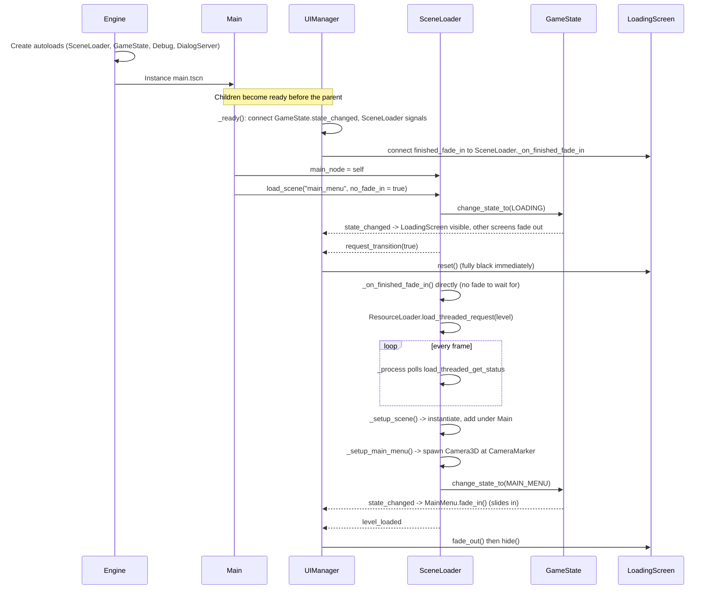
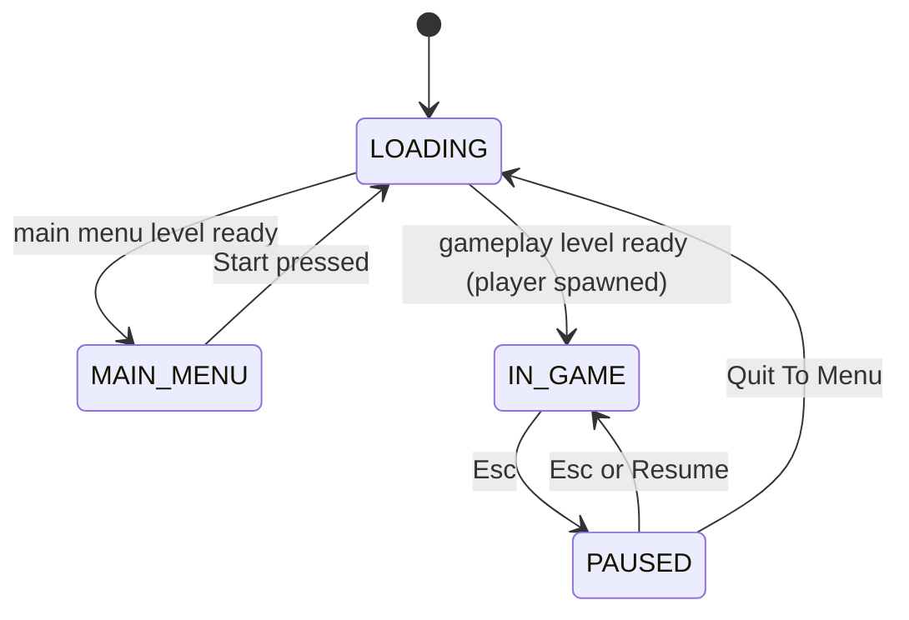
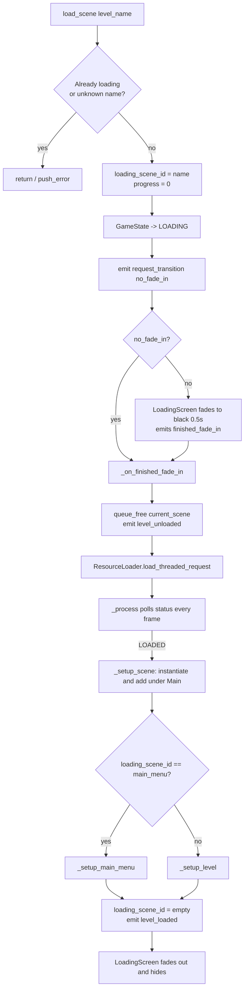

# Game (Godot 4) - Architecture & Context Guide

This document explains how the current game works: boot sequence, global state, UI, level loading, the player, and the small dialog/interaction systems. It is written for both humans and AI agents. Everything here was verified against the code in `src/` (see [Known issues](#13-known-issues--gotchas--todos) for places where code and intent disagree).

## 0. Reading order (start here)

Follow the code in this order and the whole game will make sense:

1. `src/main.tscn` and `src/main.gd` - the entry point. They instantiate `UIManager`.
2. `src/ui/ui_manager/` - owns every UI screen and reacts to game-state changes.
3. `src/ui/main_menu/` - the first screen the player sees.
4. `src/autoloads/scene_loader.gd` - loads levels, spawns the player.
5. `src/player/` - the physics-based first-person player.

Then the supporting pieces: `game_state.gd`, `dialog_server.gd`, `debug.gd`, HUD, pause menu, console.

---

## Table of contents

1. [Quick facts](#1-quick-facts)
2. [Directory map](#2-directory-map)
3. [Autoloads (global singletons)](#3-autoloads-global-singletons)
4. [Boot sequence](#4-boot-sequence)
5. [Game state machine](#5-game-state-machine)
6. [UI layer](#6-ui-layer)
7. [Scene loading](#7-scene-loading)
8. [Player](#8-player)
9. [Interaction & object pickup](#9-interaction--object-pickup)
10. [Dialog system](#10-dialog-system)
11. [Debug console](#11-debug-console)
12. [Input map & physics layers](#12-input-map--physics-layers)
13. [Known issues / gotchas / TODOs](#13-known-issues--gotchas--todos)
14. [Recipes: how to extend the game](#14-recipes-how-to-extend-the-game)

---

## 1. Quick facts

| Item | Value |
|---|---|
| Engine | Godot 4.7 (`config/features`), Forward Plus renderer |
| Physics | Jolt Physics (`3d/physics_engine`) |
| Main scene | `res://src/main.tscn` |
| Viewport | 1920x1080, stretch mode `viewport`, aspect `expand` |
| Language | GDScript |
| Game type | First-person 3D, rigidbody character, physics prop pickup, subtitle/dialog system |
| Content | One level only: `src/levels/test_level.tscn` (also reused as the main-menu backdrop) |
| Theme | `res/theme.tres` (shared by all UI) |

The repository has three top-level folders (`backend/`, `database/`, `game/`). This document only covers `game/`.

---

## 2. Directory map

```
game/
├── project.godot            # autoloads, input map, display, physics engine
├── res/                     # raw assets
│   ├── theme.tres           # global UI theme
│   └── textures/{dev,ui}/   # dev grid textures, crosshair.svg, interaction.svg
└── src/
    ├── main.tscn / main.gd           # entry point (root "Main" node)
    ├── autoloads/
    │   ├── scene_loader.gd           # level loading + player spawning
    │   ├── game_state.gd             # state machine, pause, mouse mode
    │   ├── debug.gd                  # console log + command parser
    │   └── dialog_server.gd          # subtitle timing + signals
    ├── dialog/
    │   ├── dialog.gd                 # Resource: one subtitle line (+ future audio)
    │   └── dialog_sequence.gd        # Resource: ordered array of Dialog
    ├── interact_trigger/
    │   └── interact_trigger.gd       # Area3D the player can "use" with E
    ├── levels/
    │   └── test_level.tscn           # the only level
    ├── player/
    │   ├── player.tscn / player.gd           # RigidBody3D character (class Player)
    │   └── player_controller.gd              # input -> intent (class PlayerController)
    └── ui/
        ├── ui_screen.gd              # base class (CanvasLayer) with fade_in/fade_out
        ├── ui_manager/               # orchestrates all screens
        ├── main_menu/
        ├── pause_menu/
        ├── hud/
        ├── loading_screen/
        ├── console/
        ├── dialog_box/               # one subtitle line widget
        ├── sub_screens/settings_sub_menu.tscn   # shared by main + pause menu
        └── button_style_components/  # ButtonResizeComponent, ButtonSoundComponent
```

---

## 3. Autoloads (global singletons)

Registered in `project.godot` in this order. All of them are globally reachable by name.

| Autoload | File | Responsibility |
|---|---|---|
| `SceneLoader` | `autoloads/scene_loader.gd` | Loads levels on a thread, instantiates them under `Main`, spawns the player / menu camera. Emits `request_transition`, `level_loaded`, `level_unloaded`. |
| `GameState` | `autoloads/game_state.gd` | Holds the current `State`, emits `state_changed`, controls pause + mouse mode. Holds the reference to the current `player`. |
| `Debug` | `autoloads/debug.gd` | Stores console log lines and parses console commands. |
| `DialogServer` | `autoloads/dialog_server.gd` | Times and broadcasts subtitles (`dialog_played`, `dialog_ended`). |

`SceneLoader`, `GameState` are set to `PROCESS_MODE_ALWAYS` so they keep running while the tree is paused. `UIManager` is also `process_mode = 3` (ALWAYS) in its scene.

### Communication style

The architecture is **signal driven and one-directional**:

```
SceneLoader --(calls)--> GameState.change_state_to()
GameState   --(signal state_changed)--> UIManager --(calls)--> each UI screen
SceneLoader --(signals request_transition / level_loaded)--> UIManager --> LoadingScreen
LoadingScreen --(signal finished_fade_in)--> SceneLoader   (wired by UIManager)
DialogServer --(signals)--> HUD --> DialogBox
```

UI screens never decide game state themselves, except by calling `GameState.change_state_to(...)` (pause menu Resume) or `SceneLoader.load_scene(...)` (menu buttons).

---

## 4. Boot sequence

What happens from launching the game to seeing the main menu.



Key points:

- `main.tscn` is just `Main (Node)` + an instance of `UIManager`. `main.gd` gives `SceneLoader` a reference to itself (`main_node`) so loaded levels get added as children of `Main`, then requests the `"main_menu"` level.
- The first load passes `no_fade_in = true` because there is nothing to fade from; the screen is simply black until the menu is ready.
- The **main menu backdrop is a real 3D level** (`test_level.tscn`, see `LEVEL_PATHS`) viewed through a camera placed at the level's `CameraMarker`. No player is spawned for it.

---

## 5. Game state machine

Defined in `GameState` (`enum State {MAIN_MENU, LOADING, IN_GAME, PAUSED, IN_GAME_MENU}`). Initial value: `LOADING`. `IN_GAME_MENU` is declared but not used anywhere yet.



### Side effects per state

`change_state_to(new)` runs `_on_state_exit(old)`, sets state, runs `_on_state_enter(new)`, then emits `state_changed(old, new)`.

| State | On enter | On exit | UI shown (via `UIManager`) |
|---|---|---|---|
| `MAIN_MENU` | Mouse mode `VISIBLE` | - | `MainMenu` |
| `LOADING` | - | - | `LoadingScreen` visible |
| `IN_GAME` | Restore saved mouse mode (default `CAPTURED`) | Save current mouse mode into `in_game_mouse_state` | `HUD` |
| `PAUSED` | Mouse `VISIBLE`, `pause_game()` | `unpause_game()` | `PauseMenu` |

### Pausing

Pausing is a smooth slow-down, not an instant freeze:

- `pause_game()`: tween `Engine.time_scale` to `0.0` over 0.5s (tween ignores time scale and runs while paused), then `get_tree().set_pause(true)`.
- `unpause_game()`: sets `get_tree().paused = false` immediately and tweens `time_scale` back to `1.0` over 0.5s.
- Any node that must animate/process while paused needs `process_mode = ALWAYS` (UI tweens use `TWEEN_PAUSE_PROCESS` + `set_ignore_time_scale(true)`).

---

## 6. UI layer

### 6.1 UIManager (`src/ui/ui_manager/`)

A `Node` (process mode ALWAYS) whose children are all UI screens:

```
UIManager
├── HUD            (CanvasLayer)
├── MainMenu       (CanvasLayer)
├── PauseMenu      (CanvasLayer)
├── LoadingScreen  (CanvasLayer, layer = 256, always on top)
└── Console        (PopupPanel, hidden)
```

`ui_manager.gd` does three things:

1. **Reacts to `GameState.state_changed`** - the single place that maps state -> visible screens:
   - `new == MAIN_MENU` -> `MainMenu.fade_in()` else `fade_out()`
   - `new == PAUSED` -> `PauseMenu.fade_in()` else `fade_out()`
   - `new == IN_GAME` -> `HUD.fade_in()` else `fade_out()`
   - `LoadingScreen.visible = (new == LOADING or old == LOADING)` (so it stays visible through the `LOADING -> X` transition until `level_loaded` fades it out).
2. **Relays SceneLoader signals to the LoadingScreen**: `request_transition(no_fade_in)` -> `reset()` (instant black) or `fade_in()`; `level_loaded` -> `fade_out()`.
3. **Handles global keys** in `_process`: `console` (backtick) and `ui_cancel` (Esc).
   - Backtick: shows/hides the `Console` popup. It does **not** change game state (the game keeps running while it is open). See [section 11](#11-debug-console).
   - Esc: `IN_GAME -> PAUSED`, `PAUSED -> IN_GAME`.

### 6.2 UIScreen base class (`ui/ui_screen.gd`)

`class_name UIScreen extends CanvasLayer` with empty `fade_in()` / `fade_out()`. `MainMenu`, `PauseMenu`, `HUD`, `LoadingScreen` all extend it so `UIManager` can treat them uniformly. **New full-screen UI should extend `UIScreen`.**

### 6.3 Main menu (`ui/main_menu/`)

- Two sub-screens inside one `CanvasLayer`: `MainMenuSubScreen` (Start / Settings / Quit) and `SettingsSubMenu` (instance of `sub_screens/settings_sub_menu.tscn`).
- Sub-screens "slide" horizontally by tweening `position`. Off-screen positions: main = `(-1920, 0)`, settings = `(1920, 0)`. On `_ready` both are placed off-screen; `fade_in()` slides the main sub-screen to `(0,0)`.
- Buttons:
  - **Start** -> `SceneLoader.load_scene("test_level")`
  - **Settings** -> slides settings in; **Back** slides it out
  - **Quit** -> `get_tree().quit()`
- `fade_in()` / `fade_out()` (the `UIScreen` API) just slide the main sub-screen in/out.
- Tweens are created with `create_de_facto_tween()` (ease in/out cubic, ignore time scale, runs while paused).

### 6.4 Pause menu (`ui/pause_menu/`)

Same structure as the main menu (sub-screen sliding), plus a `BGTint` `ColorRect` that fades to 50% black. Buttons: **Resume** (`GameState -> IN_GAME`), **Settings**, **Quit To Menu** (`SceneLoader.load_scene("main_menu")`), **Quit To Desktop**. `fade_in()` always resets to the pause sub-screen.

### 6.5 Settings sub-menu (`ui/sub_screens/settings_sub_menu.tscn`)

Shared by main and pause menus. It currently contains only placeholder tab buttons (General / Audio / Video / Controls) with **no logic**, and a Back button whose handler is connected by the parent menu.

### 6.6 HUD (`ui/hud/`)

- `CanvasModulate` is tweened to fade the whole HUD (alpha 0/1); the HUD is `show()`n on first `fade_in()` and starts hidden.
- **Crosshair swap** (every frame): shows `crosshair.svg` normally, `interaction.svg` when `GameState.player.looking_at_object` is an `InteractTrigger` or a `RigidBody3D` (something you can use/pick up). Both hidden while `player.hide_crosshair` is true.
- **Subtitles**: listens to `DialogServer.dialog_played/ended`, instantiates a `DialogBox` into `DialogBoxContainer` (bottom-centre) and fades it out on end.
- `Tooltip` label and a static `DialogBox` node exist in `hud.tscn` but are hidden and unused (see known issues).

### 6.7 Loading screen (`ui/loading_screen/`)

- Black full-screen `ColorRect` + `ProgressBar` (bottom-left) on `layer = 256`.
- `AnimationPlayer` with `RESET` (alpha 1, i.e. opaque), `fade_in` (0 -> 1 in 0.5s), `fade_out` (1 -> 0 in 0.5s).
  Note the naming: "fade_in" means *the black screen fades in* (hiding the game).
- Emits `finished_fade_in` (wired to `SceneLoader._on_finished_fade_in` by `UIManager`) and `finished_fade_out` (then hides itself).
- Progress bar is driven every frame from `SceneLoader.progress[0] * 100`.

### 6.8 Button components (`ui/button_style_components/`)

Drop-in child `Node`s that style their parent `Button`:

- `ButtonResizeComponent`: scales up on hover (elastic tween), back on exit. Sets the button and itself to process while paused.
- `ButtonSoundComponent`: creates hover/press `AudioStreamPlayer`s on bus `"UI"` at -20 dB. Sound files are not wired up yet (commented TODOs).

All buttons in the menus use `focus_mode = 0` (no keyboard focus).

---

## 7. Scene loading

`SceneLoader` is the only thing that creates or destroys levels. Levels are registered in a dictionary:

```gdscript
const LEVEL_PATHS: Dictionary = {
    "test_level": "res://src/levels/test_level.tscn",
    MAIN_MENU_ID: "res://src/levels/test_level.tscn",   # "main_menu"
}
```

### Flow of `load_scene(level_name, no_fade_in = false)`



### `_setup_level()` (gameplay level)

Requires a node named **`SpawnPoint`** (`Marker3D`) in the level. Then:

1. Creates a `PlayerController` (plain `Node`) and adds it to the level.
2. Instantiates `player.tscn`, sets `GameState.player`, copies the spawn point's `transform`, assigns `player.controller`, adds it to the level.
3. `GameState.change_state_to(IN_GAME)` -> HUD appears, mouse captured.

The controller must be assigned **before** `add_child(player)` because `Player._ready()` connects to its signals.

### `_setup_main_menu()`

Requires a **`CameraMarker`** (`Marker3D`). Sets state to `MAIN_MENU`, then creates a `Camera3D` (FOV 90) at that marker's transform. No player is spawned.

### Level requirements checklist

| Node name | Type | Needed for |
|---|---|---|
| `SpawnPoint` | `Marker3D` | any gameplay level |
| `CameraMarker` | `Marker3D` | any level used as the main-menu backdrop |

### The test level (`levels/test_level.tscn`)

A sandbox with: directional light + procedural sky, a 128x128 CSG floor and CSG walls/arches (`use_collision = true`, inside a `NavigationRegion3D` with a baked navmesh), three pickup props (`Box`, `Text`, `Sphere` - `RigidBody3D` on collision layer 3), a see-saw (`StaticBody3D` + `HingeJoint3D` + `RigidBody3D`), and a `CharacterBody3D` box that is moved by the level's `AnimationPlayer` (`new_animation`, 10s loop). It also contains a `DialogTrigger` (`InteractTrigger`) that plays a demo dialog sequence.

---

## 8. Player

Files: `player/player.tscn`, `player/player.gd` (`class_name Player`), `player/player_controller.gd` (`class_name PlayerController`).

### 8.1 Design split

- **`PlayerController`** = *intent*. Reads input and exposes values/signals. It does not touch physics. It could in principle be swapped for an AI or replay controller.
- **`Player`** = *body*. A `RigidBody3D` that reads the controller each physics step and moves itself.

### 8.2 Scene structure (`player.tscn`, root `PlayerCharacter`)

```
PlayerCharacter (RigidBody3D, script player.gd)
├── CollisionShape3D      CapsuleShape3D r=0.25 (height 2.0 standing, 1.0 crouched), offset y=1
├── Pivot (Node3D)        rotates around Y = yaw (azimuth)
│   ├── Marker3D          hidden, offset "look at map" marker (legacy)
│   └── Camera3D          y=1.5, FOV 90, near 0.001, far 500, rotates around X = pitch
│       └── RayCast3D     3 m forward, collides with areas, mask 53
├── AudioStreamPlayer3D   (unused)
└── CrouchCheck (RayCast3D)  upward 1.95 m, detects low ceilings
```

Body settings: mass 50, all angular axes locked (never tips over), friction 0 physics material (friction is done manually), `can_sleep = false`, continuous CD, contact monitor on (16 contacts reported - needed for floor detection).

### 8.3 PlayerController (input -> intent)

Output state:

| Field | Meaning |
|---|---|
| `move_direction` | normalized `Vector3` from WASD (forward = -Z, right = +X) |
| `is_sprinting` | Shift held |
| `request_jump` | set on Space press, cleared on release or when the player consumes it |
| `camera_azimuth` / `camera_altitude` | accumulated yaw / pitch in radians (pitch clamped to +-90 degrees) |

Signals (emitted with `true` on press, `false` on release): `crouch`, `interact`, `primary`, `secondary`.

- Mouse look is in `_unhandled_input`, ignored while `GameState.state == PAUSED`. It converts pixels to radians with a Source-engine-style formula: `px_to_rad = pixels / (DPI/2.54) / SENS * 2*PI`, with `DPI = 1000`, `SENS = 10.4` (centimetres per 360 degrees).
- Buttons/axes are polled in `_physics_process`.

### 8.4 Player movement (`Player._integrate_forces`)

This is a **custom force-based character controller** on top of a rigidbody:

1. **Floor detection**: loops over contacts; a contact counts as floor if `normal . UP >= cos(45 degrees)`. Also records the floor's velocity (moving platforms).
2. **Pick speed and acceleration**:

   | Situation | Speed (m/s) | Accel |
   |---|---|---|
   | Ground, walking | `SPEED_WALK` = 2.0 | `ACCEL_GROUND` = 12 |
   | Ground, sprinting | `SPEED_SPRINT` = 3.0 | 12 |
   | Ground, crouching | `SPEED_CROUCH` = 1.0 | 12 |
   | Airborne | `SPEED_AIR` = 1.0 | `ACCEL_AIR` = 3 |

3. **Custom friction** (grounded only): acts on the velocity component *not* along the wished direction (relative to the floor's velocity). If the friction impulse can fully stop it within one step it is applied as an impulse (static friction), otherwise as a force (kinetic). `FRICTION = 0.5`.
4. **Slope handling**: the wish direction is rotated onto the slope plane, and a compensation force cancels the horizontal part of gravity so the player doesn't slide.
5. **Acceleration**: applies a force toward the wish direction; if the next step would exceed the target speed, it applies the exact impulse needed to hit the target speed instead (no overshoot).
6. **Jump**: if on floor and `request_jump`, applies an impulse of `sqrt(2 * JUMP_HEIGHT * gravity)` (`JUMP_HEIGHT` = 0.8 m), nudges `origin.y` up by 0.05 to leave the ground, and clears the request.

### 8.5 Look & camera (`_physics_process`)

- `camera.rotation.x = controller.camera_altitude` (pitch) and `pivot.rotation.y = controller.camera_azimuth` (yaw). The body itself never rotates (angular locked); movement direction is `pivot.basis * controller.move_direction`.
- `looking_at_object` = held object, or `raycast.get_collider()` (used by the HUD crosshair).

### 8.6 Crouching

- `crouch` signal -> `_on_controller_crouch` -> `set_crouch(bool)`, which tweens (0.5s, physics-processed): capsule height 2.0 <-> 1.0, camera Y 1.5 <-> 1.25, `CrouchCheck` Y offset.
- **Uncrouch is blocked** while `CrouchCheck` hits a ceiling. Also, if you are standing and the ceiling check starts colliding, the player is forced into a crouch; when it clears and the player isn't holding the key, they stand again.

### 8.7 Camera detach helpers (unused today)

`release_camera(new_transform, fov)` / `bind_camera()` detach the camera (`top_level = true`), lock look/move/crosshair, and tween it to a target transform and back. Nothing in the current game calls them (they were meant for things like a map view).

---

## 9. Interaction & object pickup

### Interact (E / `interact_use`)

Handled in `Player._on_controller_interact` on press:

1. If holding an object -> release it.
2. Else if the 3 m raycast hits something:
   - `RigidBody3D` -> pick it up.
   - `InteractTrigger` -> `collider.interact(self)`, which emits `interacted(player)`.

The raycast has `collide_with_areas = true`, mask `53` = layers 1, 3, 5, 6 (world, props, interact triggers, +layer 6).

### `InteractTrigger` (`interact_trigger/interact_trigger.gd`)

`class_name InteractTrigger extends Area3D`. Has `@export var tooltip: String` and signal `interacted(player: Player)`. It's a generic hook: gameplay code connects to `interacted`. The `tooltip` is not displayed anywhere yet.

### Holding / throwing a `RigidBody3D`

- **Pick up**: stores the object's original layer/mask and orientation (relative to the camera). The object is moved to **collision layer 4 (the "held" layer)** and its mask drops the player layer, so it can't push the player around or shove them upward.
- **While held** (`update_held_object`, every physics step): a PID-style controller applies force and torque to pull the object to a point `PICKUP_DISTANCE` = 2 m in front of the camera. Pitch is clamped so the player can't pull themselves up by looking down. Gains scale with mass (`log(mass/10 + 1)` for position, linear in mass for rotation). Integral terms (`KI`) are 0. `apply_reaction_force` (pushes the player back) is `false`.
- **Release**: press E again; restores original layer/mask.
- **Throw**: left click (`interact_primary`) while holding -> releases and applies an impulse along the camera forward vector, scaled with mass.
- `secondary` (right click) only sets `is_rotating_held_object`; re-rotation isn't implemented.

---

## 10. Dialog system

Data (`Resource`s, editable in the inspector):

- `Dialog`: `audio_stream: AudioStream` (voice line, played by `DialogServer`; its length extends the on-screen time), `speaker: String` (empty = narration), `subtitle: String` (multiline) and `min_duration` (seconds, default 1.0). `get_display_text()` returns `"Speaker: subtitle"` (or just the subtitle with no speaker); the HUD shows this until a dedicated speaker UI exists.
- `DialogSequence`: `dialogs: Array[Dialog]`.

`DialogServer` (autoload):

- `play_dialog(dialog) -> bool`: awaitable. Emits `dialog_played`, waits `get_dialog_duration()` (1000 chars/min reading speed, at least the audio length and `min_duration`) on a pausable `SceneTreeTimer`, then emits `dialog_ended`. Returns `true` if it finished, `false` if cancelled or if that same `Dialog` is already playing.
- `play_dialog_sequence(seq) -> bool`: awaitable. Plays each dialog in order with a 0.35s gap (longer than the DialogBox fade-out so boxes never overlap). Ignored while another sequence is playing, so re-triggering a trigger can't start overlapping copies. Emits `sequence_finished(seq, completed)`.
- Audio: if a `Dialog` has an `audio_stream`, `DialogServer` plays it on an `AudioStreamPlayer` child (bus `AUDIO_BUS`, currently `Master`) for the life of the line; it is stopped and freed when the line ends or is cancelled.
- `stop_all()`: cancels everything. It bumps an internal generation counter, so any waiting coroutine exits when it wakes, and emits `dialog_ended` for active dialogs so the HUD clears. It is called automatically on `SceneLoader.level_unloaded`, so a sequence can no longer continue into the next level or menu.

**What happens when dialogs overlap** (there is no queue or priority system yet):

| Situation | Result |
|---|---|
| Two different `Dialog`s via `play_dialog` | Both start immediately. Two boxes stack in the HUD and both `audio_stream`s play at once. Each ends on its own timer. |
| Same `Dialog` instance while it is playing | Second call returns `false` immediately, no signals. |
| A sequence while another sequence plays | Returns `false` immediately; the running sequence is unaffected. `sequence_finished` is **not** emitted for the rejected one. |
| A single line during a sequence (or vice versa) | No coordination; they overlap as in the first row. |
| `stop_all()` / level unload | Everything is cut off, audio stopped, HUD cleared. A running sequence only notices when its current timer wakes, so `sequence_finished(seq, false)` (and the caller's `await`) can arrive late, up to that line's remaining duration. |

Display: `HUD` listens to the two signals and creates/fades a `DialogBox` (`ui/dialog_box/`) inside `DialogBoxContainer` (fade in 0.1s; on end, 0.2s hold, fade out 0.1s, `queue_free`).

Ways to trigger today: the `say <text>` console command (see below), and the `DialogTrigger` in `test_level.tscn`, whose `interacted` signal plays the `intro_dialog` export of `test_level.gd`, a `DialogSequence` authored in `res/dialogs/test_sequence.tres`. Author new sequences the same way: create a `DialogSequence` resource in the inspector, add `Dialog` entries, and export it on the level or NPC script.

---

## 11. Debug console

- Toggle: backtick (`` ` ``, action `console`). `Console` is a `PopupPanel` (title still says "Open Wheel Debug Console", a leftover name). It shows `Debug.debug_console_output` (refreshed every frame) and a `LineEdit` + Submit button.
- **Does not pause the game.** Toggling the console only shows/hides the popup; `GameState` is untouched. Likely consequences (inferred from the code, not tested): while in game the mouse stays captured, and `PlayerController` polls `Input` globally, so typing W/A/S/D/Space in the console may also move the player.
- Logging: `Debug.add_log(message)` appends a timestamped line.
- Commands (`Debug.parse_command`, case-insensitive first word):

| Command | Effect |
|---|---|
| `timescale <float>` | `Engine.set_time_scale(value)` |
| `quit` | quit the game |
| `say <text...>` | creates a temporary `Dialog` with that subtitle and plays it via `DialogServer` |
| `fullbright` | toggles `Viewport.DEBUG_DRAW_UNSHADED` |

| anything else | logs `Unknown command "..."` |

---

## 12. Input map & physics layers

### Input actions (`project.godot`)

| Action | Binding |
|---|---|
| `move_forward` / `move_backward` / `move_left` / `move_right` | W / S / A / D (physical keys) |
| `move_jump` | Space |
| `move_sprint` | Shift |
| `move_crouch` | Ctrl |
| `interact_use` | E (pick up / drop / use trigger) |
| `interact_primary` | Left mouse (throw held object) |
| `interact_secondary` | Right mouse (sets rotate flag, unused) |
| `console` | `` ` `` (backtick) |
| `ui_cancel` | Esc (Godot built-in; pause toggle) |

### Collision layers (bit value in parentheses)

| Layer | Used for | Who uses it |
|---|---|---|
| 1 (1) | World / static geometry | CSG level; player mask |
| 2 (2) | Player | `PlayerCharacter` layer |
| 3 (4) | Pickup props | `Box`, `Text`, `Sphere`, see-saw plank; player mask; `CrouchCheck` mask |
| 4 (8) | Held object | Applied in code during pickup (`held_layer = 4`) |
| 5 (16) | Interact triggers | `InteractTrigger` `Area3D`s |

Player `collision_mask = 5` (world + props). Interaction raycast mask `53` (world, props, triggers, layer 6). When creating new content, put pickups on layer 3 and triggers on layer 5, and give triggers `collision_mask = 0`.

---

## 13. Known issues / gotchas / TODOs

Grounded in the current code; useful to know before changing things.

**Gameplay / wiring**
- Only `test_level.tscn` uses an `InteractTrigger` (the `DialogTrigger` demo).
- `InteractTrigger.tooltip` and the HUD `Tooltip` label are not connected.
- `GameState.State.IN_GAME_MENU`, `Player.inventory`/`active_item_index`, `viewmodel_controller`, `AudioStreamPlayer3D`, `is_rotating_held_object` are placeholders with no behaviour.

**Scene loading**
- `LEVEL_PATHS["main_menu"]` points at `test_level.tscn` (same file as the playable level) - fine for now, but a dedicated menu level is the intended direction (`is_first_main_menu_load` is reserved for an intro).
- **Load failures are not recovered from.** Failure paths only `push_error` and return:
  - `load_threaded_request` error or `THREAD_LOAD_FAILED`: `loading_scene_id` is never cleared (every later `load_scene` call is silently ignored), state stays `LOADING`, and the loading screen stays black. The old level has already been `queue_free`d by then.
  - Missing `SpawnPoint`: the scene is added and `level_loaded` fires (loading screen fades out), but `_setup_level` returns before `IN_GAME`, so the state stays `LOADING` with no player and no HUD.
  - Missing `CameraMarker`: menu state is set but there is no camera.
  - Level paths in `LEVEL_PATHS` are not validated (see TODO in the file). A fix has been proposed but is **not implemented yet**.
- `GameState.player` is not cleared when a level unloads (line commented out); it can be a stale/freed reference after returning to the menu. The HUD guards with `if GameState.player` but anything else should check `is_instance_valid`.
- `_setup_main_menu` sets state before creating the camera; the trailing comment is misleading.

**UI**
- Settings tabs are placeholders. `ButtonSoundComponent` plays on an audio bus named `"UI"` that does not exist yet (no custom bus layout); until it is created Godot falls back to `Master`. **Planned:** a dedicated `UI` bus.
- Sub-screen positions assume a 1920 px wide viewport (hard-coded `+-1920`).
- `HUD.fade_out()` makes the HUD transparent but doesn't hide it (the `hide` callback is commented out).
- `DialogServer` has no queue: a second sequence started while one is playing is ignored, and individual lines can overlap (`play_dialog` only rejects the same `Dialog` instance twice). See the overlap table in section 10.
- `play_dialog` returns `false` for both "cancelled" and "ignored because already playing", and `play_dialog_sequence` treats any `false` as a cancel. If a line of a sequence is already playing standalone (e.g. via `say`), the sequence aborts early with `completed = false`.

**Player**
- Known TODO in code: crouch transitions can capture a transient camera transform; "friction doesn't work when walking then crouching".
- `LEAP_SPEED`, `STEP_SIZE_*`, `JUMP_SPEED_PENALTY`, `PICKUP_TRANSLATE_KP/KD`, `PICKUP_ROTATE_KP/KD` constants are declared but unused (gains are computed inline instead).

**Repo hygiene**
- `project.godot` `config/name` is still `"Game"` and the main menu title label reads `"New Game Project"`.

---

## 14. Recipes: how to extend the game

### Add a new level
1. Create `src/levels/my_level.tscn` (root `Node3D`).
2. Add a `Marker3D` named **`SpawnPoint`** (player spawns with its transform).
3. (Optional, if used as menu backdrop) add a `Marker3D` named **`CameraMarker`**.
4. Register it in `SceneLoader.LEVEL_PATHS`: `"my_level": "res://src/levels/my_level.tscn"`.
5. Load it with `SceneLoader.load_scene("my_level")`.

### Add a pickup prop
`RigidBody3D` with `collision_layer = 4` (layer 3), a collision shape, and a mesh. No script needed; the player's raycast finds it and the HUD shows the interaction crosshair.

### Add an interactable (door, button, NPC...)
(No example exists in the current level; this is the intended pattern.)
1. Add an `Area3D` using the `InteractTrigger` script, `collision_layer = 16` (layer 5), `collision_mask = 0`, with a `CollisionShape3D`.
2. Connect its `interacted(player)` signal to your logic, e.g. `DialogServer.play_dialog_sequence(my_sequence)`.

### Add dialog
Create a `DialogSequence` `.tres` under `res/dialogs/` with `Dialog` entries (set `speaker`, `subtitle`, optionally `audio_stream`), `@export` it on the script that triggers it, then call `DialogServer.play_dialog_sequence(seq)` (or `play_dialog(dialog)` for one line).

### Add a console command
Add a new `match` case in `Debug.parse_command` (`autoloads/debug.gd`); use `add_log()` to print feedback.

### Add a new UI screen
1. Create a scene whose root is a `CanvasLayer` with a script that `extends UIScreen`; implement `fade_in()` / `fade_out()`.
2. Instance it under `UIManager` in `ui_manager.tscn`.
3. Add its show/hide rule to `UIManager._on_game_state_changed`, adding a new `GameState.State` if needed (and handle it in `_on_state_enter/_on_state_exit`).
4. Use `ButtonResizeComponent` / `ButtonSoundComponent` children and `res/theme.tres` for consistent styling. Remember `process_mode = ALWAYS` for anything that must work while paused.

### Add a new game state
Add it to `GameState.State`, handle enter/exit side effects in `_on_state_enter` / `_on_state_exit`, then decide which UI screens it shows in `UIManager._on_game_state_changed`.
